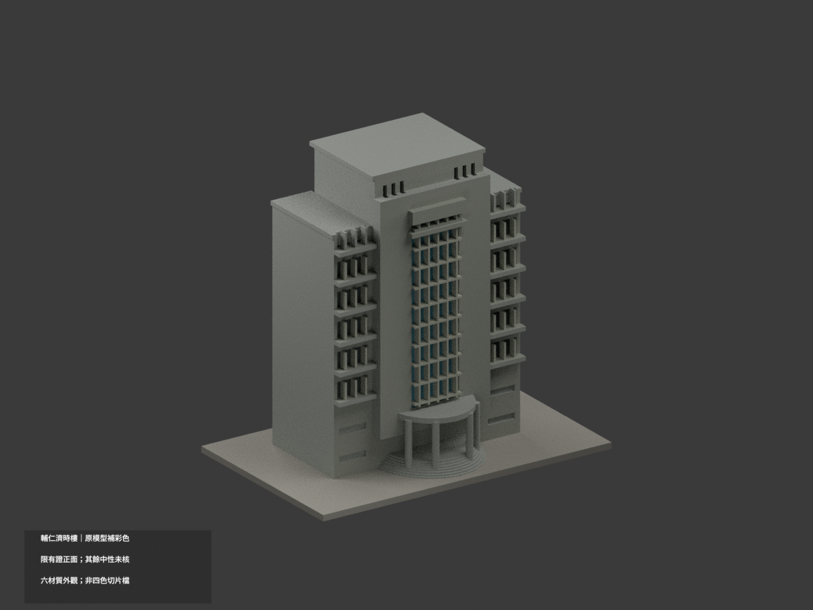

# 新莊校本部

## 模型圖鑑

| 模型預覽 | 模型預覽 | 模型預覽 |
| :---: | :---: | :---: |
| 中美堂  | 淨心堂  | 濟時樓（主塔外觀近似）  |
| 于斌樓（主體外觀近似）  | 舒德樓（主體外觀近似）  |  |

[返回校級目錄](../README.md)

- [中美堂](buildings/fju-chung-mei-auditorium/README.md)
- [淨心堂](buildings/fju-immaculate-conception-chapel/README.md) · [白柱與柱帽前臉限域配色／五視角](buildings/fju-immaculate-conception-chapel/appearance/README.md)
- [濟時樓（主塔外觀近似）](buildings/fju-fahy-memorial-building/README.md)
- [于斌樓（主體外觀近似）](buildings/fju-yu-pin-administration/README.md)
- [舒德樓（主體外觀近似）](buildings/fju-schutte-memorial-building/README.md)

[未完成範圍](COVERAGE.md)

## 既有模型彩色更新（不新增套數）

`fju-fahy-memorial-building` 保持原STL與建模程式位元組，按官方照片為原三角面分材，增加彩色外觀3MF、Blender及十視圖；未核背部／屋面保持中性。不是提高幾何精度或現況測繪，未驗四色耗材映射、切片或實體列印。舊單色previews與QA留存為歷史，不作本次彩材驗證；詳新版README。
