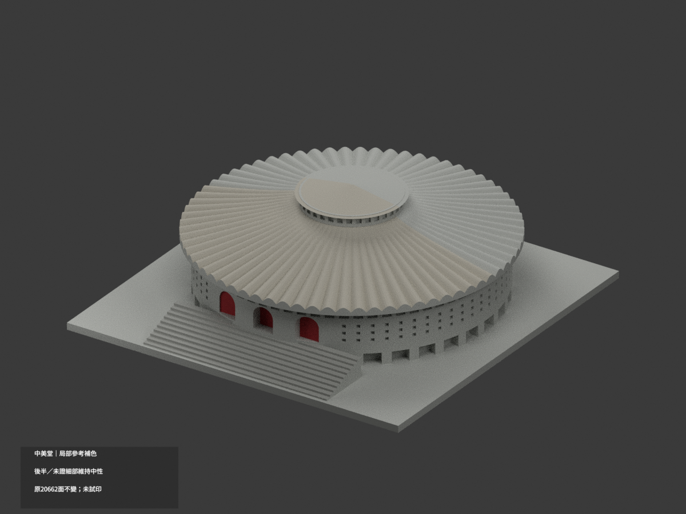
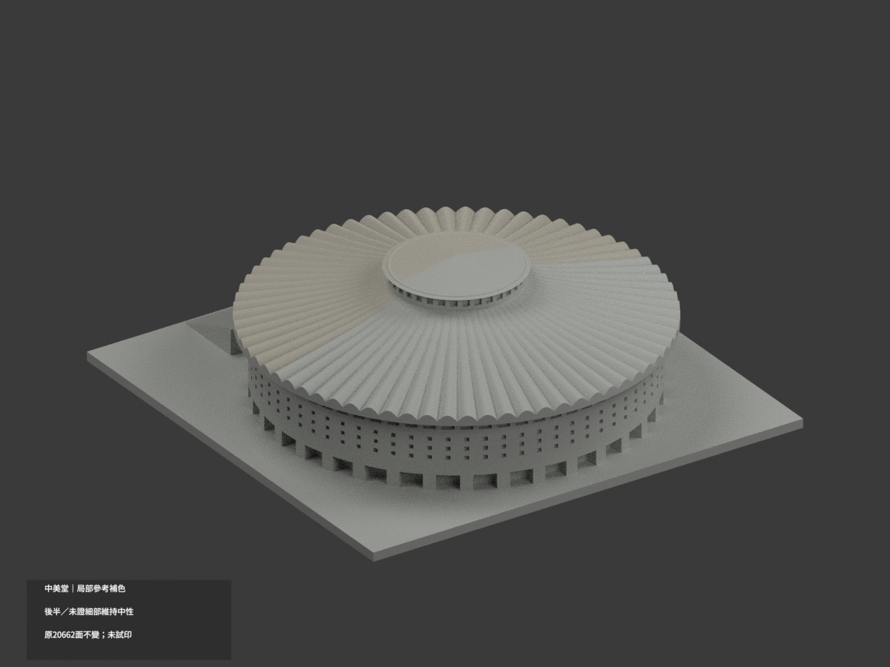
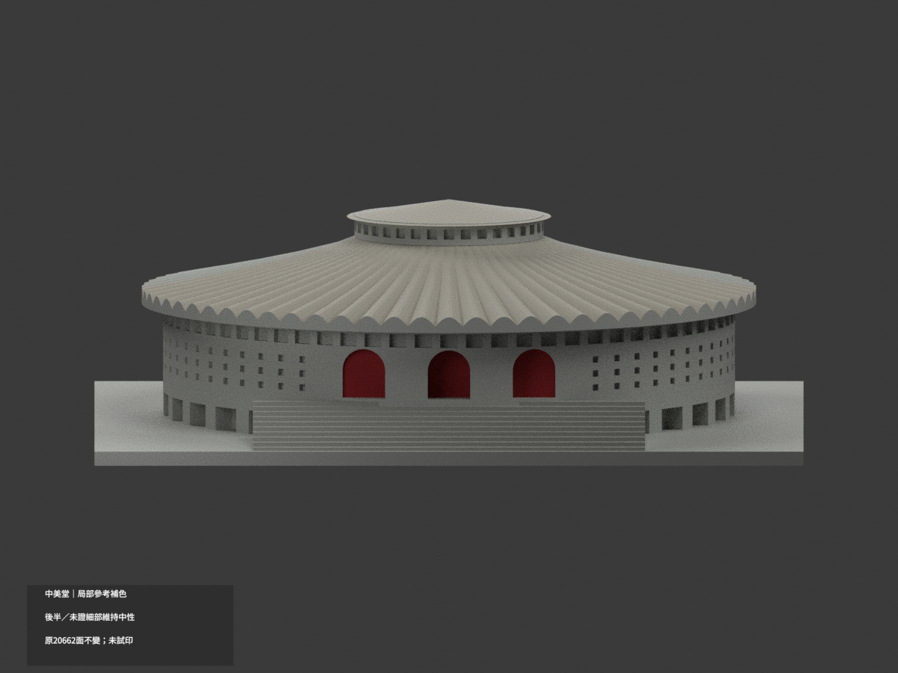
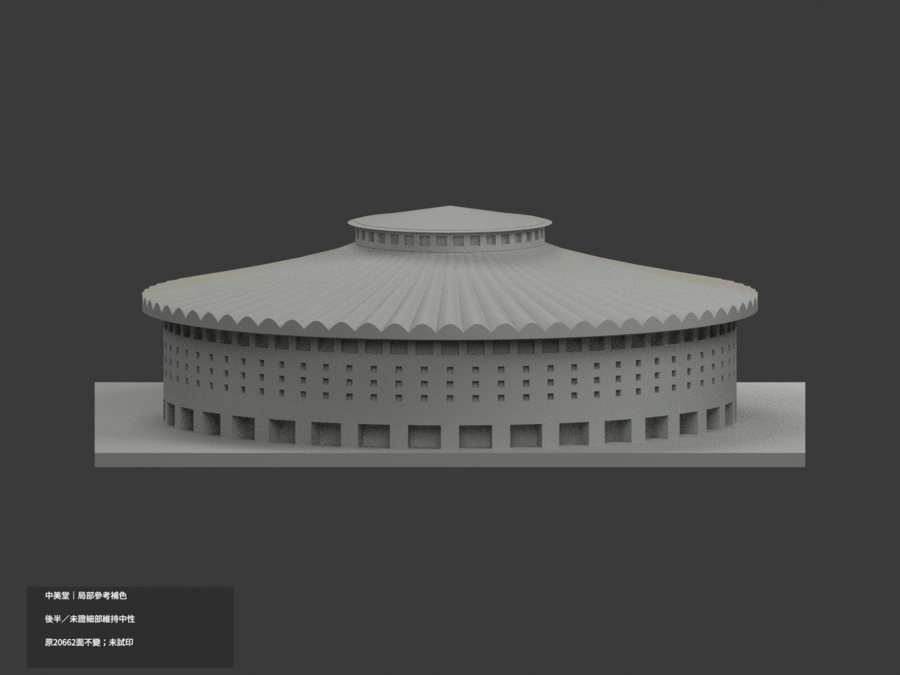
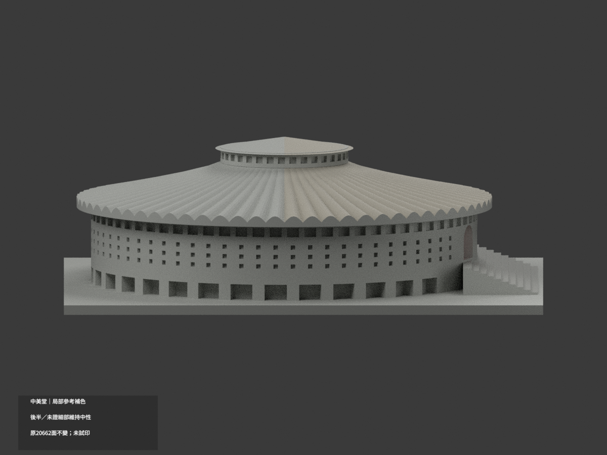
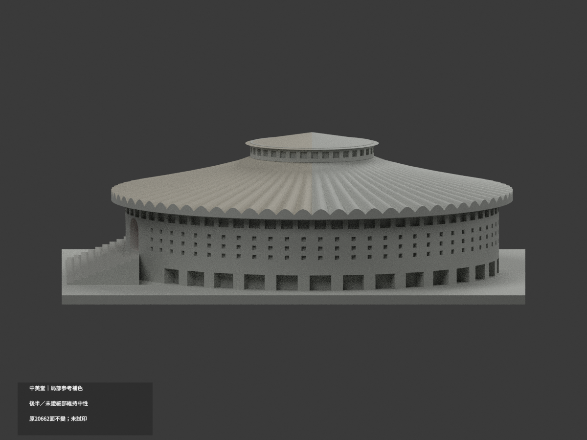
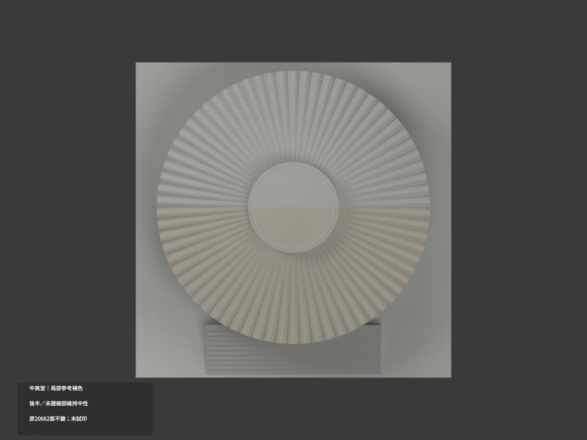
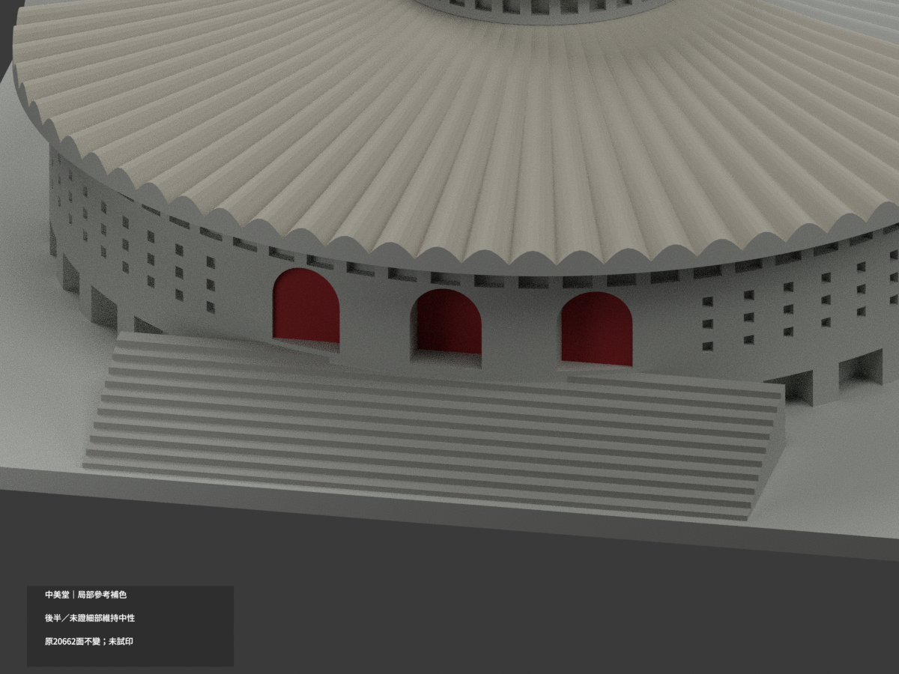
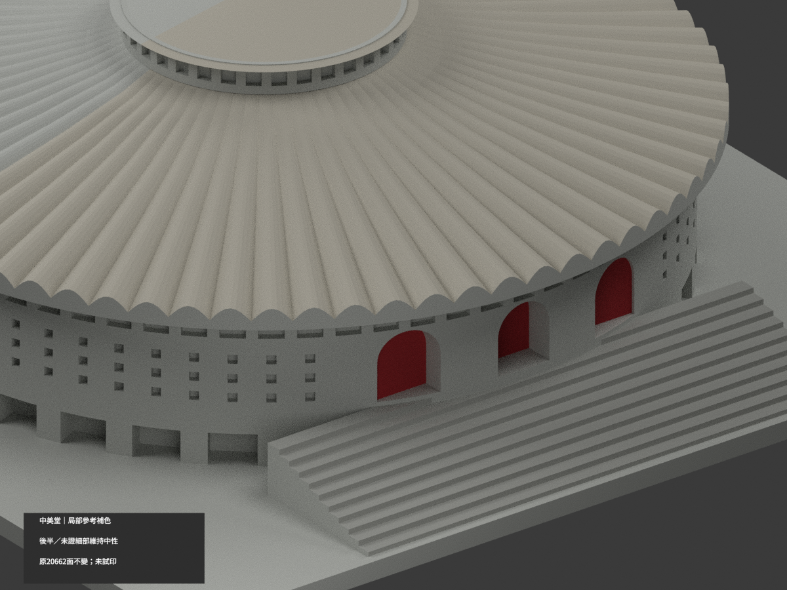
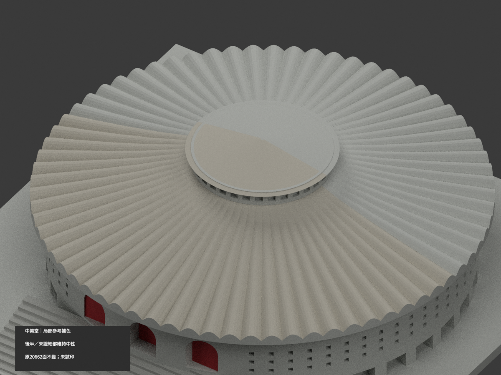

# 輔仁中美堂｜局部屋面、階梯與前門參考補色

**後半及未證格柵、細部維持中性；不是全棟全色完成。** `partial_color_incomplete=true`、`fully_colored_exterior=false`。

| 總覽 | 後方 | 正面 |
|---|---|---|
|  |  |  |
|  |  |  |
|  |  |  |
|  | | |

## 材色範圍
同 `fju-chung-mei-auditorium` 原項目、same-item、count_delta=0。保留 **20662 個原三角面與座標、原 STL/build_model.py 位元組**，沒有新增或切分面。原不可變公開包沒有 OBJ，雖原碼執行會產生 OBJ，本次不冒稱有原 OBJ 可保留。

- 前半原波折屋扇及小錐帽採淺暖灰；按原建構表面與完整原前半三角對位，不把陰谷塗黑或加斑駁。前後分界是照片覆蓋限制，不是真實材質接縫；後半與屋底中性。
- 紅只在三個原拱凹的 **背面 y=-49.6，共75片（每門25片）**；洞側壁、拱內頂、周圍牆不染紅，不添拱框。
- **小官照中間紅門看似矩形，原模型卻是三拱；僅借紅色色族，不聲稱三個實門均為拱形，不修改原幾何。**
- 灰只在十級原階梯的獨立踏面／朝前立面，不將框選盒中的牆、側板、基地一起塗灰；不補文字獻辭或圖案。
- 連續圓形外牆、格柵、採光窗、後部和基地未知中性，不為增加分色率硬套黑玻璃或石材線。

## 來源與限制
來源是輔仁圖書館校史頁一張 **380×219** 官照，標「現在」不等於拍攝日期已確定；僅支持大致色族，不是色票、材料測繪或2026現況證明。其他取用失敗的照片不當作已看來源，也不借其2025檔名替官照定年。
原照只私人保存，不隨模型公開、不貼圖；未確認 CC／再散布授權，不保證商用。原模型授權不自動涵蓋原照。

## 格式、重建與列印
[原 STL](model.stl) · [基本材質 3MF](appearance.3mf) · [彩材 Blender](scene.blend) · [原模型說明](ORIGINAL-MONOCHROME-README.md)
STL沒有色；3MF basic materials 與 Blender 實際面材一致。四材質標籤**不是已驗證四色耗材切片專案**。原毫米模型與150mm展示底座保留，非實測比例；**未實際列印**，無切片路徑、無新列印保證。

依原 requirements：`build_model.py` 重建原模；`colorize_model.py` → `export_appearance.py` → `validate_color.py`。Blender 執行 `render_color.py` 和 `verify_color_scene.py`；檢查原STL/三角座標/正體積閉合/3MF身份與完整隔離重建。十圖需人工色域審核，程式PASS不能替代。
原預覽/來源/舊QA完整保留作歷程，不能當作本次色版證據；沒有刪檔。
