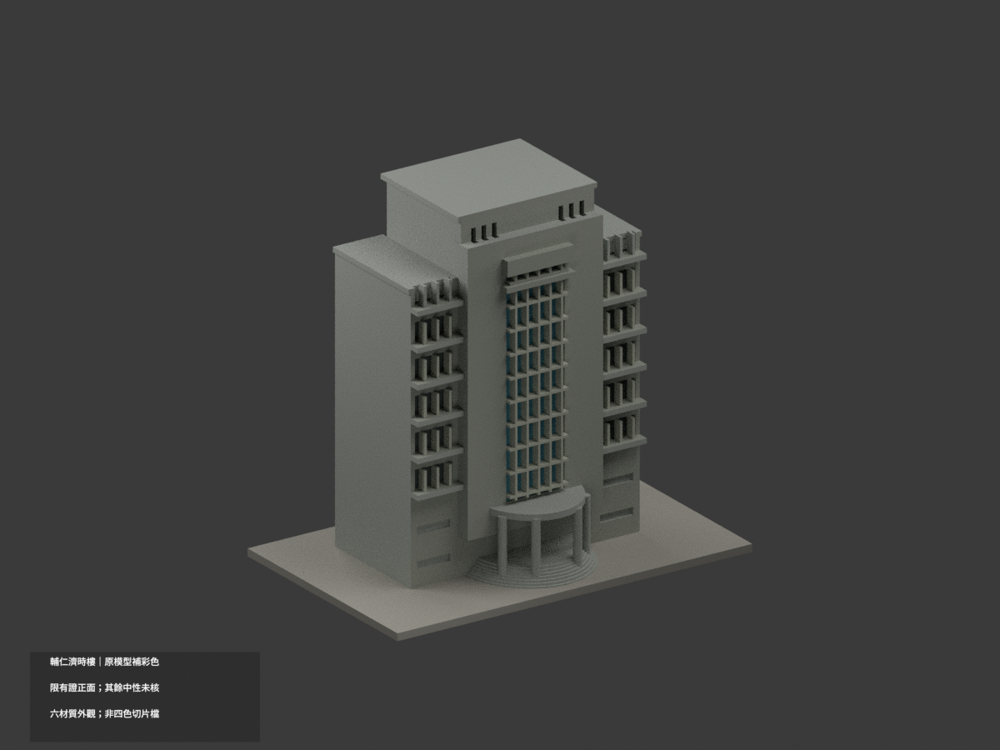
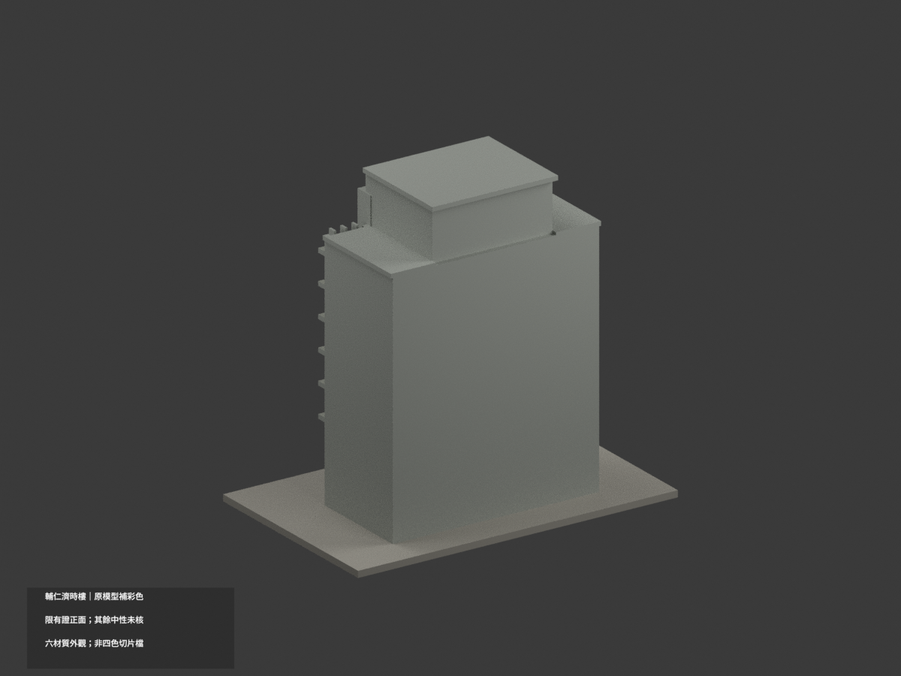
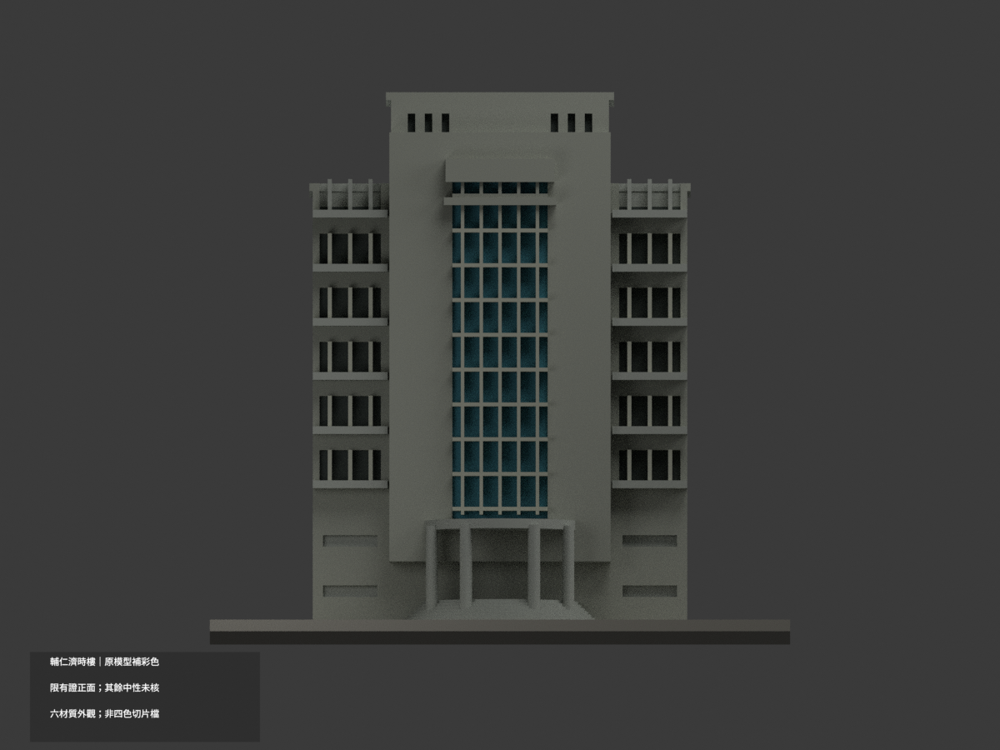
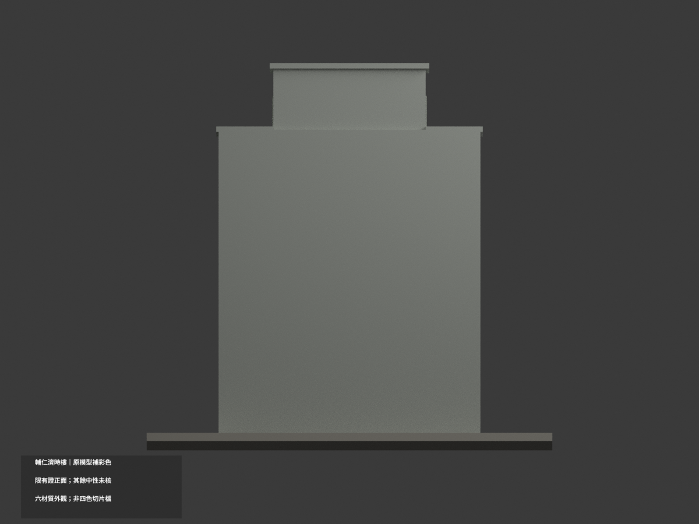
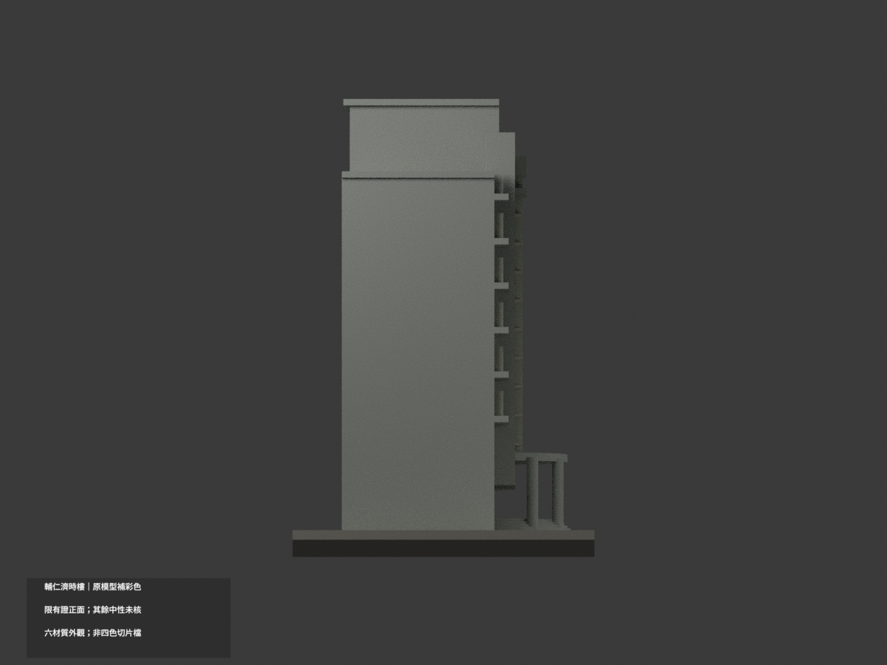
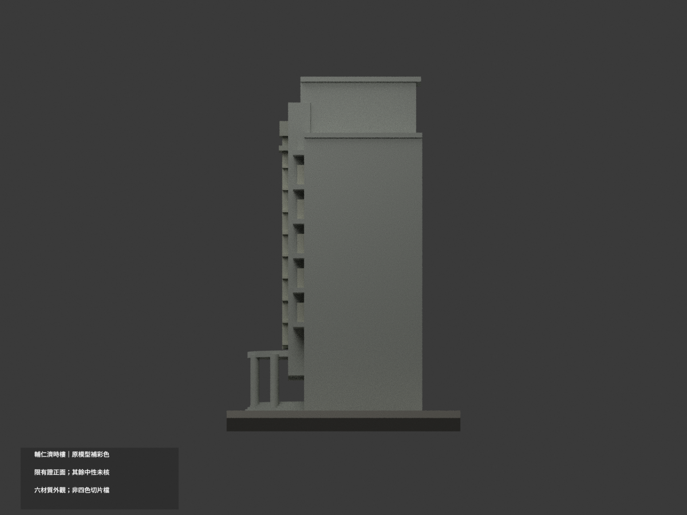
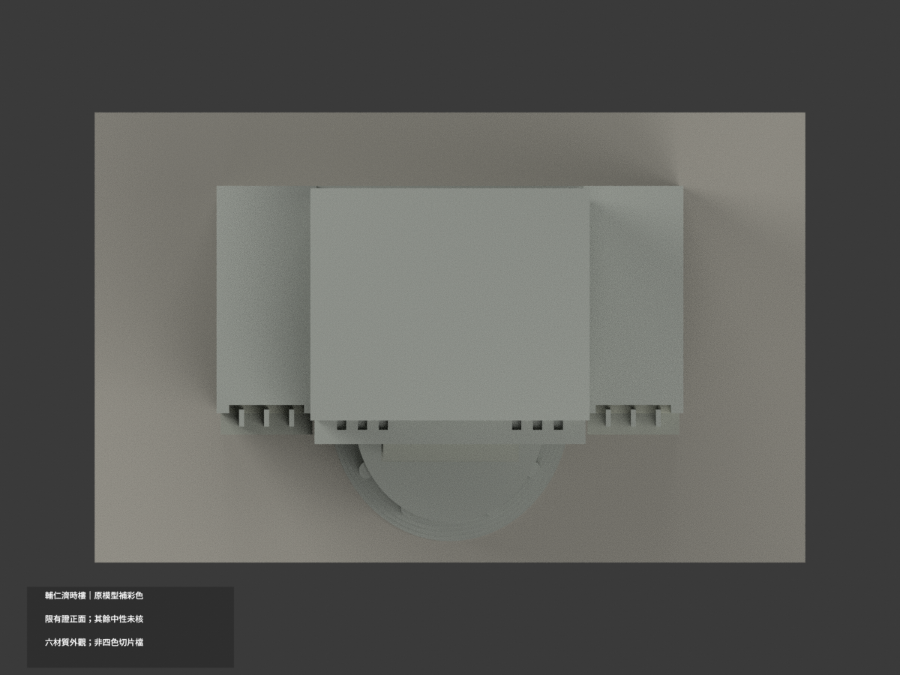
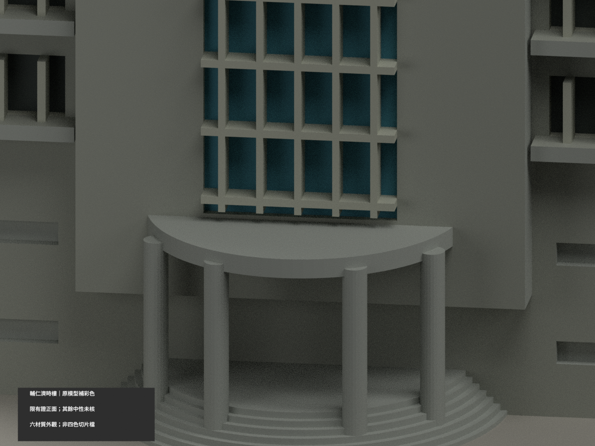
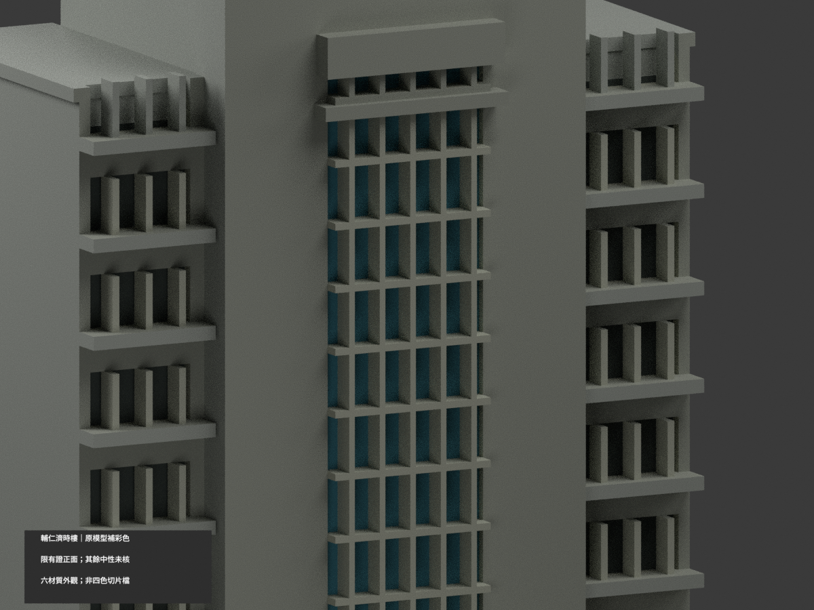
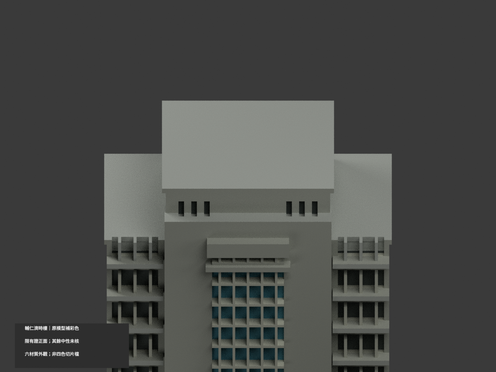

# 輔仁濟時樓｜原模型有界補彩

## 彩色模型預覽

原 **4982 三角形及 STL／建模程式不變，count_delta = 0**。只以官方正面照片補灰牆、藍綠窗與淺灰梃；背側／屋頂／樹遮入口保持中性。仍為原主塔外觀近似，不是新測繪或某年完整現況。

| 整體 | 背斜 | 正面 |
|---|---|---|
|  |  |  |
|  |  |  |
|  |  |  |
|  | | |

## 材色範圍

- 正面不透明牆與高端部為灰色族；中央既有窗凹底採藍綠反光色，梃與框為暖淺灰，側列小窗採暗灰。不是校準的玻璃透光色或修復漆號。
- 原碼先把建築 X 軸乘 0.88；本次只按反轉後座標辨識材域，輸出頂點不改。已有格梃不是新添構件，牌板仍空白，不畫金字。
- 照片下部樹遮；在同一已有正面牆/中窗帶內，材色作一致色族概化延伸，不宣稱逐點可見。**半圓門廊屋頂、柱、階及未知入口保持中性**，不因整棟灰牆而宣稱入口色已核。
- 原窗格、尺度、進深、概括入口階等仍是舊模型近似。整片屋頂水平面、側牆及背面未知中性；中性不是現地灰色的證明。沒有新增照片紋理、門扇、文字或立面幾何。
- 來源照片未明確拍攝日，日照與反光影響顏色；不主張 2026 即時或任何一年的精確全館。

## 彩色檔與重建

[appearance.3mf](appearance.3mf) 是毫米六基本材質逐面分配；[scene.blend](scene.blend) 使用同一原網格實際材質。[model.stl](model.stl) 保留且本身不含顏色。原遠端包沒有 OBJ，不宣稱保存不存在的原 OBJ。

```sh
python colorize_model.py
python export_appearance.py
python validate_color.py
blender -b -t 2 -P render_color.py
blender -b --python-exit-code 1 -P verify_color_scene.py
```

舊 `previews/`／`render_preview.py`／`validation.json` 與原 QA 檔保留作單色歷程，非本次彩色 QA；原 renderer 會重建單色，勿混用。新證據見 COLOR-FORMAT-GEOMETRY-QA、SCENE-QA、DELIVERY-QA 及獨立視覺審核。隔離重建保留不刪檔。

## 列印與權利限制

六材質外觀**不是已驗證四色耗材切片專案**；未實際列印、未驗證切片/換色/支撐。材色不改善原模型尺寸或可列印性保證。

[輔仁大學官方濟時樓介紹與正面照片](https://jmomission.fju.edu.tw/aboutFju.jsp?labelID=28)為來源（完整來源角色見 COLOR-SOURCE-REGISTER.json）；未確認個別 CC。原照片、原頁與裁圖只私人研究，不公開、不作紋理。模型授權不包含照片或建築設計權利，不保證商用。

原幾何範圍為輔仁大學新莊校本部濟時樓主塔外觀近似；背面素牆、側窗缺漏和樹遮入口概括仍保留，不因補彩冒稱全館完整精測。
