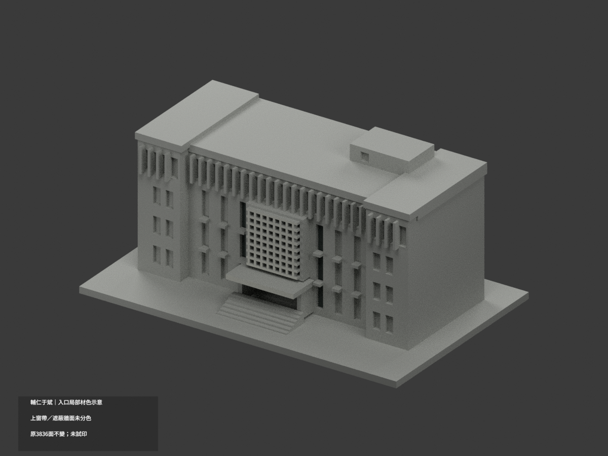
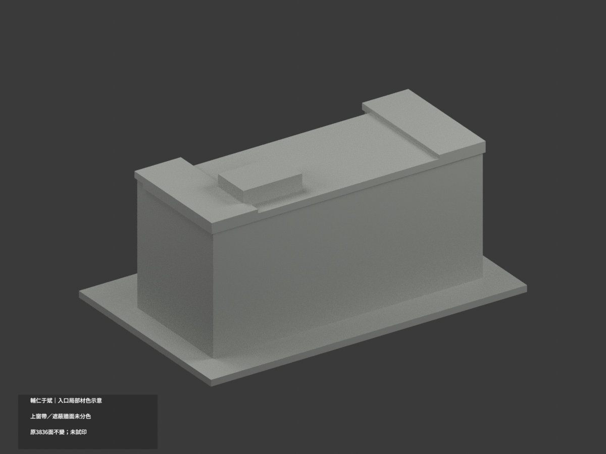
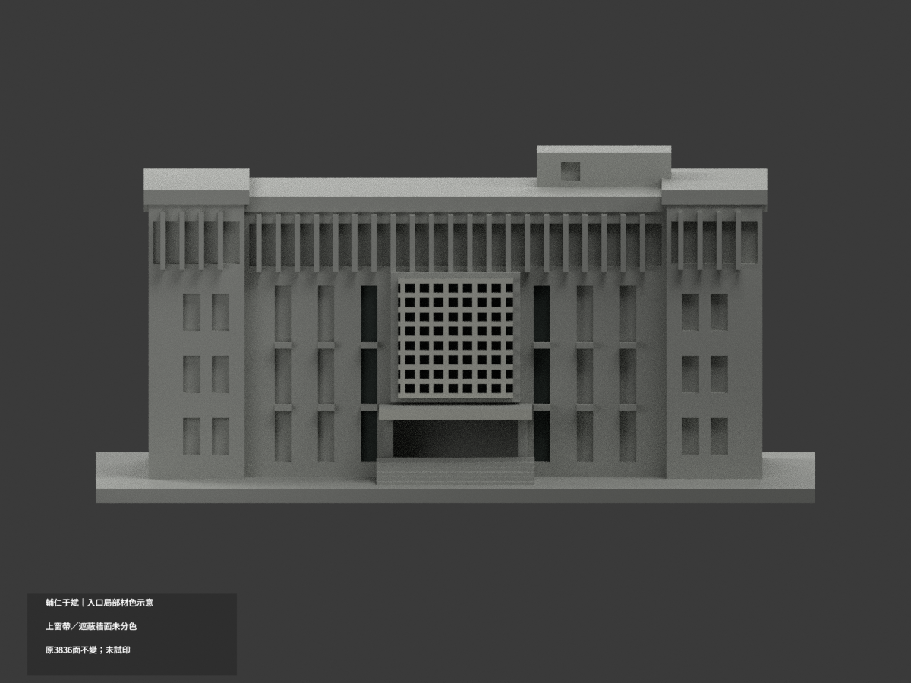
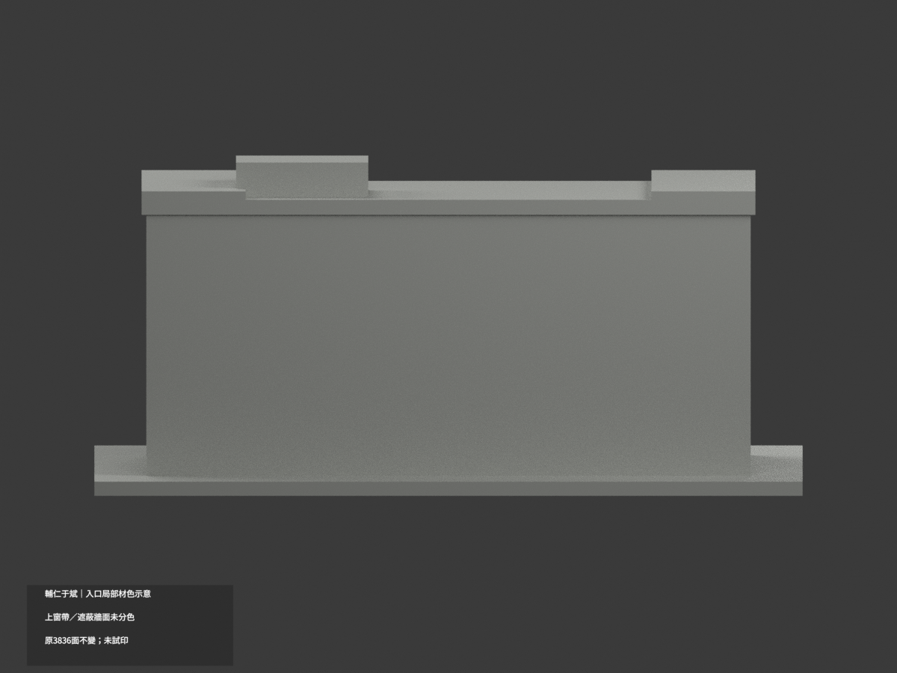
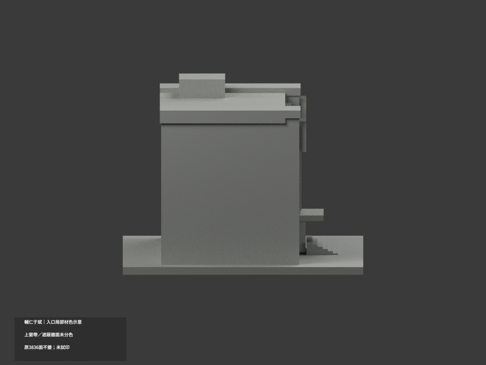
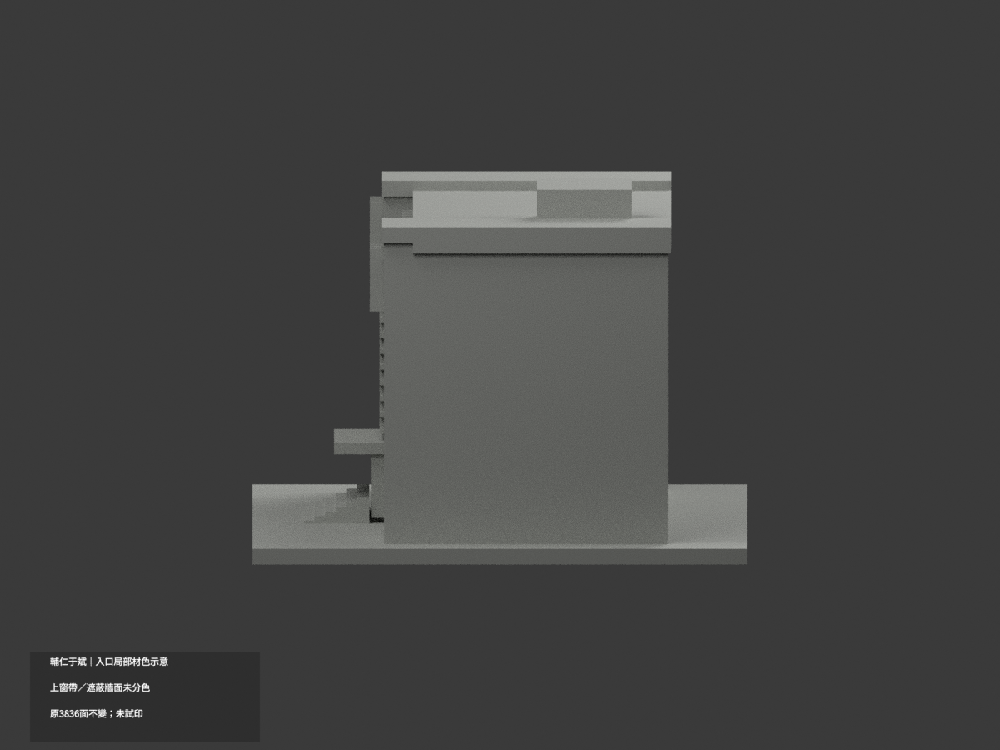
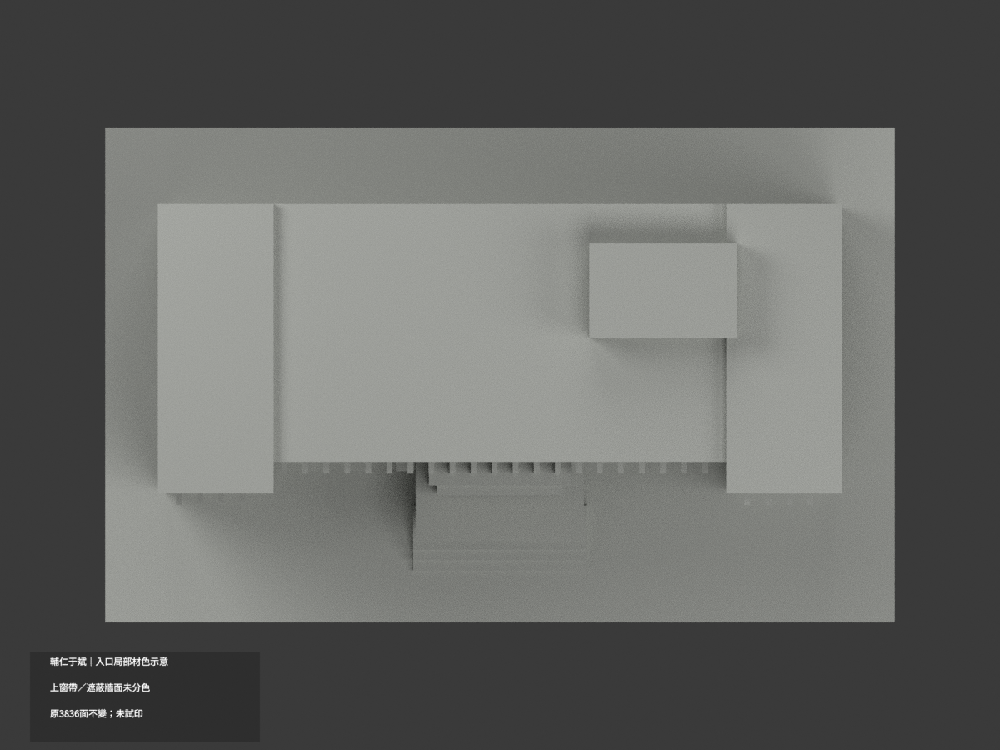
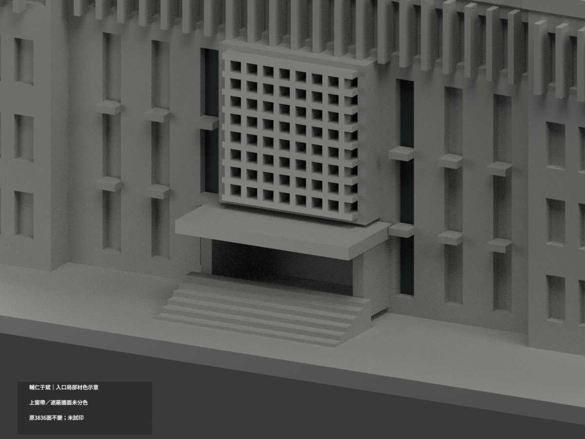
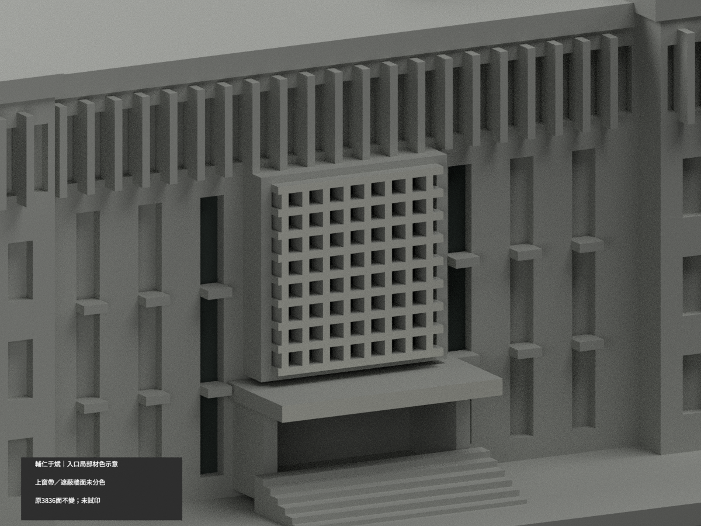
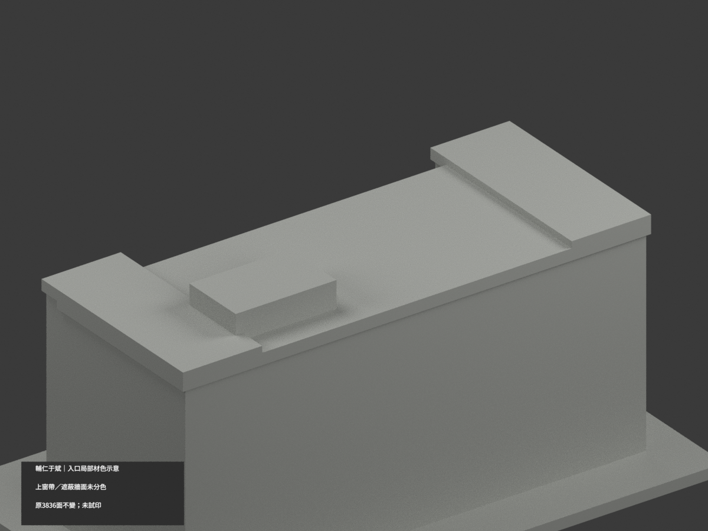

# 輔仁于斌樓｜入口局部材色示意

**上層窗帶、遮蔽牆面及其他未知部位未完成分色。** `partial_color_incomplete=true`、`fully_colored_exterior=false`。只有據入口格柵、近側縱窗及雨棚前緣；不是全棟完成。

| 總覽 | 背側 | 正面 |
|---|---|---|
||||
||||
||||
||||

## 材色範圍
同 `fju-yu-pin-administration` 原項目，same-item、count_delta=0。**3836 個原三角面、頂點與原 STL/build_model.py 位元組不變**，沒有切面、增加幾何或修正原近似外觀。原公開包無 OBJ；原程式隔離重建可產生 OBJ，但不虛稱本包保存了原公開 OBJ。

- 白色只對應原入口格柵正面 402 面及雨棚前緣 2 面；未把框側、洞壁、整個 bbox 都塗白。
- 暗灰只對應格柵後方原凹背 2 面及左右最近的縱窗凹背各 2 面；是有限陰影／窗族示意，不是全幕牆玻璃。
- 全上層長窗帶、其他縱窗、側翼窗、被樹遮住的連續主牆、背側與屋頂全部中性，沒有按三角或高度任畫白／深色分區。
- 官照雨棚底有細格柵，但原拓撲沒有細分，**底面維持中性**，不以整塊黑色冒充格柵。屋頂、入口門、階梯受人遮蔽，不強推材色。
- 不新增文字、雕像、行人、樹木、活動裝飾、窗扇或真實石材拼縫。

## 日期與來源
色源為 2019-12-20 刊出的部落格全景（拍攝日未知）及校方 2023-10-26 更名活動入口近照，不是同一年度精測。原碼的「2025 front」只屬先前幾何證據敘述，**不是本次照片日期**，不宣稱2025或2026完整現況。
原圖／水印私人保存，不隨模型公開、不作貼圖；未確認 CC 或再散布授權，不保證商用權利。照片的光線/反射不等於校準材料色，HEX只是近似展示色族。

## 格式與列印
[原 STL](model.stl) · [材色 3MF](appearance.3mf) · [Blender](scene.blend) · [原說明](ORIGINAL-MONOCHROME-README.md)
原展示底座 150×94 mm，建築比例是原照片近似，不是測量。3MF basic materials 與 Blender 真正逐面材質，STL 不含色。三材質標籤不是已驗證三色／四色耗材切片專案。**未實際列印**，未產生切片工具路徑；原細格柵及挑棚的列印風險不因補色解除。

## 重建與 QA
依原 requirements 安裝後 `build_model.py` → `colorize_model.py` → `export_appearance.py` → `validate_color.py`。Blender 執行 `render_color.py`、`verify_color_scene.py`。
幾何／3MF檢查包含原字節、逐三角座標、正體積閉合、材質索引及完整隔離重建；場景會重開核實，十圖與 README/hash 綁定另驗。程式檢查不等於來源及材域人工判讀。
原 `previews/`、原 render/validation 等完整保留，屬舊單色歷程，不當作新補材 QA；未刪原件。
