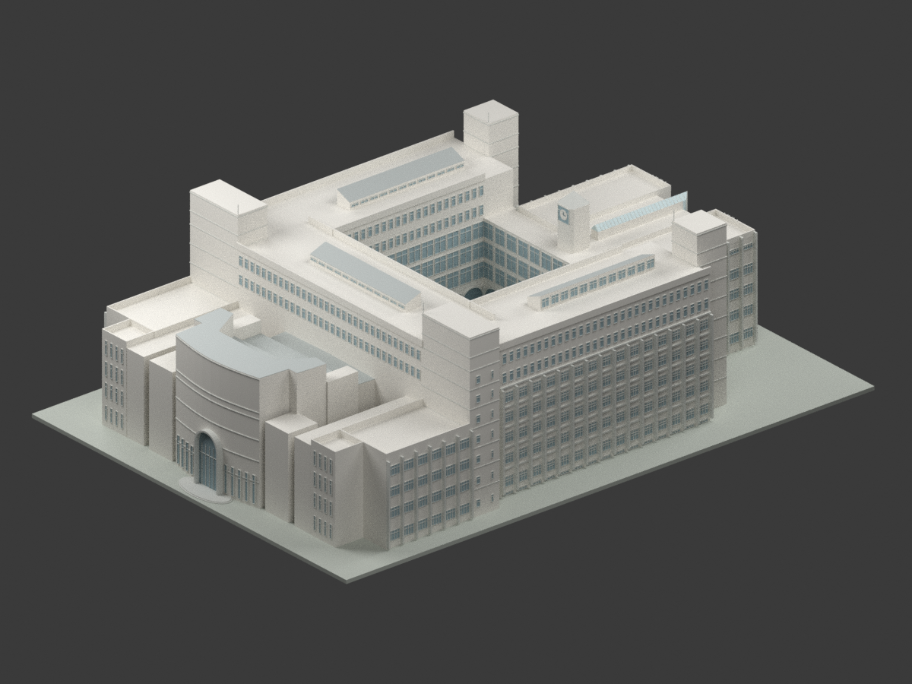

# 歸仁校本部

| 建築模型 | 建築模型 | 建築模型 |
| :---: | :---: | :---: |
|  **[長榮堂](buildings/cjcu-hall/README.md)** |  **[行政大樓](buildings/cjcu-administration/README.md)** |  **[蘭大衛紀念圖書館主量體](buildings/cjcu-library/README.md)** |
|  **[綜合體育館](buildings/cjcu-gymnasium/README.md)** 屋面板材族中性示意，非實際配色 |  **[校門十字架鐘塔（地標構造物）](buildings/cjcu-gate-cross-tower/README.md)** |  **[公共衛生學院大樓｜1995年歷史設計圖版](buildings/cjcu-public-health-1995-design/README.md)** [STL](buildings/cjcu-public-health-1995-design/model.stl) · [彩色3MF](buildings/cjcu-public-health-1995-design/model.3mf) · [Blender](buildings/cjcu-public-health-1995-design/scene.blend) |

[長榮大學目錄](../README.md)

臺南市歸仁區長大路1號。以下4件樓館及1件地標構造物獨立縮尺；其餘項目見學校缺口名錄。

- [長榮堂](buildings/cjcu-hall/README.md)
- [行政大樓](buildings/cjcu-administration/README.md)
- [蘭大衛紀念圖書館主量體](buildings/cjcu-library/README.md)
- [綜合體育館](buildings/cjcu-gymnasium/README.md)
- [校門十字架鐘塔（地標構造物）](buildings/cjcu-gate-cross-tower/README.md)

[綜合體育館屋面示意與可重建檔](buildings/cjcu-gymnasium/appearance/README.md)：依 2020 校方屋面夜景辨識的金屬板材族中性示意；非實際日光配色／材質規格，非 2026 現況。僅1,206個桶拱屋面原面使用任選無彩標記，其餘3,488面沿用原預覽值；不是全館配色完成。原幾何、採光罩粗化及後側近似、支撐／未試印限制保留，不另計模型。

## 公共衛生學院歷史設計研究

吳明修建築師事務所長榮公共衛生學院大樓新建工程，1995年含5月修訂之完整第一／第二期歷史設計。非現況、非竣工確認，未證實與現代同校建物別名對應，新增套件不代表新增一棟已知實體建築。鐘塔圖間矛盾、入口前皮未定及窗位估讀保留；中性配色、封閉背襯、細件加粗，未實體試印。
