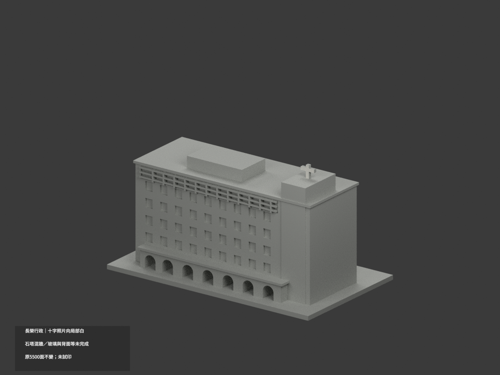
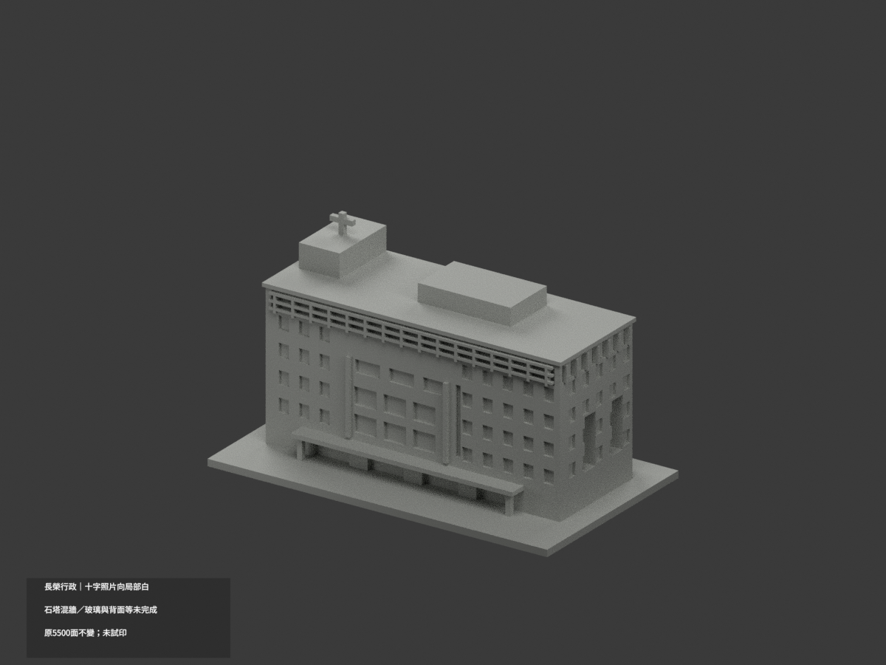
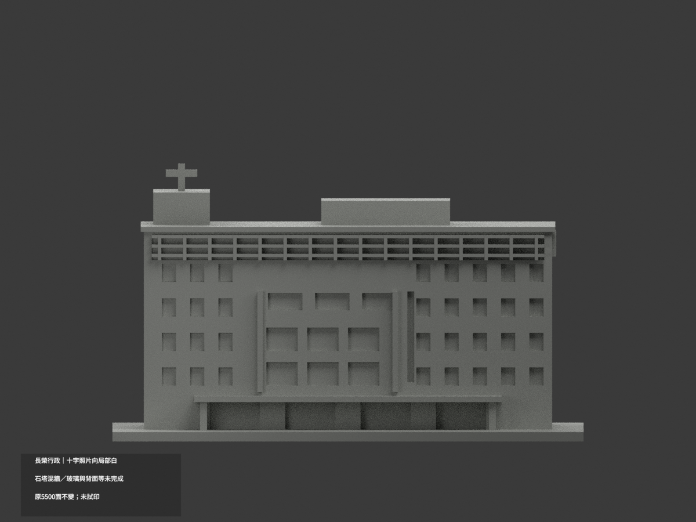
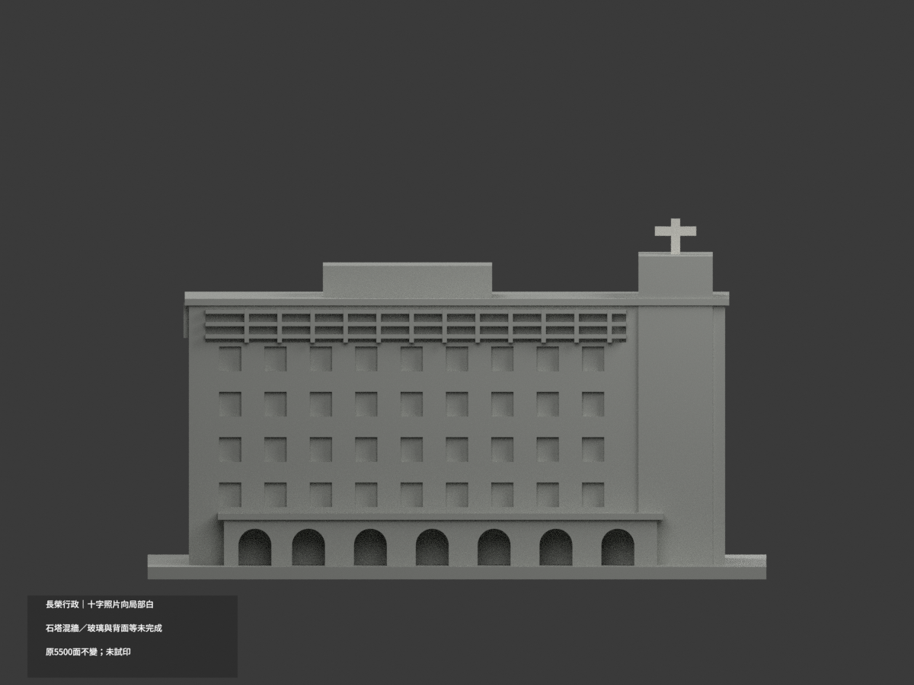
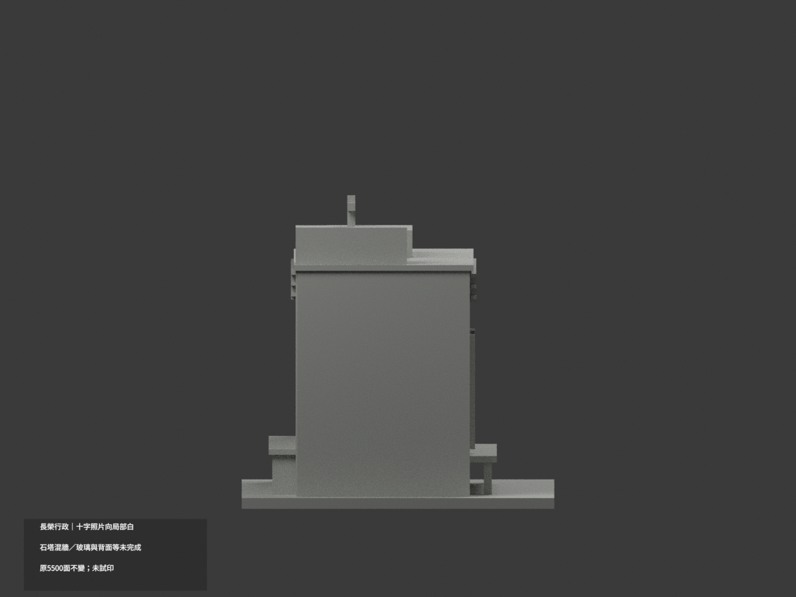
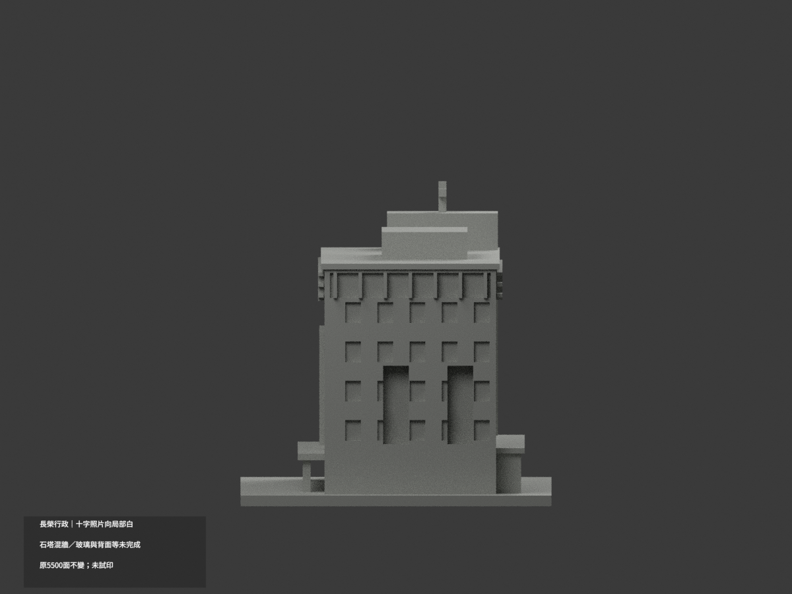
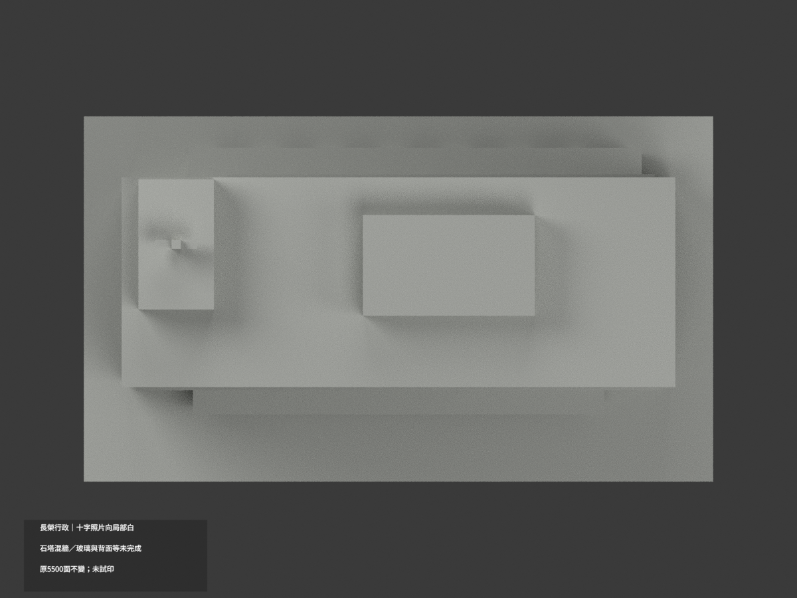
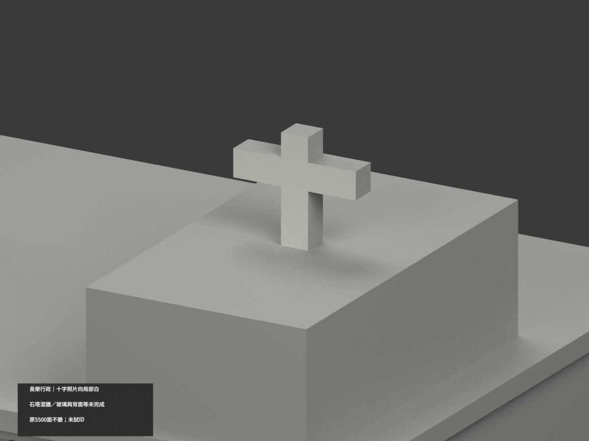
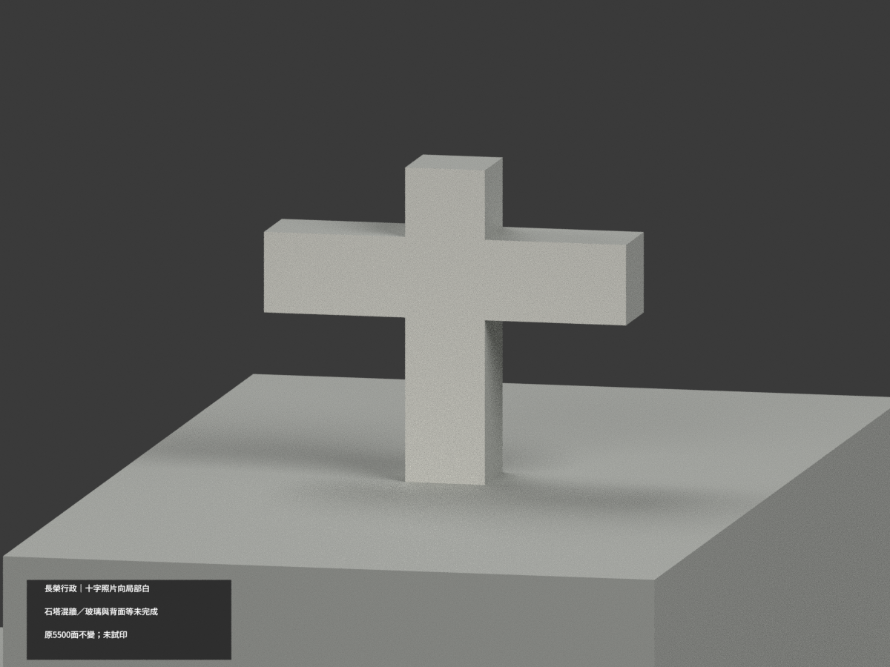
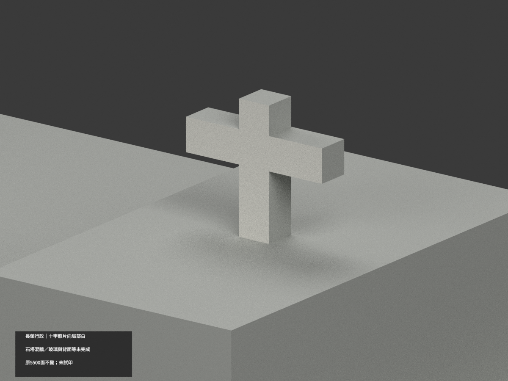

# 長榮行政大樓｜十字照片朝向面局部白

**石塔混牆、玻璃與其餘域尚未完成分色。** partial_color_incomplete=true、fully_colored_exterior=false。僅塔頂十字照片朝向完整10面名義白，非全館完整補色。

| 總覽 | 另一側 | 正面 |
|---|---|---|
||||
||||
||||
||||

## 材色範圍
同 cjcu-administration 原項目，same-item、count_delta=0。長榮大學歸仁校本部行政大樓，不含營造照片左鄰圖書館。原5500三角及STL/build_model.py字節不變，22原件無OBJ；code可輸出重建OBJ不代表有原件。
- 照片朝向對應原+Y，整y=14.1平面10三角形成一個完整共邊十字域，x=-58..-48,z77.9..86.5。原根部與塔union後界保留；全3頂點有限界及整共面核，無人工截色。
- 其餘5490面中性：十字反面y=11.9及窄側頂邊、石塔跨深基座、混磚灰拱廊、遮陽細框玻璃代理、檐屋背底。不是整塔米白或整片玻璃深灰。
- preview採照片朝向以展示已核十字面，front仍原-Y坐標。色界為證據範圍非真材縫，名義白非校準色票，保原照片推估幾何不追認精度。

## 來源與日期
親看營造外觀照，右側為行政樓、左側圖書館排除。URL201807非已驗拍攝年月，實際拍攝日期未知，不稱2026現況。官方front503圖未取得不作色證。原照私人保存、不公開、不作紋理、不建人物；未確認CC或再散布授權，不保證商用。

## 格式與列印
[原STL](model.stl) · [逐面材色3MF](appearance.3mf) · [Blender](scene.blend)
150mm底座為原示意尺寸非測量比例。物件明名 CJCU Administration partial color，獨立核真slug/館名。STL無色，3MF/Blender逐面分材，不是兩色或四色耗材切片驗證，未實際列印。

## 重建與 QA
原build_model.py → colorize_model.py → export_appearance.py → validate_color.py；Blender render_color.py／verify_color_scene.py。完整隔離Shapely2.1.2精確原build＋color重建、原bytes/全三角multiset、共面均一、閉合正體積、3MF面材、scene重開、十圖1200×900與hash。原README/previews/validation保留歷史，不冒新QA，不刪檔。

## English scope
Partial only:10 original triangles forming the complete approach-facing rooftop cross profile off-white;5490 neutral. Whole y=14.1 plane equals complete finite profile, including original tower-union root; opposite y=11.9 face and narrow returns neutral. Stone tower with dark base, mixed brick arcade, glazing screens and all other domains neutral. Contractor photo right administration only, left library excluded. Original5500 triangles and22 immutable files unchanged;no originalOBJ. URL201807 not verified capture date,not2026 survey. Preview faces+Y;front remains original-Y. Sameitem/count0/no geometrychanges/no filament test.
