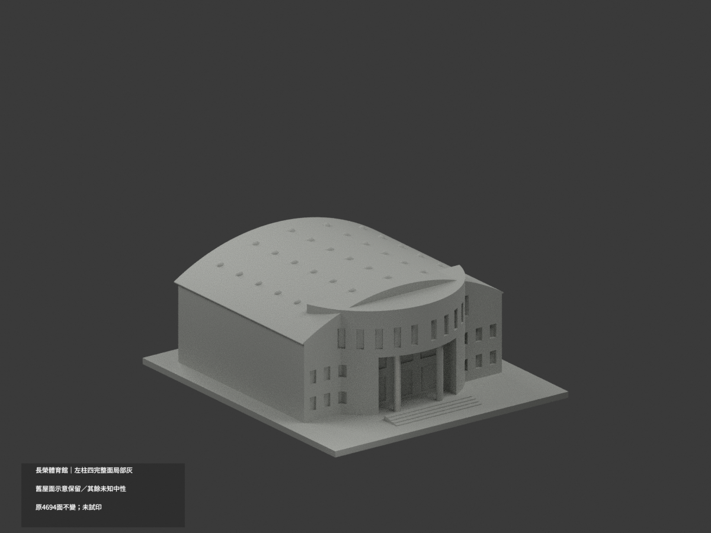
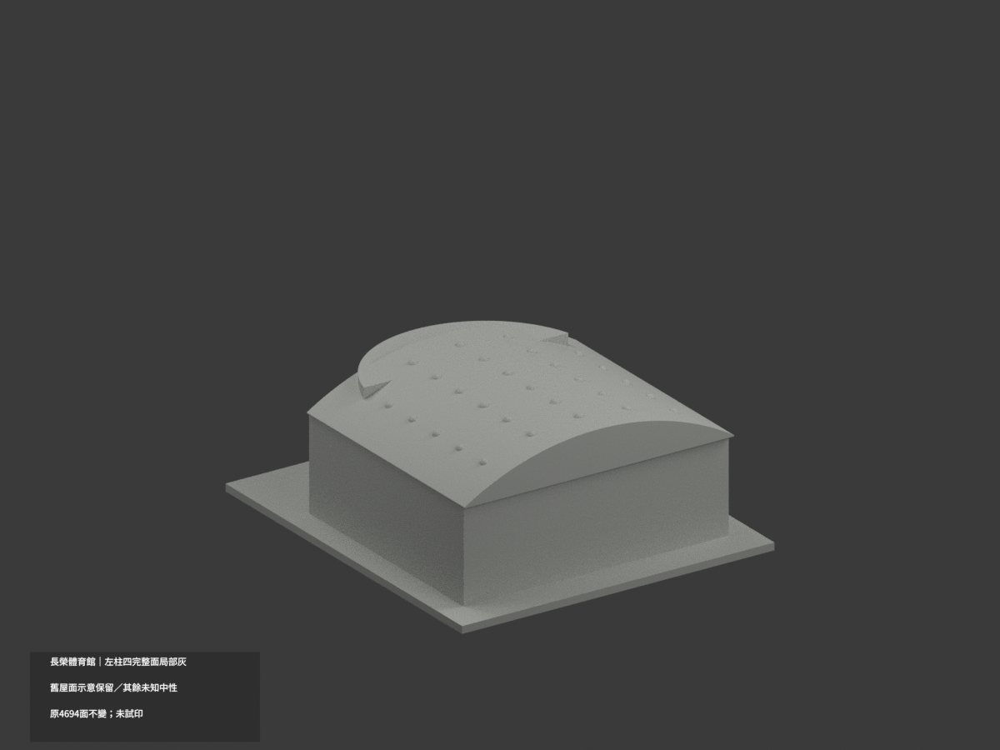
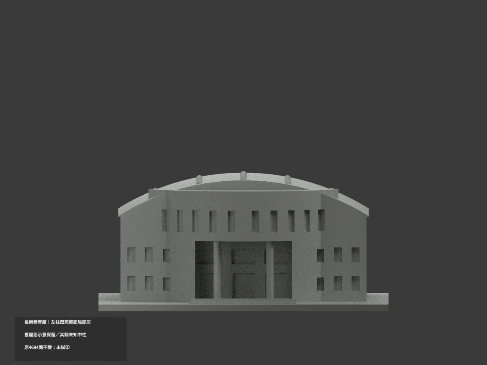
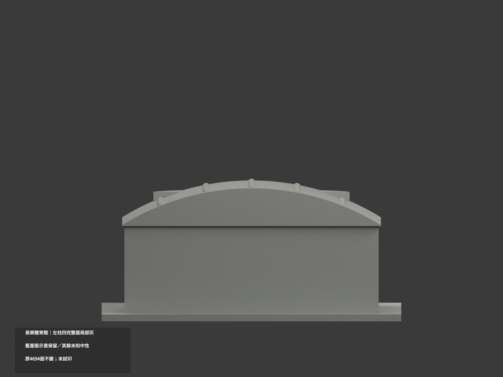
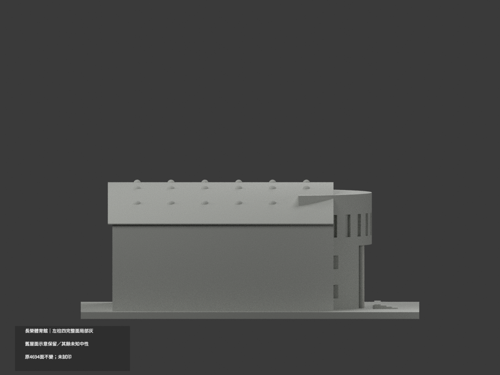
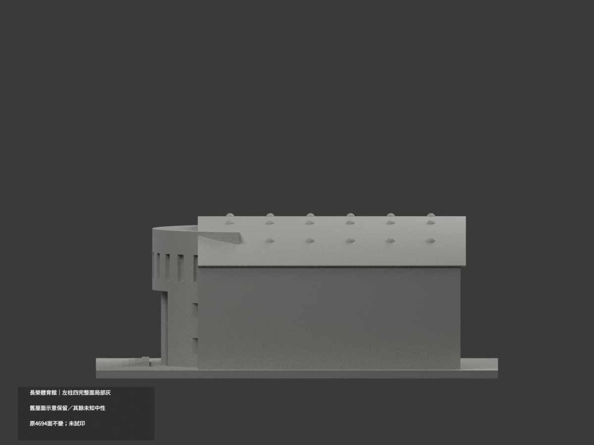
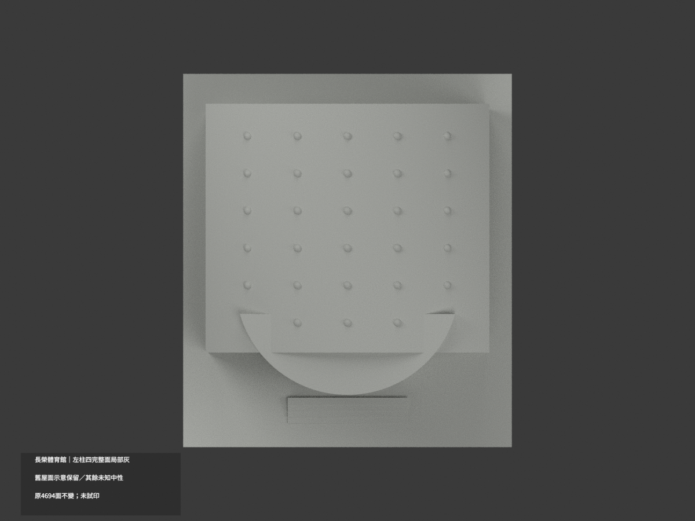
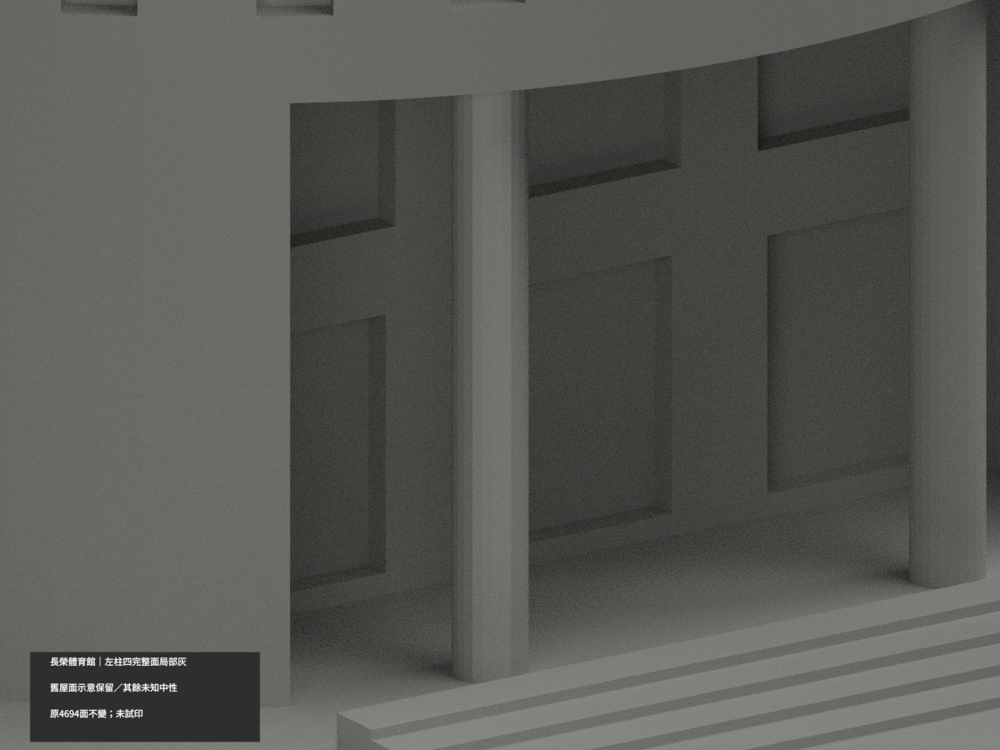
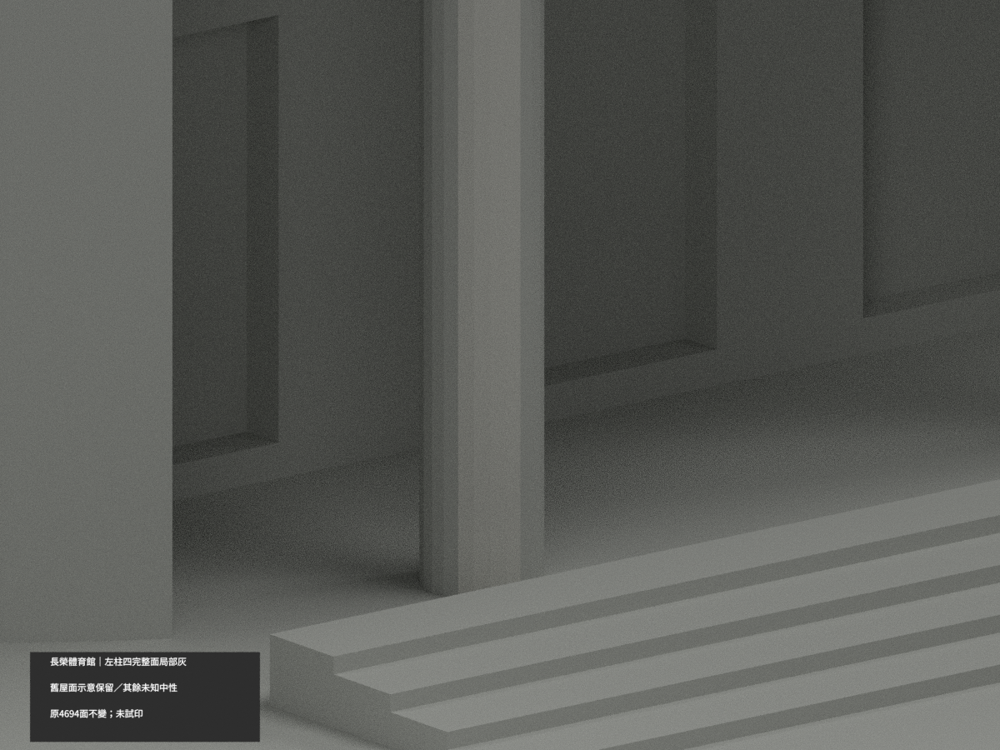
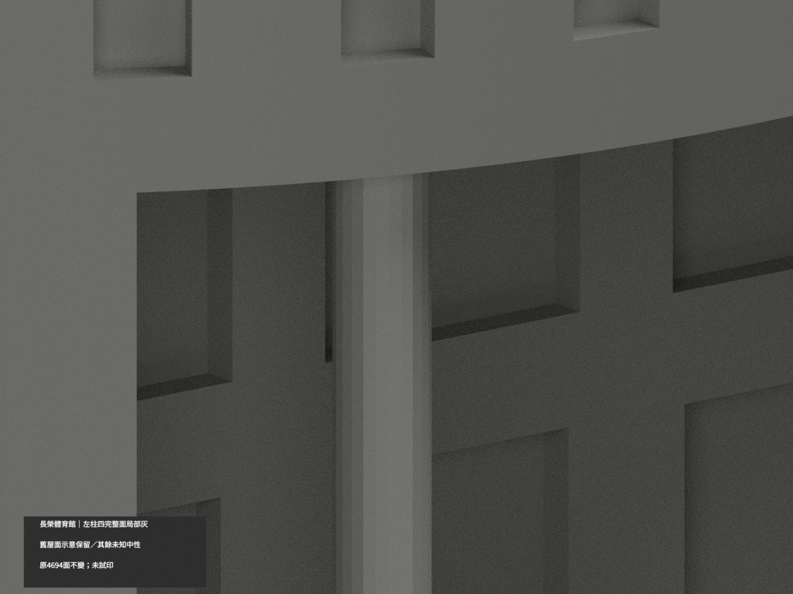

# 長榮大學體育館｜左入口柱局部淺灰

**既有屋面展示色不是實景材質證；其餘未知域尚未完成分色。** partial_color_incomplete=true、fully_colored_exterior=false。本次僅左柱四個完整柱面8三角淺灰，不是原單色模型發現，也非全館補色完成。

| 總覽 | 背側 | 正面 |
|---|---|---|
||||
||||
||||
||||

## 範圍與限制
同 cjcu-gymnasium 原項目，長榮大學歸仁校本部體育館，same-item、count_delta=0。原4694三角及所有62原件不變，immutable包無OBJ，不新增原OBJ。左柱中心(-12,-49)，24gon半徑1.7，k14..17有限chord共8面名義淺灰；全3頂點plane/tangent/z1e-5匹配，無限plane恰等有限面，z3..31是原Boolean露出界，不從照片人工裁色。所有共面連通域均一。
其餘4686面未知中性：右柱、左柱其他facet、屋頂/導光罩、混磚/金字牆、窗門細框反光、階踏/棚底等不擴色。不加真石材紋理、不改原近似幾何，不稱2026現況。

## 既有來源缺口版本轉換
原 appearance/ 全目錄保留原bytes，含1206屋面任選中性展示分類、原3MF/Blender/圖/QA。該示意不是白日實景材料證。原scene完整公開另存 ORIGINAL-SOURCE-GAP-scene.blend、原README另存 ORIGINAL-SOURCE-GAP-README.md，原render_preview.py/previews亦原樣保留。新scene/新appearance.3mf/新十圖只對有據8面分色，不覆寫原appearance/歷史，也不新增棟數。

## 來源與日期
親看官方入口白日近照，僅左柱可見前左扇區連續石灰族，花台遮其他扇區不外推。官方URL202404與頁日非拍照日期，照片capture未證；未用舊夜照取色或官方503未讀圖。照片私人保存不公開不貼紋理，不建人物；未確認CC/商用授權。

## 格式與重建
[原STL](model.stl) · [逐面材色3MF](appearance.3mf) · [新Blender](scene.blend)
原150mm底座只是示意尺寸非實測比例。明確物件身份 CJCU Gymnasium partial color。STL無色，3MF/Blender逐面材色不是兩色/四色耗材切片驗證，未試印。原build_model.py→colorize_model.py→export_appearance.py→validate_color.py；render_color.py/verify_color_scene.py。隔離Shapely2.1.2原build+color精確重建、全三角multiset/原bytes/3MF/閉合體積/scene重開/十圖1200×900與hash。舊QA不冒新證據，所有歷史保留。

## English scope
Bounded source-gap transition, not a monochrome discovery:8 original triangles on four complete front-left facets of the left entrance column light gray;4686 unknown neutral. All62 immutable original files retained;no originalOBJ. Original appearance/ roof sheet-family neutral preview retained unchanged, not actual daylight material certification. Original scene public alias ORIGINAL-SOURCE-GAP-scene.blend and original renderer/previews/README preserved. Sameitem/count0/no geometry changes. Capture date unknown,not2026 survey. Partial only, not tested filament slicing.
