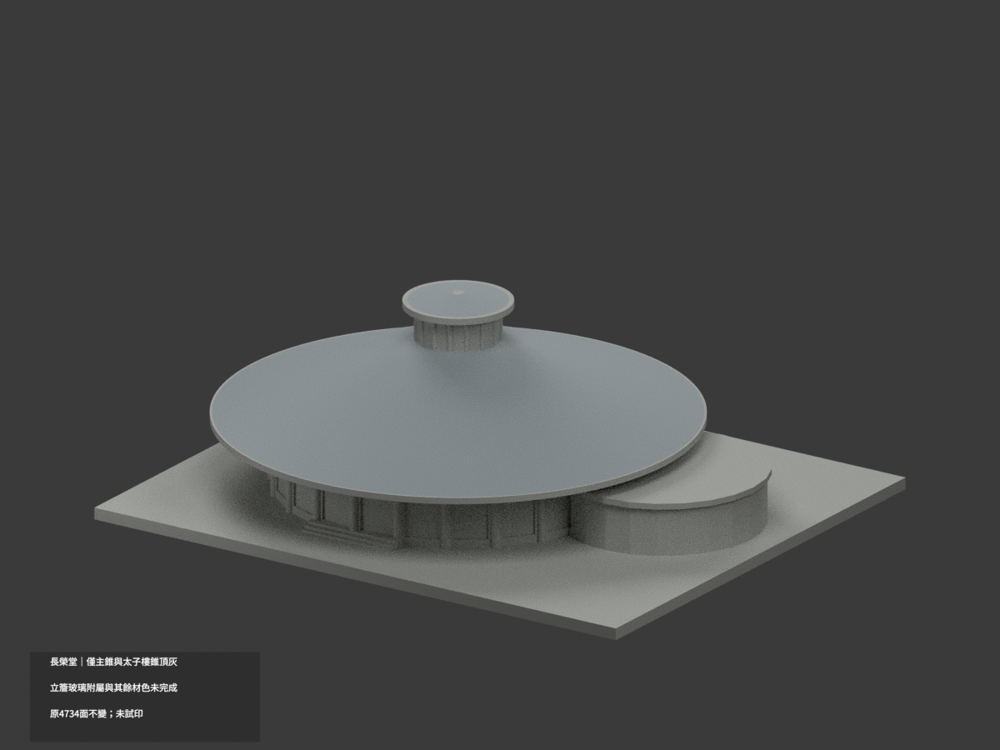
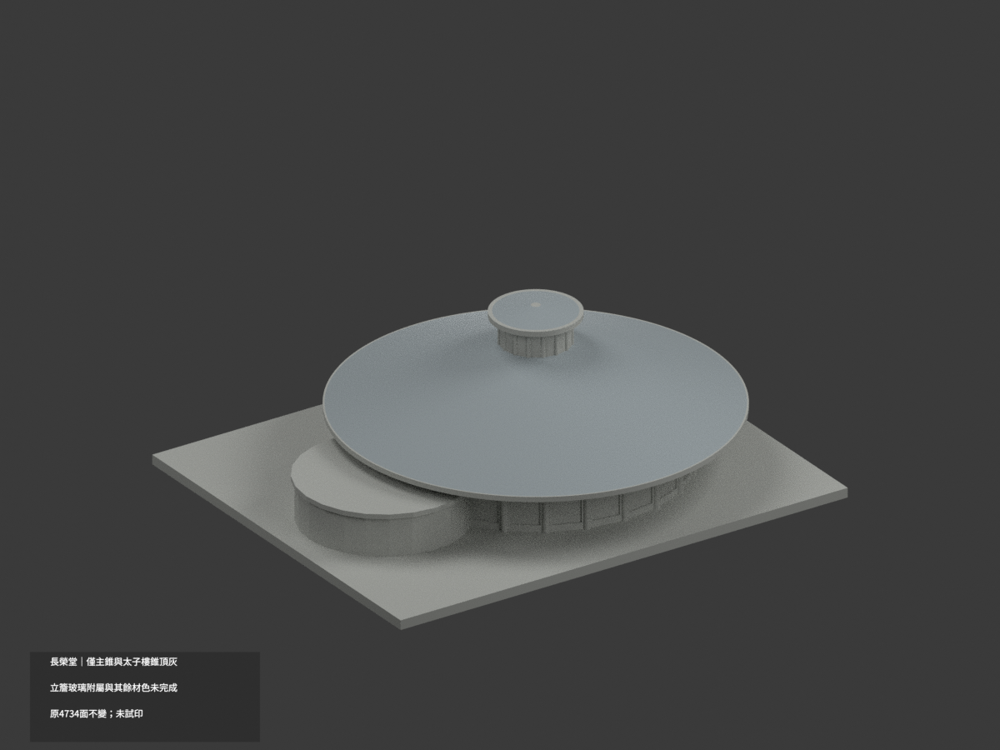
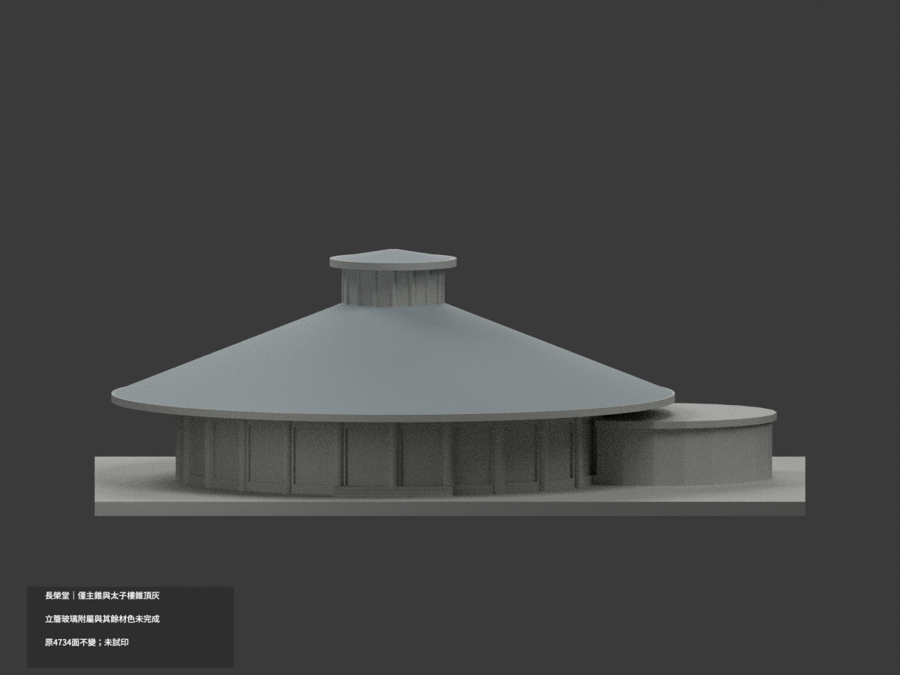
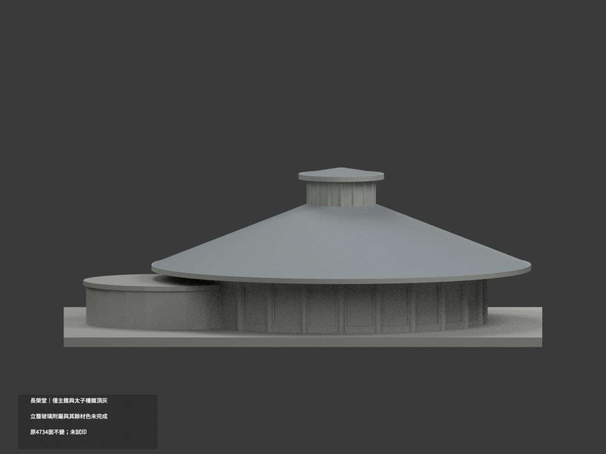
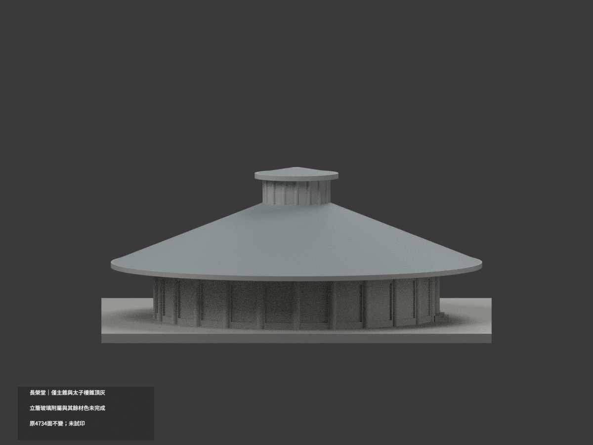
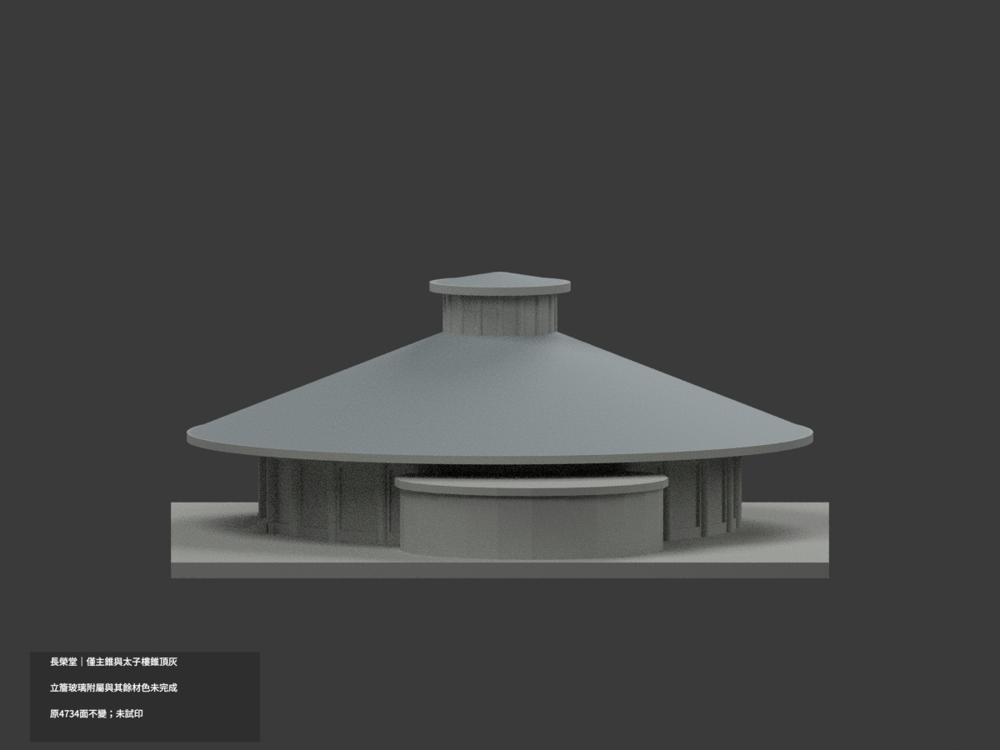
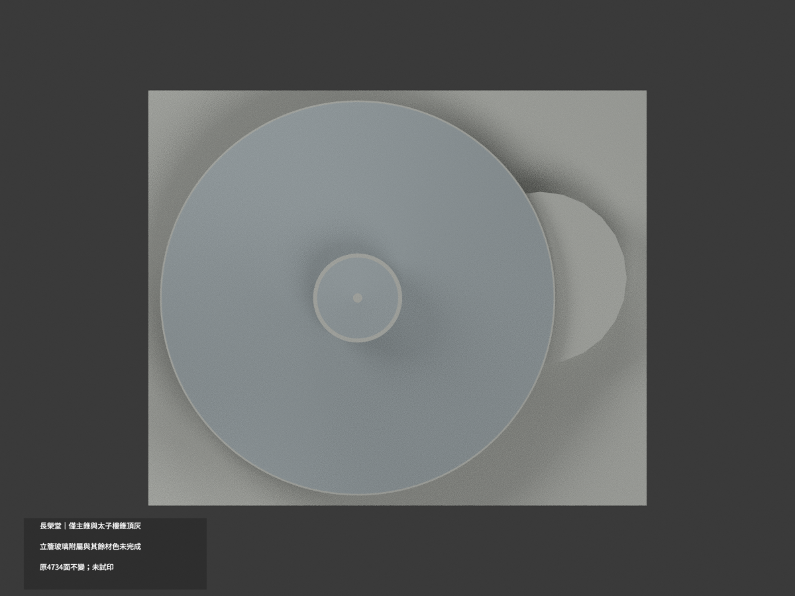
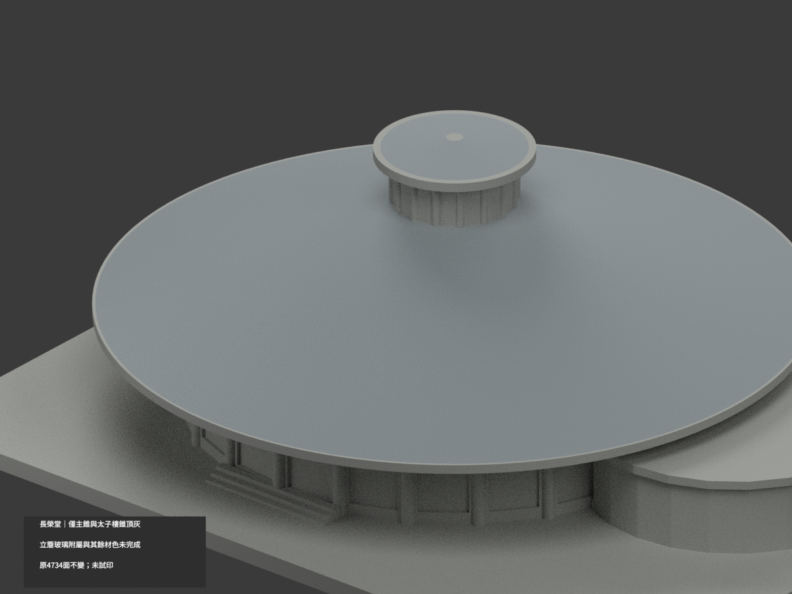
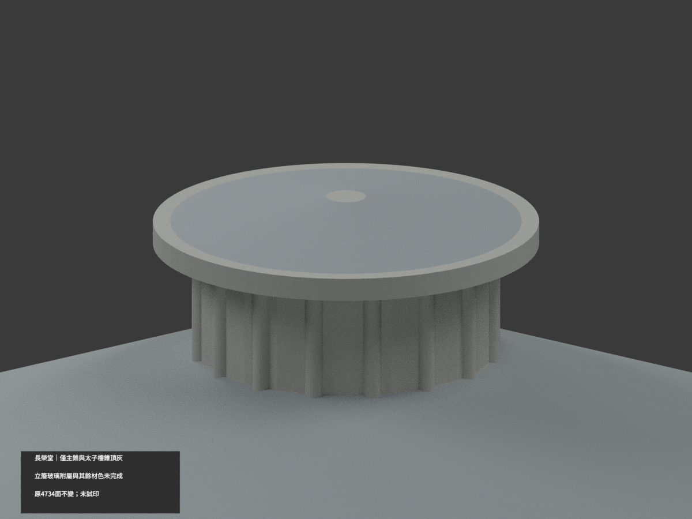
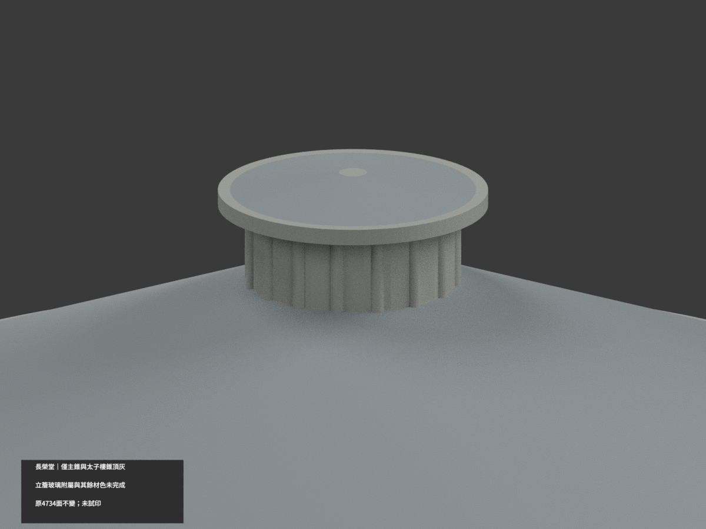

# 長榮大學長榮堂｜主錐與太子樓錐頂局部金屬灰

**局部補色未完成：主錐屋皮448與太子樓錐頂192，共640原三角名義金屬灰；立簷、玻璃、附屬體與其餘面尚未分色。** partial_color_incomplete=true、fully_colored_exterior=false。同項 cjcu-hall／count_delta=0，長榮大學歸仁校本部。英文身份 CJCU Hall partial color。

**同一長榮堂既有外觀近似，主圓堂與低側附屬體保持原包；不另造教堂、鐘塔或鄰棚，原實心玻璃代理不宣稱透明室內或隱蔽竹構復原。**

| 前斜視 | 後斜視 | 正面 |
|---|---|---|
|  |  |  |
|  |  |  |
|  |  |  |
|  | | |

## 完整原面材域

由原碼中心(−12,0)重建主144邊frustum下r59.5/z21、上r10.5/z40.4，以及太子樓96邊下r13.4/z49.6、上r1.4/z51.6。每個四點梯形先枚舉全三頂點無限支撐平面距離≤0.0001mm，再以四邊cross-product/邊長驗有限梯形。全無限候選聯集與有限聯集相同：主448、上192；近退化邊界16片可能同時接近鄰plane，聯集去重只賦一次，不normal漏片。

保主簷union後實露下界z21.2及頂肋交界Boolean碎面，不補名義隱皮、不加板紋。640名義金屬灰、4094中性，原4734三角、全共面連通材域一致。三張不同方向真航拍支持兩錐全周，不靠單側鏡像；不稱校準精確金屬色或細立縫。

立簷垂直緣、屋底、太子樓最小頂平盤/直唇、肋/玻璃通風背混材均中性。主24柱玻璃鼓體為原實心代理，不整藍或黑、不虛構內竹桁架。側服務附屬含字與細部不整白，階、底、未列域全中性。中性不是真實灰，資料覆蓋界線不是真材界。

## 日期與原始限制

三照DateTimeOriginal未可驗，建築師照一修改欄2022:10:28 14:52:25不是拍攝日期。202404/202210網址亦不是capture證據，不稱2026現況。保原照片估測毫米、粗錐/加厚部件及未知背面限制，補色不追認測繪。來源僅私人研究，不公開原照、貼圖或推定商用權利。

## 檔案與 QA

原STL/build與4734三角座標拓撲字節不變；immutable22件無OBJ，原程式可輸出OBJ但隔離產物僅私存，不冒稱原repo有OBJ。原README.md另存ORIGINAL-MONOCHROME-README.md，舊單色圖/QA保留，原scene私存。appearance.3mf兩展示材及scene.blend真面材保持原形；export/validate/render/verify及真3MF/scene身份 CJCU Hall partial color。

精確依賴隔離原build+color、閉合正體積、3MF座標/面材、Blender重開及十張1200×900檢核；重建留存不刪，未試印或驗多料切片，STL本身無色。

## English limitations

CJCU Hall partial color. Main144gon frustum448faces and lantern96gon192faces receive nominal metalgray;4094neutral,4734originaltriangles unchanged. Exact original4point trapezoid supportingplanes and normalized edge halfspaces independently enumerate complete finite domains. Whole-plane union equalsfiniteunion;16near-boundary slivers may match adjacentplanes but are assigned once,none omitted. Preserve eaveunionz21.2 and lanternrib Boolean fragments. Three actual aerial photos support fullroofcircumference,not mirrorinference. Verticalfascias/undersides/apexdisk/ribs/glass/solid-drums/sideannex/stairs/base remain neutral;no hiddenbamboo interior. Captureunknown,URL/modifydate notcapture,no2026claim. Original22files,noOBJ,count_delta0,no geometry/publicphoto/testprint.
