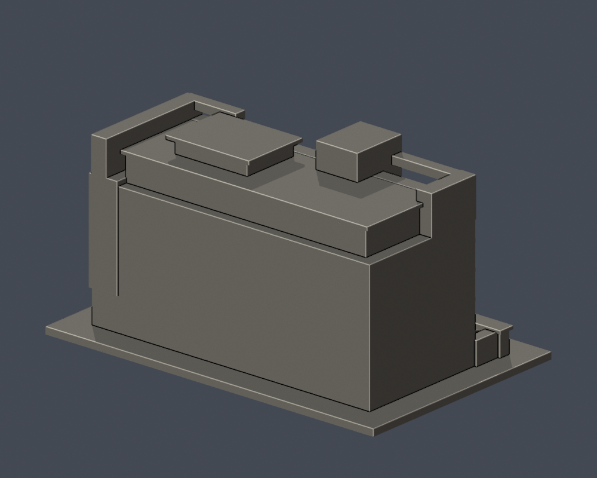

# 蘭大衛紀念圖書館主量體｜長榮大學

## 右短翼補色版

[右短翼補色說明、範圍與驗證](brick-side-20261120/README.md) · [逐面材色 3MF](brick-side-20261120/appearance.3mf) · [補色 Blender 場景](brick-side-20261120/scene.blend)

只將原右短翼磚牆外皮 92 面補為近似暖紅磚，窗洞及其餘 3,850 面保持原展示材。照片未校色，未試印；不是全棟分色。此處原 STL、主量體 Blender 場景及代表圖仍保留原版，補色版不另計建築或套件。

| 右短翼補色版驗證圖 |
| :---: |
|  |
| 只呈現三排窗周圍的磚牆範圍，不替換下列原代表圖。 |

## 原代表圖（保留主量體中性版）

| 模型預覽 | 模型預覽 | 模型預覽 |
| :---: | :---: | :---: |
|  |  |  |

[學校目錄](../../../README.md) · [校區目錄](../../README.md)


## 範圍與外觀
保留六個地上使用層的高層主量體、三層連續水平玻璃帶及外挑白色帶、上層退縮、前端屋頂核心、右側紅磚窗列與底層拱廊。

這是圖書館主量體外觀近似，排除相接的計算機與網路中心低層翼，不聲稱整座圖資群完整重建。背面和左短側缺乏充分實拍，為簡化無窗包絡；屋頂與進深視覺估計。地下樓層不挖空，正面坡地化為平底座。

這是公開外觀照片推估的可編輯、可再建構縮尺模型，不是測量、竣工圖或完整BIM。各件獨立縮尺；包含平底座的外框為 150.00 × 96.00 × 81.00 mm，最大150 mm，不代表同校模型使用相同比例尺。

## 檔案
- [原始模型 STL](model.stl)
- [可編輯 Blender 場景](scene.blend)
- [建模程式](build_model.py) · [Python依賴](requirements.txt)
- [正面](previews/front.png) · [背面](previews/rear.webp) · [俯視](previews/top.webp)
- [來源與不確定性](sources.json)
- [幾何驗證](validation.json) · [0.2mm層檢查](layer-check.json) · [輪廓多邊形有效性](contour-validity-check.json) · [0.8mm參考薄特徵篩查](thin-feature-check.json)
- [SHA256](SHA256SUMS.txt) · [重跑檢查](check_all.sh)

| 模型預覽 | 模型預覽 | 模型預覽 |
| :---: | :---: | :---: |
| 正面<br> | 背面<br> | 俯視<br> |

原中性版俯視展示圖改用 1000 × 800 無損 WebP，RGBA 像素與原 PNG 完全一致；正面代表圖、正背並排圖與右短翼補色版不變。需原 PNG 可下載[固定版本原始俯視圖](https://github.com/hplin50643/taiwan-buildings-3d/blob/46fbf504829d8827d8a3a0d0402b01139fc9109a/%E9%95%B7%E6%A6%AE%E5%A4%A7%E5%AD%B8/%E6%AD%B8%E4%BB%81%E6%A0%A1%E6%9C%AC%E9%83%A8/buildings/cjcu-library/previews/top.png)。使用 Blender 4.3.2、Pillow 13.0.0（libwebp 1.6.0）執行 `python export_display_webp.py` 可用暫存目錄重建；加 `--archive-png-dir /path/to/output` 可重現原 PNG 位元並核對原 SHA-256，不覆寫交付場景。

另將原中性版背面展示圖改用同尺寸、像素完全相同的無損 WebP；需原 PNG 可下載[固定版本原始背面圖](https://github.com/hplin50643/taiwan-buildings-3d/blob/1bb6b3aee487ca32c9999cba9750ddcbbaa5534d/%E9%95%B7%E6%A6%AE%E5%A4%A7%E5%AD%B8/%E6%AD%B8%E4%BB%81%E6%A0%A1%E6%9C%AC%E9%83%A8/buildings/cjcu-library/previews/rear.png)。同一匯出工具可重建俯視及背面兩張 WebP；加 `--archive-png-dir /path/to/output` 可取得並核對兩張原始 PNG，不覆寫交付場景。

## 重建與驗證
需要 Python 3.12、requirements.txt 所列套件與 Blender 4.3.2+。在本目錄安裝依賴後執行：

```sh
python -m pip install -r requirements.txt
python build_model.py
blender -b -t 2 -P render_preview.py
sh check_all.sh
```

build_model.py 中各幾何參數單位為mm；修改視覺估計參數後必須重新建模、渲染和驗證，不能沿用舊驗證JSON。scene.blend只含一件與STL三角面位置一致的模型mesh、材質與相機。材質只用於預覽；STL不含顏色。

## 驗證與列印限制
原始STL未經repair：驗證水密、邊流形、頂點環單一、原始法向與繞序、正體積、單一連通表面殼、無分離內腔殼、150mm外框、獨立重建SHA及儲存Blender幾何一致。0.2mm節距、起始z=0.071mm逐層檢查閉合及degree2，並驗證各閉合多邊形及合併多邊形有效。

薄特徵篩查使用canonical edge interpolation，在1mm節距截面做0.8mm參考形態開運算；尖角與曲線也會造成損失。此檢查不是全面壁厚測量，不代表0.8mm最小壁厚合格，也不是實際切片、支撐可拆除性、走線或實體試印保證。

三條水平簷帶、雨棚與底部拱廊需在實際切片器評估支撐。細窗格增厚，不是全模型最小壁厚保證。

## 來源
- [學校官方：キャンパス紹介／校園導覽](https://www163.cjcu.edu.tw/web2023/ja/about_campus_tour.php)：將圖書館及計算機與網路中心分別介紹，單位命名不直接證明實體分棟。
- [學校官方：蘭大衛紀念圖書館外觀](https://www163.cjcu.edu.tw/images/campus/campus_lib.jpg)：清楚確認主立面玻璃帶、右短侧窗列和低拱廊。
- [華豐營造股份有限公司：行政大樓工程旁的圖書館側面](https://www.hwa-fong.com.tw/upload/201807271455032.jpg)：圖左可見圖書館側立面和水平玻璃帶轉角，補充官方正側照片。
- [學校圖書館：歷史沿革及服務](https://dweb.cjcu.edu.tw/lib/article/7424)：核對蘭大衛紀念圖書資訊大樓別名及2008-11-05啟用。

公開封包不再散布來源照片，只提供連結與原創模型。全校尚未完成；見學校目錄的逐項缺口。
