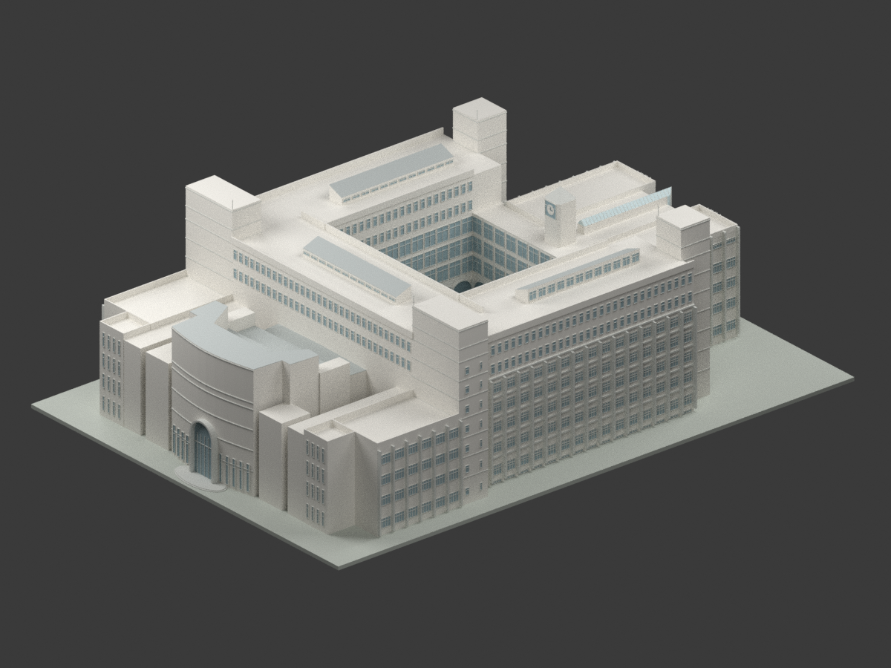
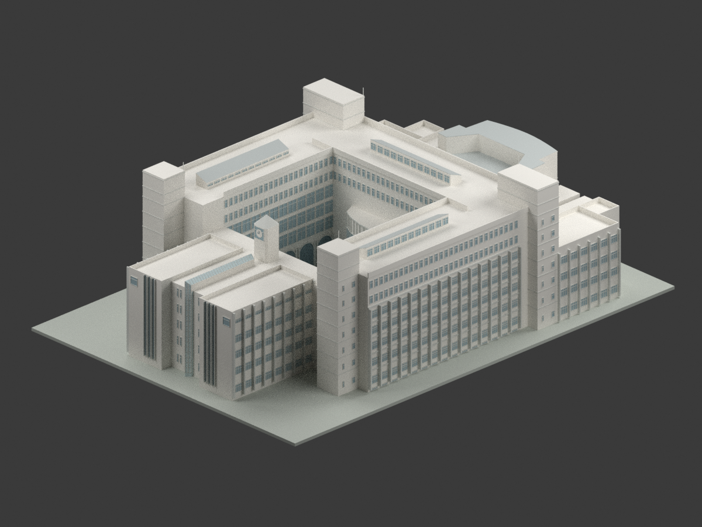
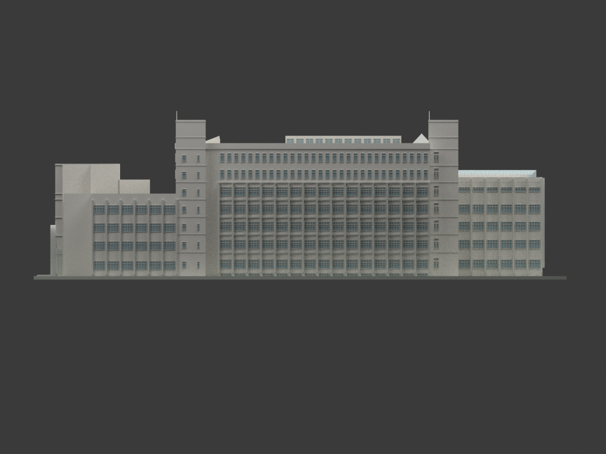
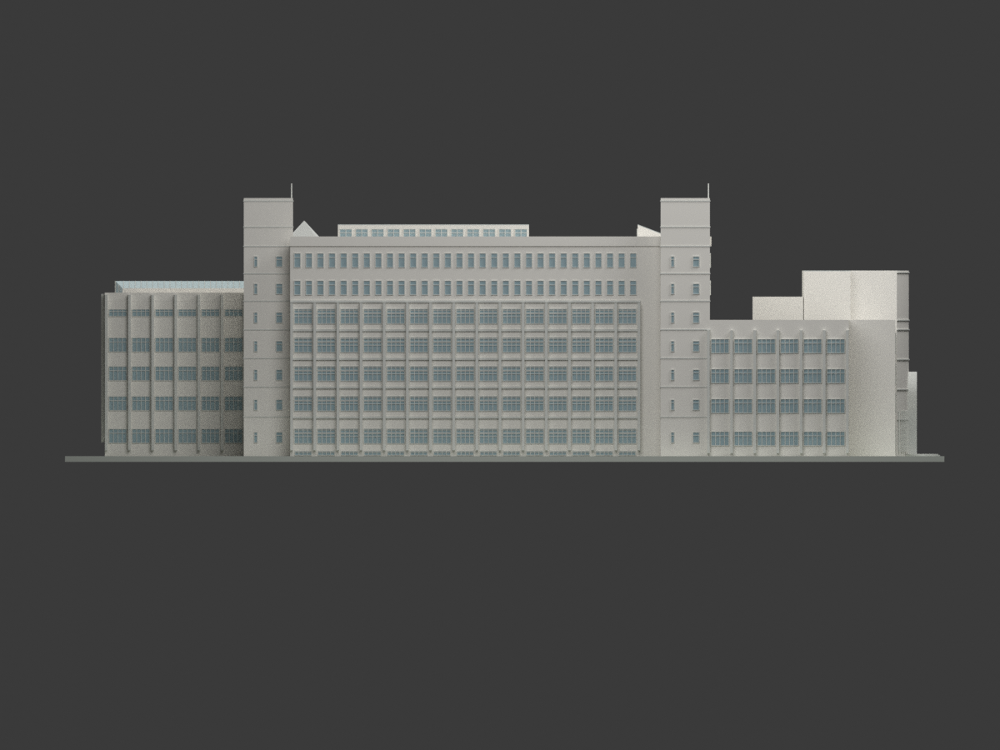
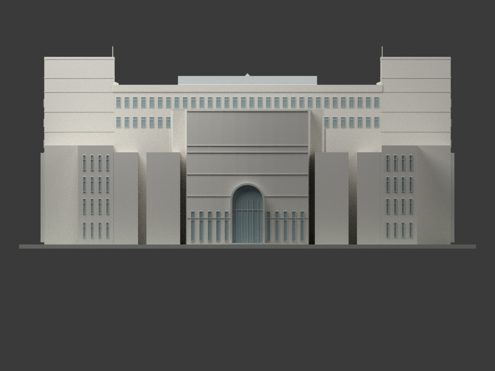
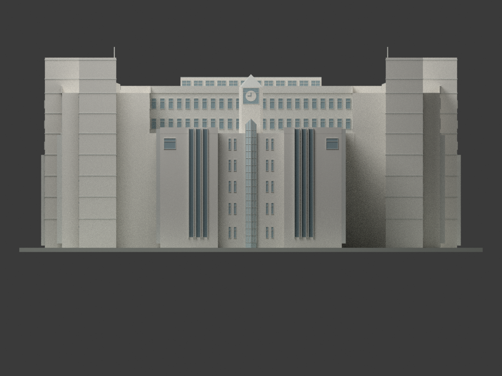
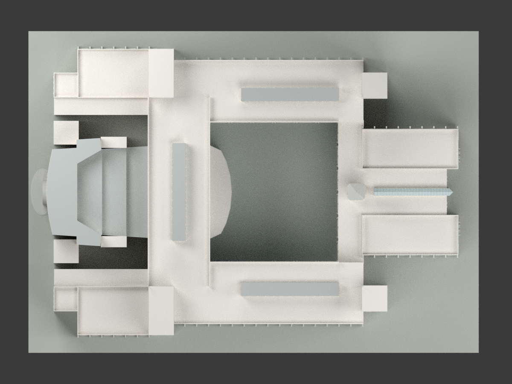
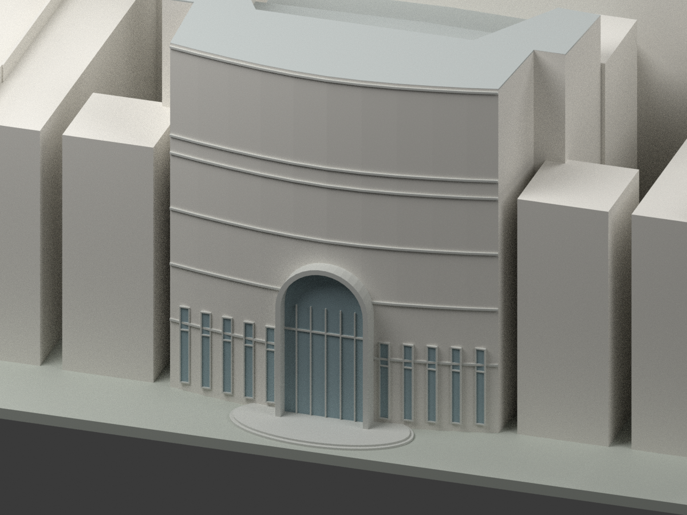
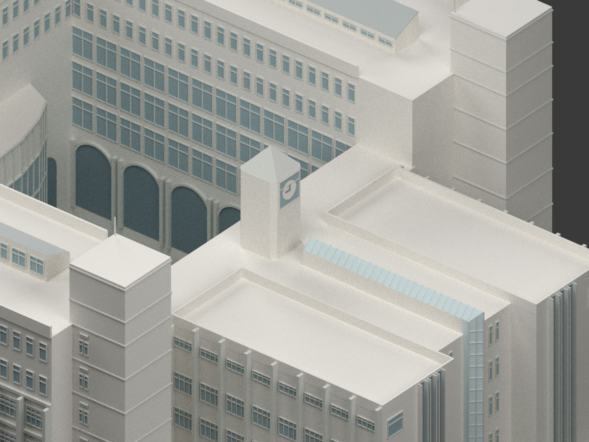
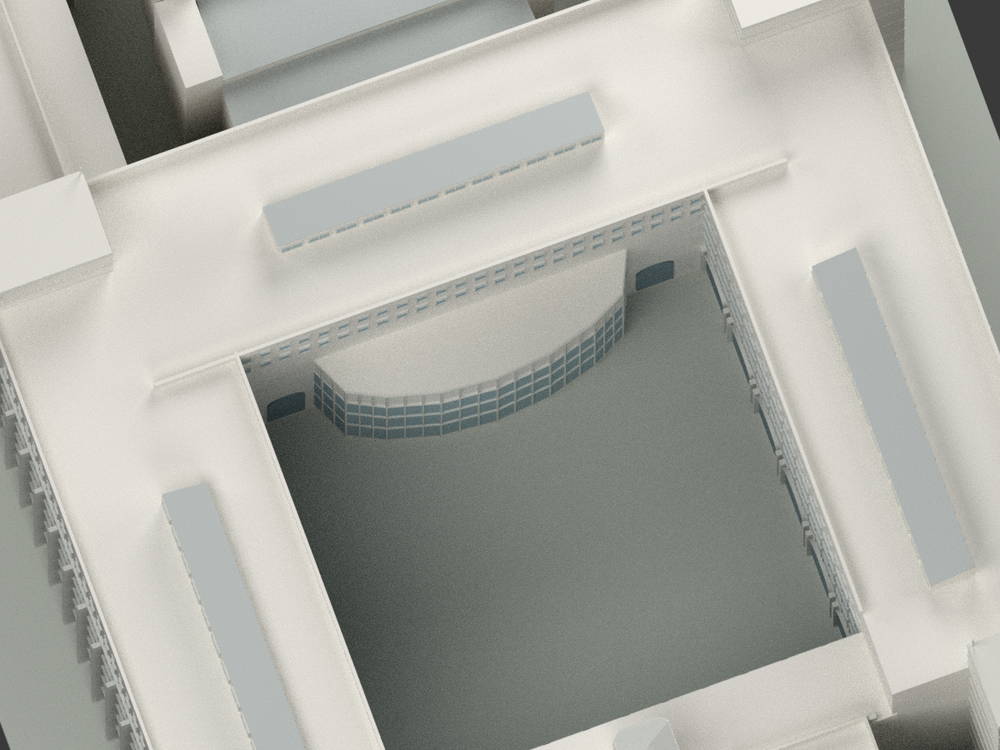

# 長榮公共衛生學院大樓｜1995 年歷史設計模型

## 模型實際渲染

| 西南全景 | 東北全景 | 南向 |
| --- | --- | --- |
|  |  |  |
|  |  |  |
|  |  |  |
|  | 內庭與西入口採背襯幾何表達 | 全部圖片由本包 mesh 實際渲染 |

## 範圍與交付

- **原案：長榮公共衛生學院大樓新建工程**，吳明修建築師事務所，1995 年設計、含 5 月修訂；完整第一／第二期設計。非現況、非竣工確認，也未證實與現代同校建物別名的對應。
- `model.stl`、有色 `model.3mf`、`scene.blend`、`mesh.npz`、可重建程式及 QA。尺寸單位 mm；比例 **1:400**，展示底座約 **303.75 × 217 mm**，含避雷針總高約 **96.13 mm**。
- 原始掃描、裁圖、私人研究與 `.blend1` 不屬公共交付；來源連結與歸屬見 [SOURCES.md](SOURCES.md)。

## 來源控制與沒有混用的部分

- 軸網 **108.80 × 76.80 m**，不是建築最外包絡。主體七層：1F +0.96、2F +5.46、3F +9.60、4F +13.56、5F +17.52、6F +21.48、7F +25.26、RF +29.04 m；屋面完成 +29.10、女兒牆 +30.34、屋突 +35.65、避雷針 +37.65 m。
- 西低翼另用 1F +0.60、2F +5.10、3F +9.24、4F +13.38、RF +17.52 m，不能把全棟地坪強制相同。東翼 RF +21.48 m。
- 主 U 形屋頂是 **三條不透光單坡屋頂**，不是玻璃天窗：低端 +30.65、高端 +32.00 m；北條 26.40 × 3.55 m、西條寬 3.54 m，保持原圖差異。高側 AW19、低側 AW20 依方向放置；不把 VRV 用途概括到每一條屋頂。
- 東 I 軸是另一個真正的玻璃山形罩：RF +21.48 上 1.70 m 基座、45° 坡／1.00 m 起拱，寬 2.00 m，頂 +24.18 m。玻璃以不透明色塊表達。長向由 14′ 軸（x86.40）起，17′ 後另有 0.80 + 1.13 m 尺寸鏈，三角端尖 x107.53；0.93 m 外框線與 0.80 m 中心網格不可混用。玻璃細肋以約每兩格保留一肋簡化。
- 西會議廳四階屋頂 **25.62／21.365／19.665／17.965 m**，另兩小屋頂 +22.02 m；A8-13 的曲邊／凸耳已按格網描點，不猜完美圓弧，圖量約 ±0.15 m。下三階保留 1:50 排水坡。細部女兒牆線位與排水場內緣不同，交界採相接厚實外殼，不製造裂縫。
- 鐘塔採 **A8-25 剖面優先**：21.48 + 4.18 + 6.88 = **32.54 m**；同圖立面底另標 +29.04，與剖面／東翼高度及整體立面不合。平面按 A8-25 的 75＋300＋25／50 cm 鏈，X 外緣為 79.20～83.70 m、中心 81.45 m。此矛盾沒有改寫為「原圖完全一致」；32.54 m 是有據重建解讀，不是實測。原圖不含鐘機械費用，不保證實際設置。
- A3-1 西向另畫較低入口前皮及其後高層，和 A8-13 曲邊的前後線位未完全協調；模型優先 A8-13／A4-1 的屋頂與曲邊，補讀 A4-13 後，入口寬 5.80 m、地坪 +0.30、開口頂 +11.30、內階 +11.66（並非完整頂帽最高點，外框輪廓另作簡化）、前帽突出至 1 軸外 3.20 m 已納入；但整片較低前皮頂高及前後線位仍未唯一決定，其餘低前皮簡化合併，不當作精確施工重建。
- 大型虛線三角／圓弧是避雷保護範圍，**不是實體屋頂**。屋頂圖旁獨立屋突詳圖不按紙面位置另加成建築。

## 立面與列印簡化

- 南北主長翼 1–5F 為較寬橫窗及外凸柱框，6–7F 是較密 AW16 窄窗，不是七層同格。AW3 2.43 × 1.36 m 與上方 AW4 2.43 × 0.56 m 分開表達；AW16 為 0.85 × 1.94 m。
- B／P 附近是真正窗牆面，A／Q 附近的遮陽／地下採光投影不封成 3.2 m 深實牆。門窗中心、窗台、框距與突出深度部分為立面圖量，並非每件均有精確尺寸。
- 84.5.17 修訂的 AW10′ 百葉依 1–7F 平面及南立面定位於東南樓梯核心南面，2 個 AW10 窄窗成對上方每層 1 個 100 × 30 cm 短橫百葉；高程約樓面 +2.8～3.1 m 是圖量而非額外標註尺寸。
- 東向窄豎窗／通高豎帶、西向拱入口、低翼與會議廳、主中庭各向的拱／直柱與玻璃有分別。內庭玻璃、拱口及多數窗戶是**封閉背襯浮雕**，不宣稱真實通透或內部空間。
- 西低翼兩個天井保持空缺，邊廊不以整塊實心量體填井；井邊與會議廳折線按平面區別。
- 省略室內家具、地下室內部、東翼採光井內部樓梯與完整室內剖面；沒有把剖切樓梯貼到主中庭外皮。小型機電、排水管、未確定定位的細門窗與設備不任意補齊。
- 顏色為中性材質近似，非有色原圖或現況取樣。薄避雷針加粗至原尺約 0.16 m（模型 0.4 mm）；部分窗框／紋理約 0.2–0.4 mm，**未做實體列印測試**，不是所有設備都能可靠成形。
- 一個封閉連通外殼方便交換，不等於免支撐、免切片或完整可製造保證。底座是作者展示支座，不是測量地形。大模型需確認成形平台、方向、支撐與薄件；STL 不帶顏色，3MF 帶材質索引但切片軟體支援可能不同。

## 可重現

在獨立目錄使用 Python 3 與 `requirements.txt` 所列套件，Blender 4.3.2：

```bash
python build_model.py
python export_3mf.py
python validate_model.py
blender -b -t 8 --python render_model.py
blender -b --python verify_scene.py
```

模型採原始公尺控制，再轉為 1:400 的 mm；程式無原圖執行依賴。`components.json` 記錄部件原尺包絡，`AUDITORIUM-DIGITIZATION.json` 記錄曲邊估讀限制。重建雜湊、STL／3MF 往返、場景重新開啟、相機構圖、來源／視覺核對各有獨立 QA 檔；`SHA256SUMS` 為凍結清單。

## 權利分列

館藏原圖逐張標示 CC BY-NC，保留作者與來源，僅私人備份。這不自動替新幾何設定一個全包授權，也不代表取得商業利用保證；請見 [來源及權利說明](SOURCES.md)。
