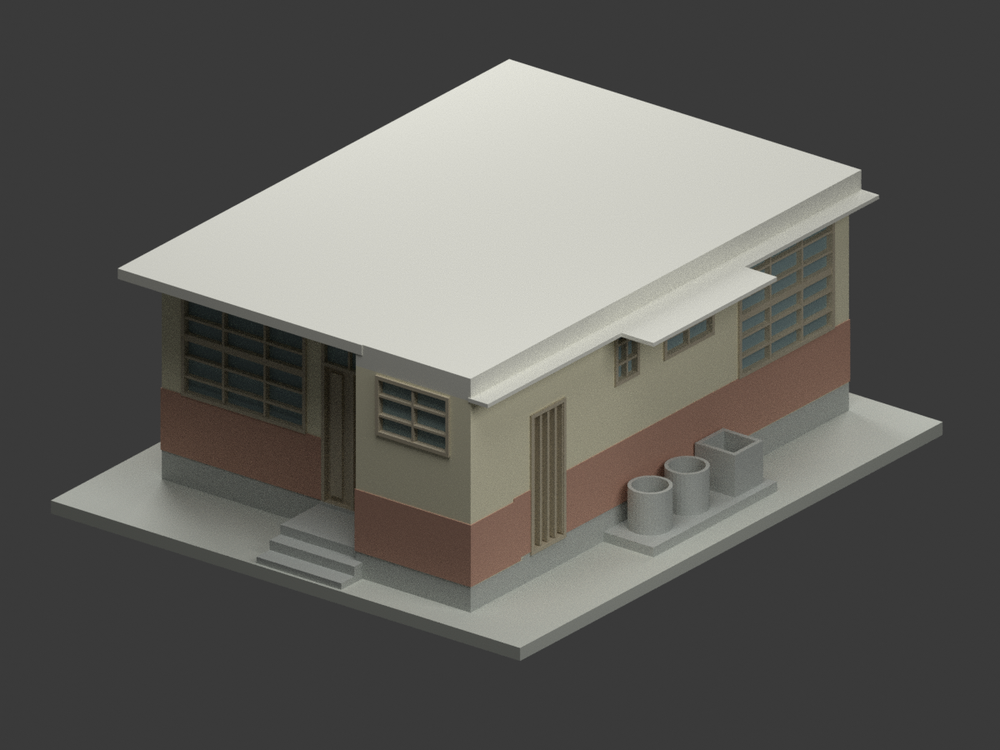

# 高雄市立高雄高級商業職業學校歷史建築設計研究

## 模型圖鑑

| 建築模型 | 建築模型 | 建築模型 |
| :---: | :---: | :---: |
|  **[本校單戶宿舍｜未定年原設計](校本部/buildings/ksvcs-main-campus-dormitory-undated-design/README.md)** [STL](校本部/buildings/ksvcs-main-campus-dormitory-undated-design/model.stl) · [彩色3MF](校本部/buildings/ksvcs-main-campus-dormitory-undated-design/model.3mf) · [Blender](校本部/buildings/ksvcs-main-campus-dormitory-undated-design/scene.blend) |  |  |

現行收錄 **1 套模型包**；不是全校建築數或全校完成。

## 收錄範圍

陳仁和建築師事務所《臺灣省立高雄商業職業學校本校宿舍新建工程設計圖》CCRH11423034，未定年歷史單戶宿舍外觀；不借用同冊教室1957日期，也不是鳳山分部宿舍或未題名雙戶平面。6.00×7.50m主軸、前部另伸1m，右側露天洗滌區不封房；外框約±0.10m圖量、後挑板厚沿用顯示簡化，中性色材質與閉實體外觀，不復原隱藏空心結構或室內。是否按圖實施與現存均未知，未試印。

[高雄市教育局校名錄](https://www.kh.edu.tw/orgArch/departments_intro/N0/P2)列現名為高雄市立高雄高級商業職業學校；[校方簡史](https://www.ksvcs.kh.edu.tw/deptweb/night/intro-nightschool-history.php)記錄1970年省立高級商校名稱、1979年改市立。歷史本校名稱與現名合計一所高中職，不列入大專校院校數。鳳山分部後來獨立成校，其既有模型與本件本校宿舍分開，不合併建物或把分部模型重複計入本校。校本部是目錄歸組，不宣稱已核實本案今日位置或存續。

保留設計者與國立臺灣博物館典藏來源；原圖權利與本次模型／程式／渲染分開，不附原圖、裁圖或私人參考備份，不宣稱不受限制商用。

[校本部圖鑑](校本部/README.md) · [回總目錄](../README.md)
