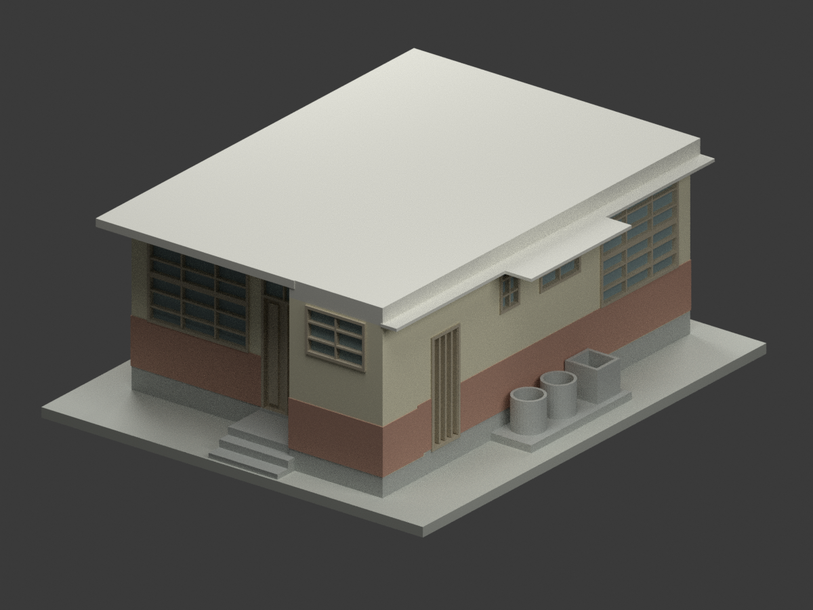
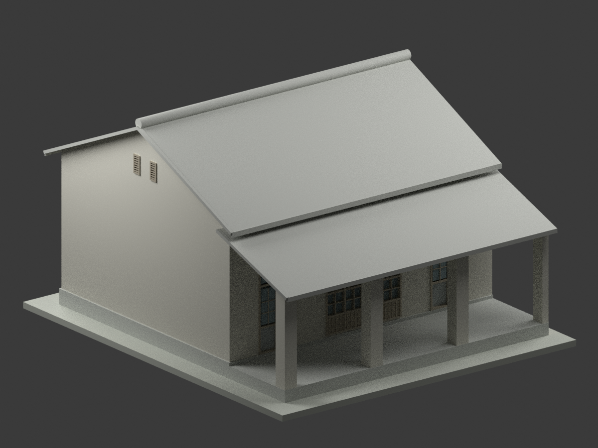
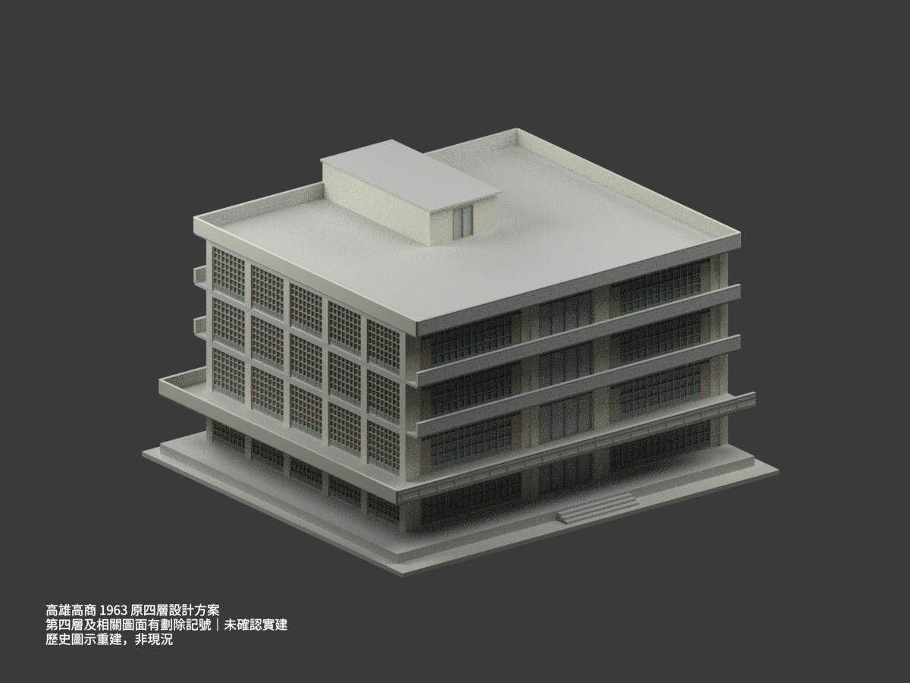
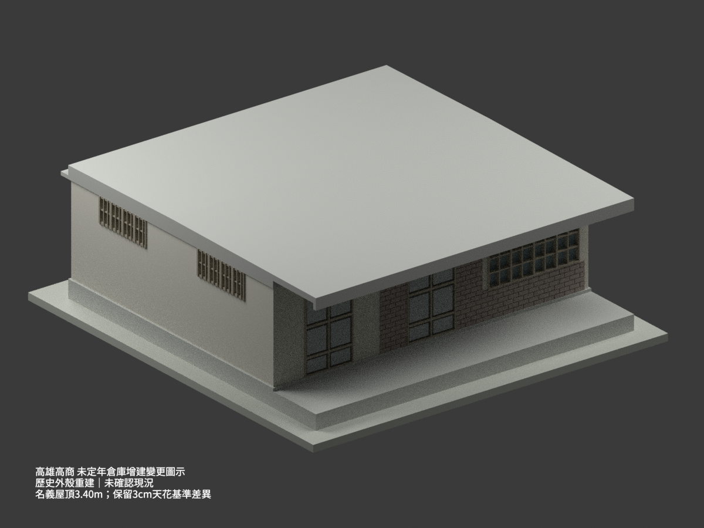

# 高雄市立高雄高級商業職業學校｜校本部歷史建築設計研究

## 模型圖鑑

| 建築模型 | 建築模型 | 建築模型 |
| :---: | :---: | :---: |
|  **[本校單戶宿舍｜未定年原設計](buildings/ksvcs-main-campus-dormitory-undated-design/README.md)** [STL](buildings/ksvcs-main-campus-dormitory-undated-design/model.stl) · [彩色3MF](buildings/ksvcs-main-campus-dormitory-undated-design/model.3mf) · [Blender](buildings/ksvcs-main-campus-dormitory-undated-design/scene.blend) |  **[教室／走廊單元｜1957竣工圖示／局部截斷](buildings/ksvcs-classroom-module-1957-design/README.md)** [STL](buildings/ksvcs-classroom-module-1957-design/model.stl) · [彩色3MF](buildings/ksvcs-classroom-module-1957-design/model.3mf) · [Blender](buildings/ksvcs-classroom-module-1957-design/scene.blend) |  **[1963原四層方案｜相關圖面有劃除記號、未確認實建](buildings/ksvcs-classroom-1963-four-storey-scheme/README.md)** [STL](buildings/ksvcs-classroom-1963-four-storey-scheme/model.stl) · [彩色3MF](buildings/ksvcs-classroom-1963-four-storey-scheme/model.3mf) · [Blender](buildings/ksvcs-classroom-1963-four-storey-scheme/scene.blend) |
|  **[倉庫增建變更｜未定年歷史外殼、實建未確認](buildings/ksvcs-warehouse-alteration-undated-design/README.md)** [STL](buildings/ksvcs-warehouse-alteration-undated-design/model.stl) · [彩色3MF](buildings/ksvcs-warehouse-alteration-undated-design/model.3mf) · [Blender](buildings/ksvcs-warehouse-alteration-undated-design/scene.blend) |  |  |

現行收錄 **4 套模型包**；不是全校建築數或全校完成。

## 收錄範圍

陳仁和建築師事務所《臺灣省立高雄商業職業學校本校宿舍新建工程設計圖》CCRH11423034，未定年歷史單戶宿舍外觀；不借用同冊教室1957日期，也不是鳳山分部宿舍或未題名雙戶平面。6.00×7.50m主軸、前部另伸1m，右側露天洗滌區不封房；外框約±0.10m圖量、後挑板厚沿用顯示簡化，中性色材質與閉實體外觀，不復原隱藏空心結構或室內。是否按圖實施與現存均未知，未試印。

[高雄市教育局校名錄](https://www.kh.edu.tw/orgArch/departments_intro/N0/P2)列現名為高雄市立高雄高級商業職業學校；[校方簡史](https://www.ksvcs.kh.edu.tw/deptweb/night/intro-nightschool-history.php)記錄1970年省立高級商校名稱、1979年改市立。歷史本校名稱與現名合計一所高中職，不列入大專校院校數。鳳山分部後來獨立成校，其既有模型與本件本校宿舍分開，不合併建物或把分部模型重複計入本校。校本部是目錄歸組，不宣稱已核實本案今日位置或存續。

保留設計者與國立臺灣博物館典藏來源；原圖權利與本次模型／程式／渲染分開，不附原圖、裁圖或私人參考備份，不宣稱不受限制商用。

[回學校圖鑑](../README.md)

## 教室／走廊單元：1957竣工圖示／局部截斷

陳仁和《省立高雄商業職業學校教室新建工程設計圖》CCRH11423001，含手寫竣工圖與1957-10-16判讀，保留模糊字跡限制。僅一間教室與前廊局部增建單元，不是獨立整棟，不增加獨立整棟建築計數。原有接口人工封面只是模型截斷製作面，不是歷史外牆，不補相鄰樓體。FL=GL+0.50m、主屋面支承GL+5.00m，屋頂±0.15m圖量／重建容差；中性材質、細框與隱藏構造簡化，非現況、未試印。

## 1963原四層方案：相關圖面有劃除記號、未確認實建

陳仁和教室新建工程原四層外觀方案，CCRH11423022–027六張A1–A6；部分日期為1963年11月，各張日期不同，A1／A2未確認獨立日期。第四層及相關圖面有劃除記號，未確認實建；不是三層修訂、核定終版、已證實實建整棟或現況測繪。叉記不建成構件，平屋頂不下移一層；不補鄰棟，不推定今日具名樓體。25×20m主軸、四層各3.40m與梯屋原方案控制保留，門窗約±0.10m圖量、構造及材質簡化，未試印。

## 倉庫增建變更：未定年歷史外殼、實建未確認

陳仁和《臺灣省立高雄商業職業學校倉庫增建變更工程設計圖》CCRH11423055，未定年，精確校址與是否按圖實建未確認。不是鳳山分部CCRH11423036小庫房，不補未畫鄰棟、內部儲藏或現行用途。9.00×7.50m主軸加1.80m前廊；名義屋頂3.40m、天花2.57m與推算2.54m差3cm保留；1:100找坡最高3.4375m為協調推導，不是原圖直標。後簷與前廊分開處理，9mm格柵加厚25mm、窗框圖量與中性色材質簡化，非現況、未試印，不計已證實實建整棟。
