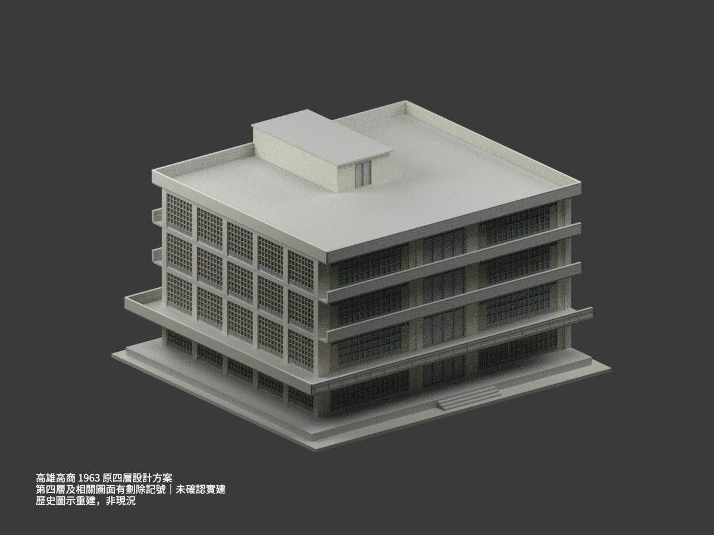
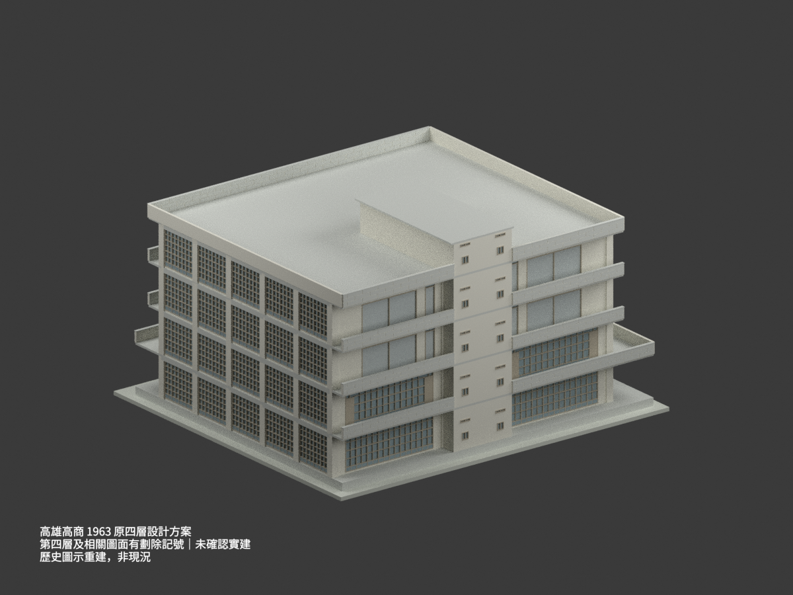
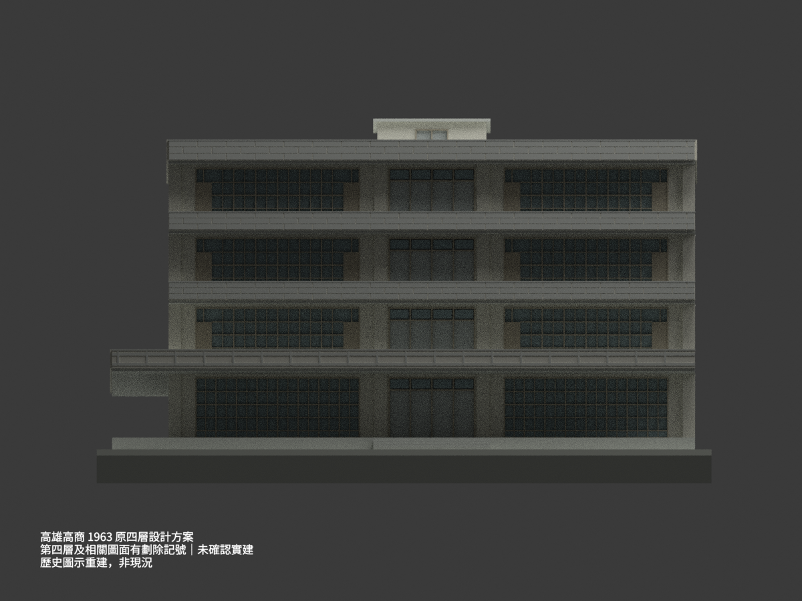
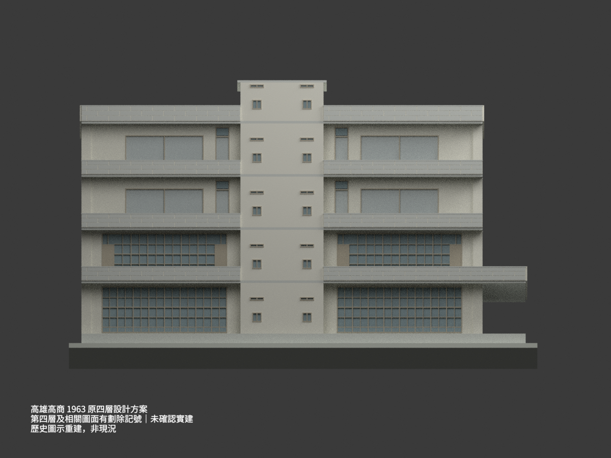
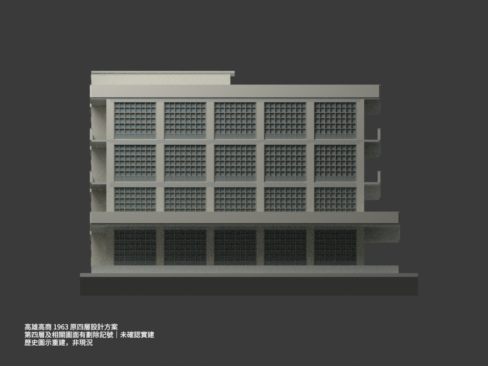
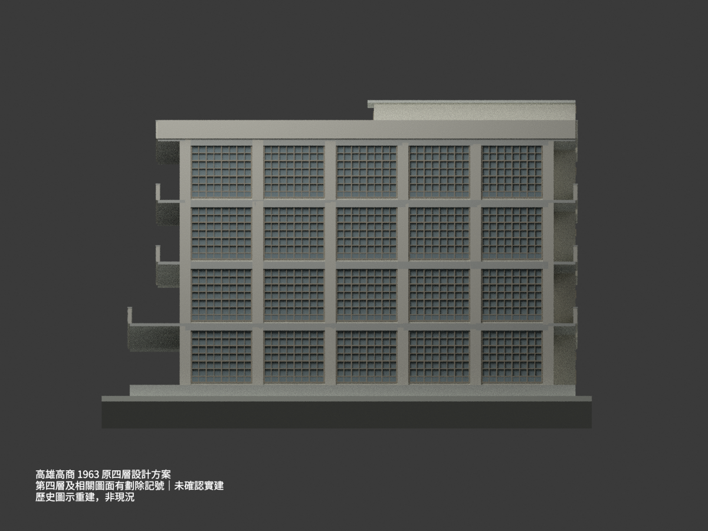
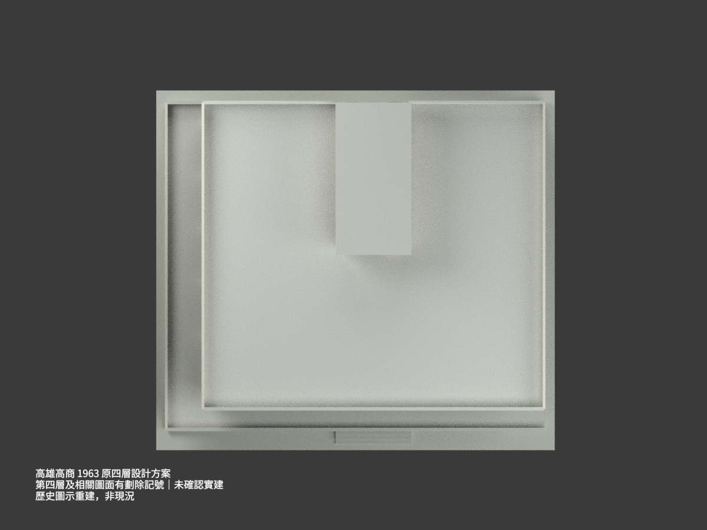
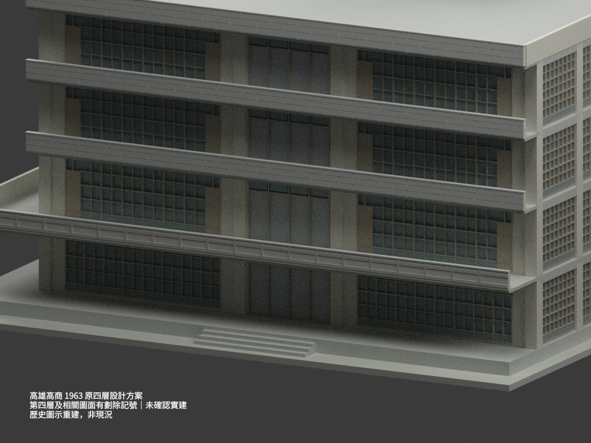
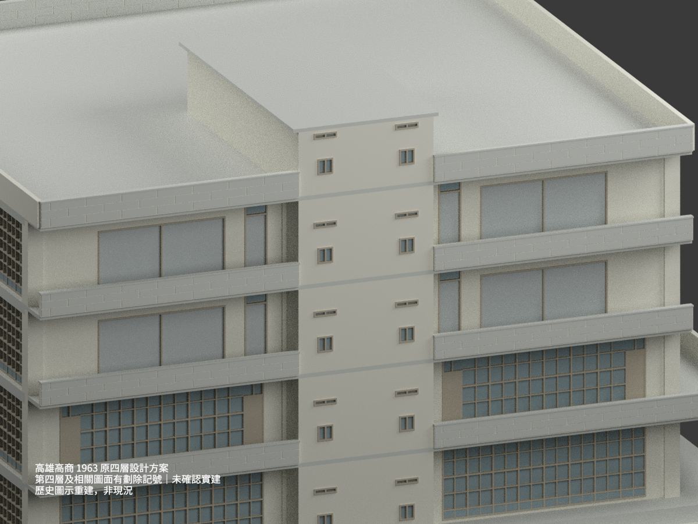
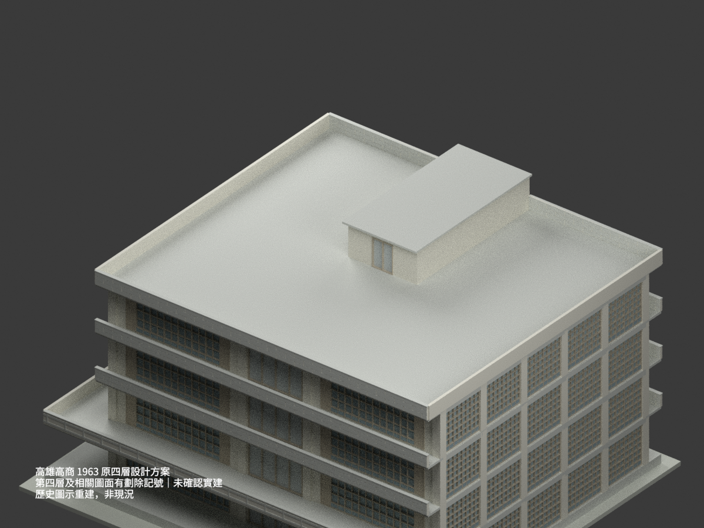

# 高雄高商 1963 原四層設計方案（圖面後續劃除，未確認實建）

## 模型實際渲染：歷史四層圖示方案，非現況

**第四層及相關圖面有劃除記號；未確認實建。這不是三層修訂案，也不是核定終版或目前校舍測繪。** 每張渲染均內嵌同樣提醒。不得計入「已證實實建整棟」數量。

| 原方案主視角 | 北側與梯屋 | 南立面 |
|---|---|---|
|  |  |  |
|  |  |  |
|  |  |  |
|  |  |  |

## 來源、版本與範圍

原題「台灣省立高雄商業職業學校 教室新建工程設計圖」，建築師陳仁和，國立臺灣博物館典藏 CCRH11423022–027。僅重建六張 A1–A6 所可讀的**原四層外觀方案**，不補造鄰棟，不主張其對應今日某座具名大樓。

- [A1 平面／屋頂／基礎](https://collections.culture.tw/docomomo_collectionsweb/Collection?GID=MAMAMNM4)
- [A2 床版／天花／梯屋屋頂控制](https://collections.culture.tw/docomomo_collectionsweb/Collection?GID=M6MAMNM4)
- [A3 四向立面，1963.11.8](https://collections.culture.tw/docomomo_collectionsweb/Collection?GID=MWMAMNM4)
- [A4 樓梯廁所剖詳，1963.11.20](https://collections.culture.tw/docomomo_collectionsweb/Collection?GID=M4MAMNM4)
- [A5 主剖與構造，1963.11.12](https://collections.culture.tw/docomomo_collectionsweb/Collection?GID=MDMAMNM4)
- [A6 主剖與構造，1963.11.10](https://collections.culture.tw/docomomo_collectionsweb/Collection?GID=MEMAMNM4)

各張日期不相同；A1／A2未確認獨立日期，不能把全套假稱同日完成。A1 的4F平面、A2 的4F天花、A3四向頂層帶以及A4–A6上部剖面都有大叉。主要圖線仍可辨，故可限定為歷史方案重建；沒有附註能確定劃除時間、正式取消程序或三層修訂後的屋頂位置。本模型不把叉線建成斜撐、曲梁或曲屋頂，也不擅自把屋頂下移一層。

原影像 CC BY-NC、詮釋資料 CC BY 分別記錄。原圖、裁圖與私人核對檔只存私人備份；公開包不含原圖。原作署名及適用著作權限制仍須尊重；此處不把影像授權逕自套成模型整包授權，也不保證模型的商業使用權。

## 主要控制與幾何解讀

- 主軸網 **25.00×20.00 m**：東西 10＋5＋10 m、南北五跨各4 m；軸線不等於外包尺寸。模型以西x=0、東x=25、南y=0、北y=20。
- 1F **GL+0.65 m**；四個層高各 **3.40 m**。2F/3F/4F為4.05/7.45/10.85 m，主RF **14.25 m**、女兒牆頂 **15.25 m**、梯屋頂 **16.85 m**。主屋面平坦，非沿大叉形成的雙曲或傾斜屋面。
- 第二層床版控制 **28.05×24.55 m**，西／南外廊各3.05 m、北外廊1.50 m。第三、四層與屋頂控制25×23 m，南、北各1.50 m；沒有把每層外框做成相同。柱外緣、牆厚、欄板與細部出挑另有外包差異。
- 梯屋屋頂 **5.70×11.45 m**，x=9.65～15.35、y=10.05～21.50。直接縱鏈為150＋800＋195 cm；A1南牆端y=10.40，再向南挑35 cm到屋頂線。**35 cm不能移到北端**。北側核心與屋頂高度依原四層圖示保留。
- 屋頂薄板、肋梁及挑簷在來源中分開；外觀模型採平屋皮、局部水平梁帶，不把整屋頂視作等厚實心結構設計。隱藏肋梁、配筋及內部樓梯／廁所細構省略。
- 南入口 A1可數1～4級，三個外露踏面各35 cm、總寬5.70 m。模型以四等高0.65/4=0.1625 m協調到平台；**這是總高分配，不是原圖逐級標高**。底座為展示支座，不代表真實地形。

## 開口、欄板與可辨差異

東、西各五個4 m開間，保留四層密窗。南1F兩組寬窗，南上層窗組兩端保留木面／上亮差異，中央入口有四片分格與上亮。北1F、2F兩翼均有密窗，北2F兩端仍有實心旁扇與上亮；北3F、4F改為較寬素面分格開口圖示，靠核心另有窄高門及上亮。北側梯屋的兩列小方孔／窄橫孔另建，不把南北立面盲目鏡射。

窗框位置、葉片與小格線依可讀立面圖量，採 **±0.10 m 圖量／重建容許**，不是現場測量精度。側窗寬名義3.36 m以避開數值上恰與柱邊相切的接面；來源開間4 m、柱約0.60 m優先保留。底部小格以分格背板表示；玻璃色只是外觀區分，A5／A6部分剖詳可見木面做法，尚未逐窗型完整整合，不能把所有底格確證為玻璃，也不一概當成實木裙板。若小格／門葉內部未能逐條尺寸化，採外觀簡化，不聲稱完整窗表級復原。

第二層南欄板使用矩形浮飾的簡化帶，和上層的砌縫式欄帶區分。欄面細部並非逐塊雕刻；A5局部可讀紅磚／表面做法，渲染採中性米灰作辨識，**不代表原建色票或現況材質確認**。沒有把劃除叉記或手繪線偏斜當成建築構件。

## 檔案與 QA

- `model.stl`／`model.3mf`：**1:150、毫米**，同一封閉網格，3MF保留分色；`scene.blend`含同網格、相機、燈光及歷史方案提醒文字。
- 網格數及尺寸見 `BUILD-QA.json`；STL／3MF索引、頂點、分色、邊界與水密性另由 `FORMAT-QA.json` 檢查，重建雜湊與 Blender 重開各有獨立記錄。
- 程式會移除布林及單精度一致化後的**零厚、零體積數值碎片**，不丟棄有體積的建築部件。所有有效建築幾何須為單一連通、水密及一致繞向。
- **未實際列印**。1:150小格條最薄約0.27 mm，屋簷與欄板仍需切片器檢查、支撐及材料選擇；水密不等於已證明可列印或工程可用。可放大比例或於切片階段加粗細件，但須自行重新檢查。
- 場景中的文字提醒只用於渲染，不屬於STL／3MF建築網格。

## 重建

```sh
python -m pip install -r requirements.txt
python build_model.py
python export_3mf.py
python validate_model.py
blender -b -t 4 --python render_model.py
blender -b -t 2 --python verify_scene.py
```

Blender4.3.2、Cycles64 samples，停用本環境不支援的去噪器。若系統提供Noto CJK字型，渲染顯示繁體中文警語；其他系統自動用英文等義警語。這些是實際模型渲染，不是生成式想像圖。
