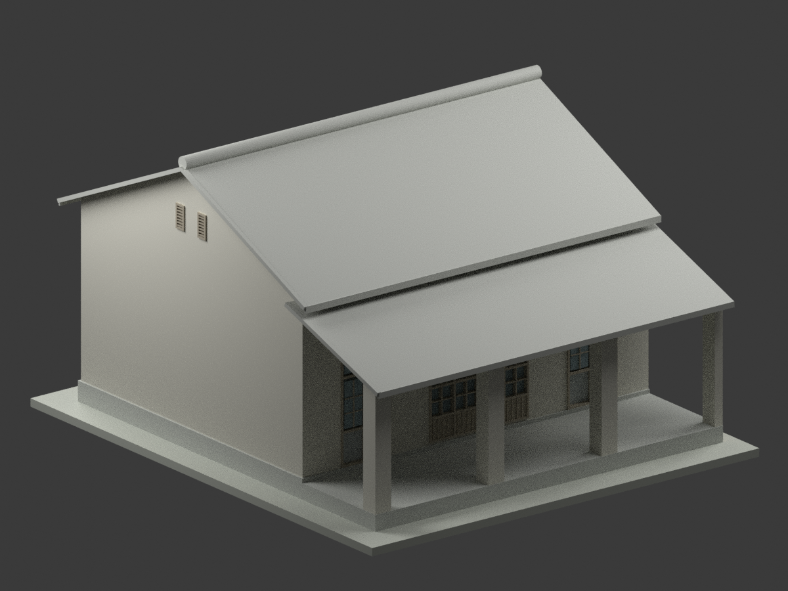
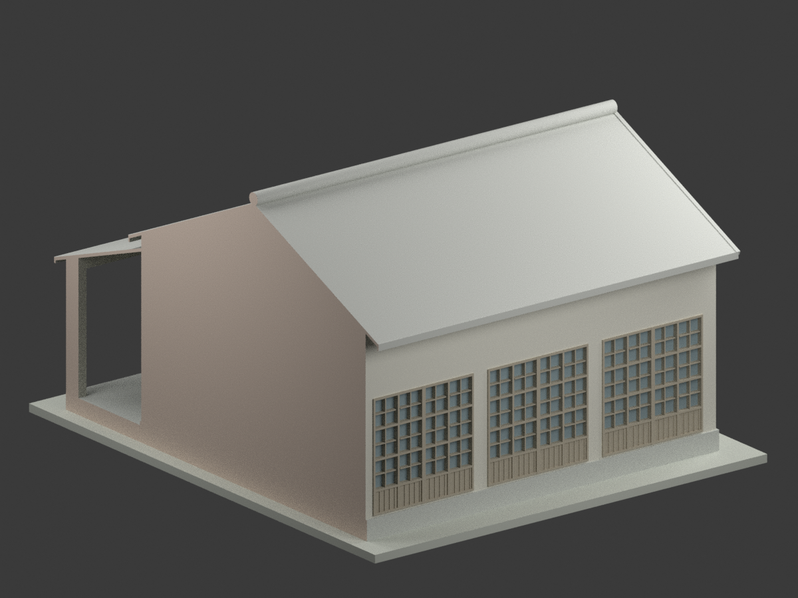
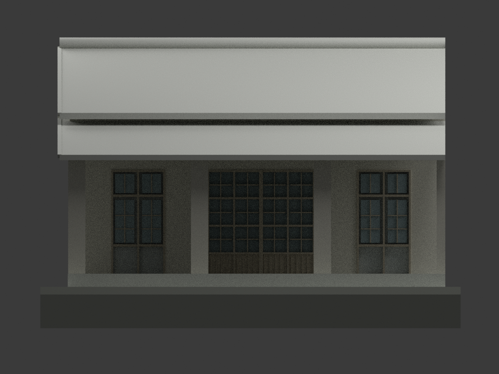
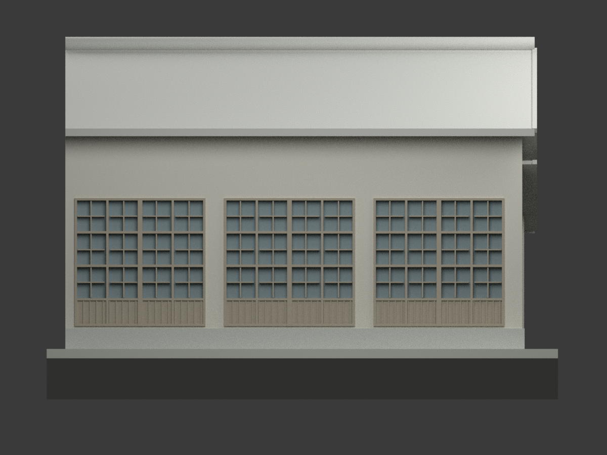
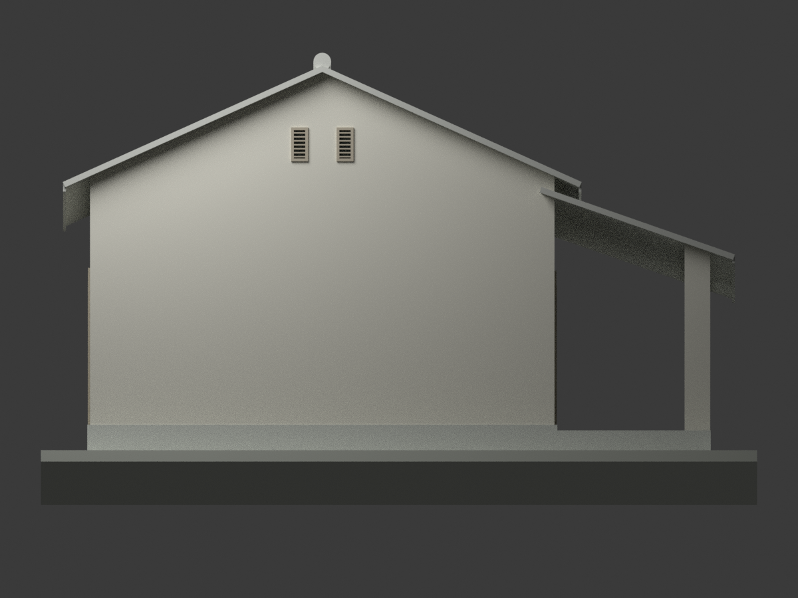
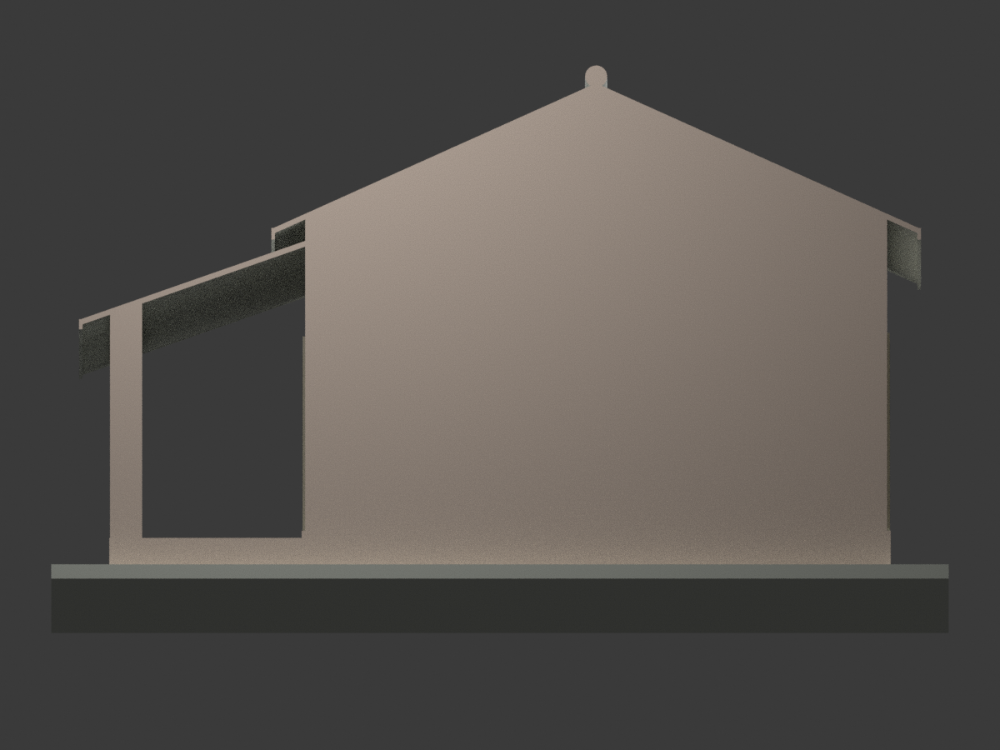
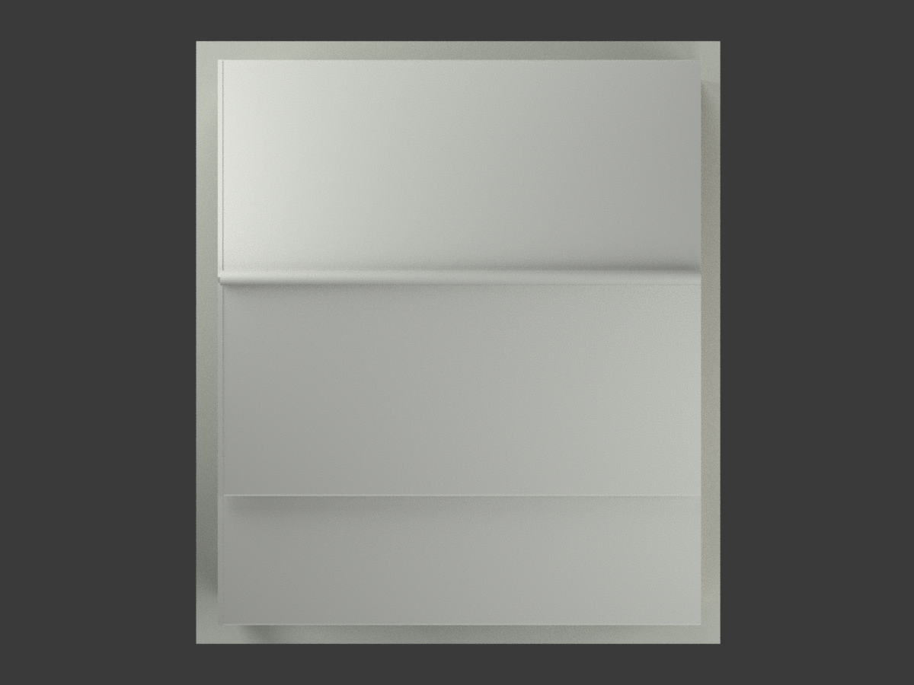
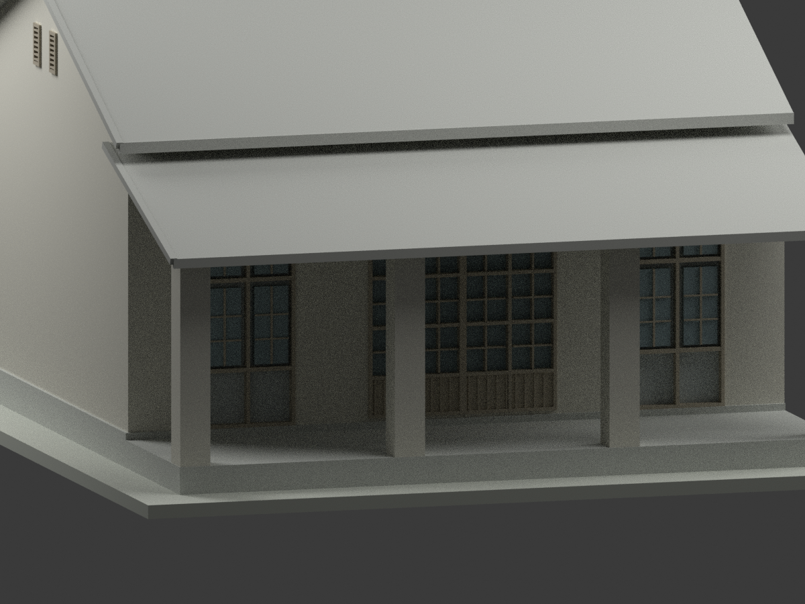
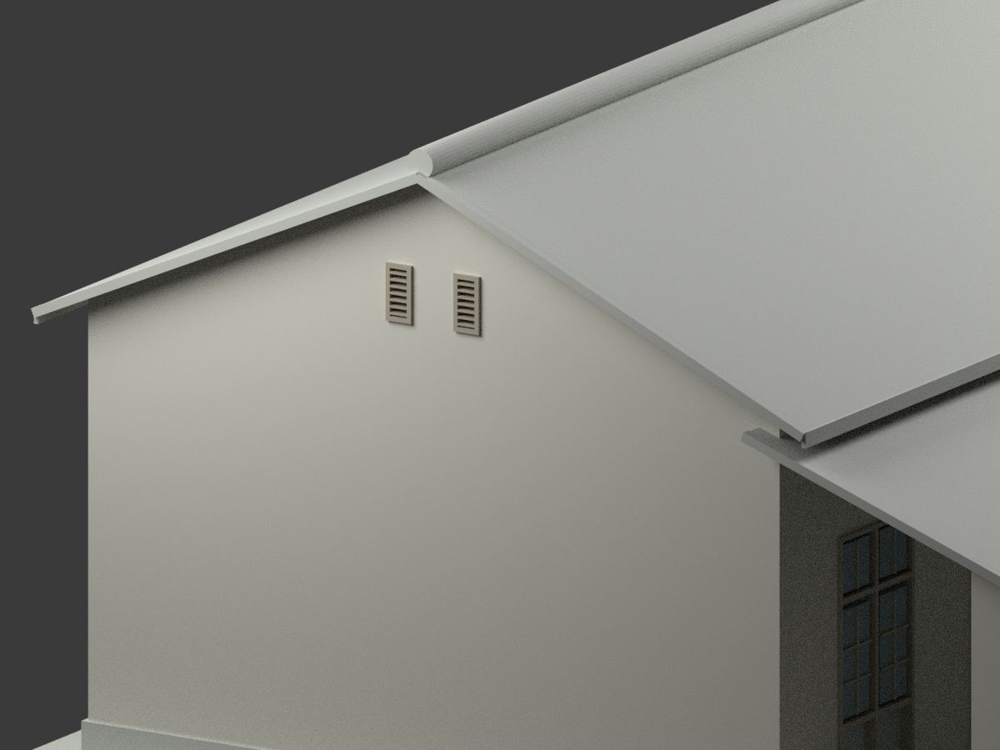
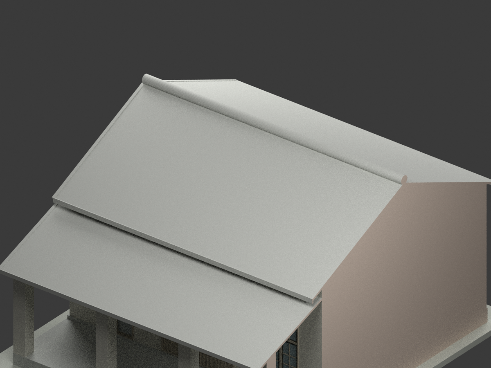

# 高雄高商 1957 年竣工圖示教室／走廊單元（局部截斷）

## 模型實際渲染

| 主視角 | 後側 | 走廊正面 |
|---|---|---|
|  |  |  |
|  |  |  |
|  |  |  |
|  |  |  |

## 範圍與來源

這是**局部教室增建單元，不是獨立整棟建築**，不增加獨立整棟建築計數。依原圖的一間教室及前廊建置；不補造學校全貌、相鄰既有量體、內部陳設或目前狀態。原圖題名「省立高雄商業職業學校教室新建工程設計圖」，另有手寫「竣工圖」。日期讀作民國 46.10.16（1957-10-16），字跡略糊，保留判讀限制；此標示不是現況實測證明。

建築師陳仁和。國立臺灣博物館典藏 CCRH11423001，[原始館藏頁](https://collections.culture.tw/docomomo_collectionsweb/Collection?GID=MSMFMNM4)。本案只用這一張同版圖的平面、基礎、屋架、三向立面及剖面，不混同校其他宿舍／鳳山分部圖。

原圖影像標示 CC BY-NC，詮釋資料標示 CC BY，兩者分開記載。原圖及裁圖只存私人備份，公開包僅含本次模型、程式、渲染及文字檢查。不將原圖授權逕自套成模型整包授權，也不保證商業使用權；原作著作權、署名及適用限制仍須自行確認。

## 尺寸、基準與截斷

- x 軸 0–9.60 m，三跨各 3.20 m；教室 y 軸 0–7.80 m，前廊至 y=-2.70 m。這是軸線控制，不是外包尺寸；不擅稱東西南北真實朝向。
- 室內 FL=GL+0.50 m、前廊 FL=+0.40 m。原圖 4.50 m 是從室內 FL 起算，主屋面支承 **GL+5.00 m**；半跨 3.90 m、升高 1.755 m，脊架 **GL+6.755 m**。早期 4.50／6.255 m 的 GL 解讀已撤回，不採用。
- 主坡 4.5:10；前廊另為 3.5:10。前廊外支承 +3.70 m，向主牆上升 2.70×0.35，交接控制 +4.645 m，明確低於主屋面，不強拉成同高。
- 主屋皮名義較架線高 0.045 m（脊 +6.800 m）；前廊屋皮採支承控制線，外挑 0.635 m 後簷端 +3.478 m。原像素廊端約 +3.348 m，差 0.130 m，落在採用的 **±0.15 m 圖量／重建容許**內；不是測量精度保證，亦非所有像素完全吻合。主、廊局部圖尺度不同，沒有用全圖單一尺度硬套。
- 圖示主橫向出簷 0.635 m；非接口縱端出簷採平面圖量 0.45 m，不能把 0.635 m 任意移到所有方向。脊帽簡化圓形輪廓，名義最高 GL+7.05 m，±0.15 m 圖量；不推定原帽材質、紋樣或精確構造。
- **x=9.60 m 是原有建物接口的人工模型截斷線**。主屋頂、前廊屋面、最後半柱、屋脊全部在此切齊；不增造端山牆、收邊回折、鄰棟、開口或裝飾。截面以中性褐色標示，僅為封閉模型的製作面，不是歷史外牆。顯示底座可超出此線，但不代表建築延續。
- 正面「原有」在圖左、背面在圖右，是同一接口的相反視向。未標方向的側面圖映射到非接口端，是由平面與兩立面合讀的明示推定，不冒稱另有一張具方向的側立面。

## 外觀細部與簡化

正面保留兩組 1.40 m 雙扇門及上亮、中央 2.80 m 窗；背面三組 2.80 m 窗（135+10+135 cm 內鏈）。窗四主直列、三水平大組，下方是條紋實心裙板而非落地玻璃。門窗垂直外框約 GL+0.50～3.35 m（±0.10 m 圖量），模型窗底 +0.55／頂 +3.30 m、裙板至 +1.10 m；雙扇門含上亮，葉頂約 +2.60 m。小格條略加粗且以不透明背板封閉。非接口山牆僅兩個 0.30×0.60 m 上通氣孔，沒有下方虛構大窗。孔高優先手寫 60 cm，圖量中心約 GL+5.45 m，故模型孔底／頂 +5.15／5.75 m；原圖畫出的高度與手寫尺寸不完全一致，沒有把像素高度當作精確尺寸。前廊四處支承保持開放，最後一柱隨接口截半。

牆、柱厚度與窗框細部未逐件有尺寸：柱寬採圖示約 0.45 m、外牆表面距軸約 0.185 m，均應按原圖估讀理解。主屋面及前廊板厚採外觀 0.08 m，不是結構計算；屋面細條紋與瓦片／板接縫未逐條複刻，因外觀材料與接縫間距未充分定量；省略隱藏屋架、內牆／黑板、基礎配筋及排水暗構造。外表採中性灰米、灰屋面及木色窗框，僅供辨識，沒有彩色原作或現況材質證據。

## 檔案與檢查

- `model.stl`：1:50、毫米；`model.3mf`：同一網格、保留分色；`scene.blend`：同網格材質、相機、燈光。
- `build_model.py`：可重現布林聯集；`render_model.py`：10 張實際渲染；`export_3mf.py`、`validate_model.py`、`verify_scene.py`：格式及重開檢查。
- 網格 6,728 三角面、單一連通、水密及一致繞向；含顯示底座外包 219×252×145 mm。所有結果以最終 QA 檔為準。最後封閉點採 STL 單精度一致化及微小數值退化面清理，不改變上述控制。
- **未實際列印**。細窗格、屋簷與坡面可能需支撐；1:50 仍需切片器評估最小壁厚、支撐及材料。水密不等於保證可列印或工程適用。

## 重建

```sh
python -m pip install -r requirements.txt
python build_model.py
python export_3mf.py
python validate_model.py
blender -b -t 4 --python render_model.py
blender -b -t 2 --python verify_scene.py
```

Blender 4.3.2／Cycles 64 samples；本環境停用不支援的去噪器。README 首節為實際輸出圖，不是 AI 想像圖。
