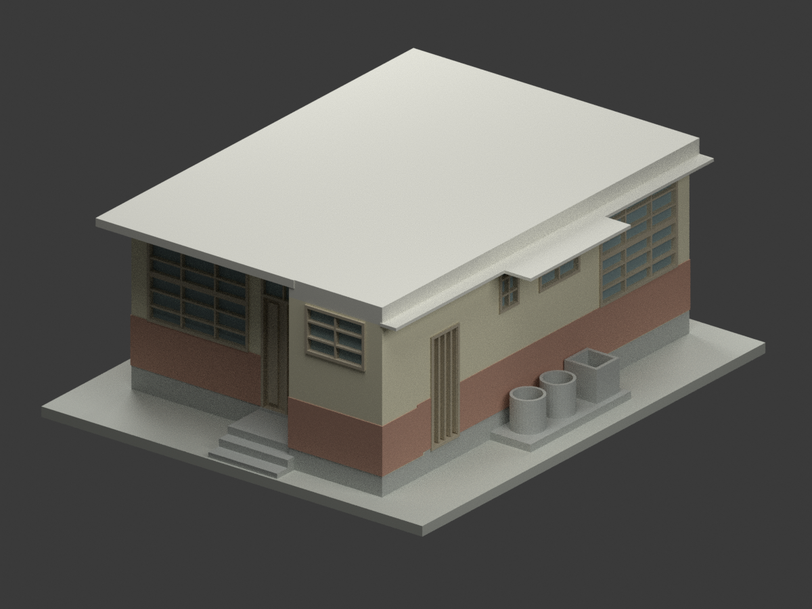
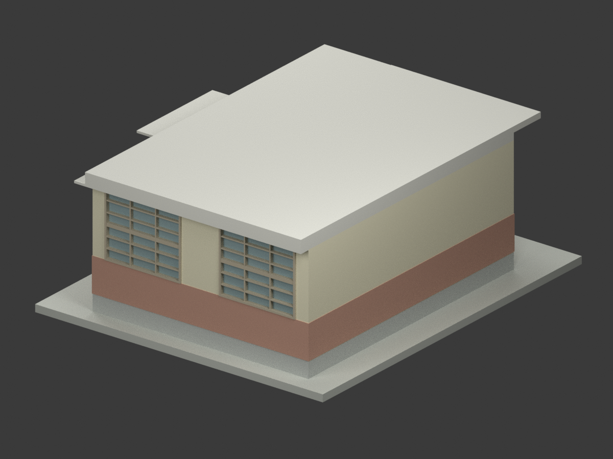
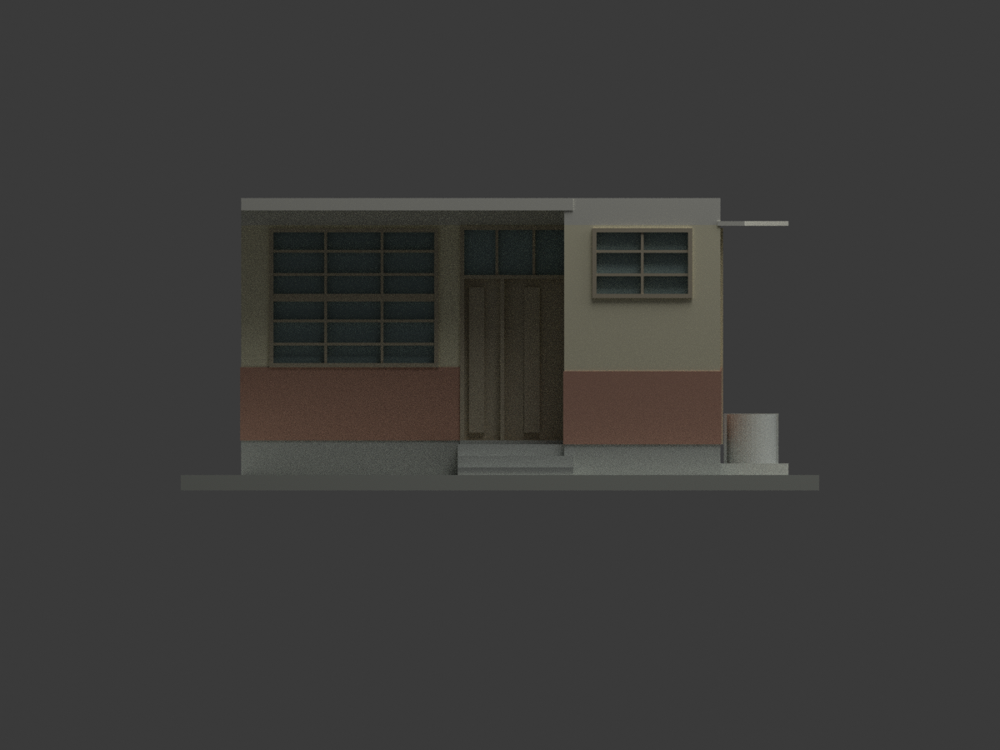
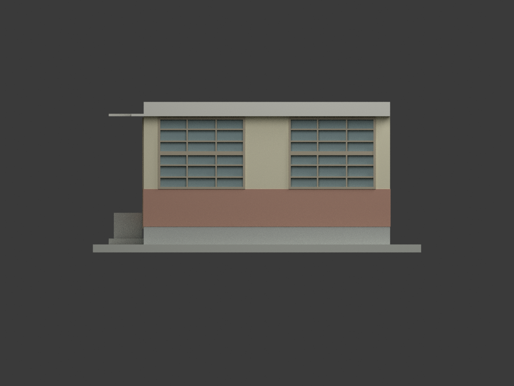
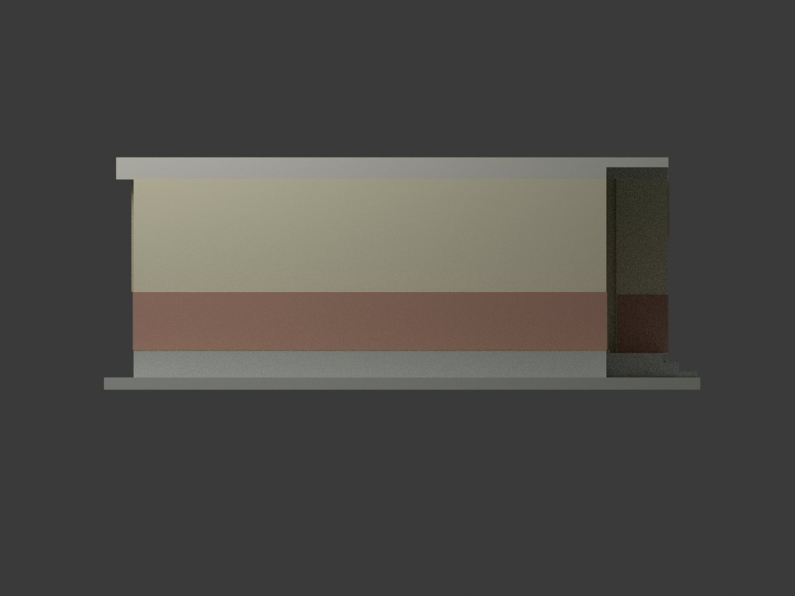
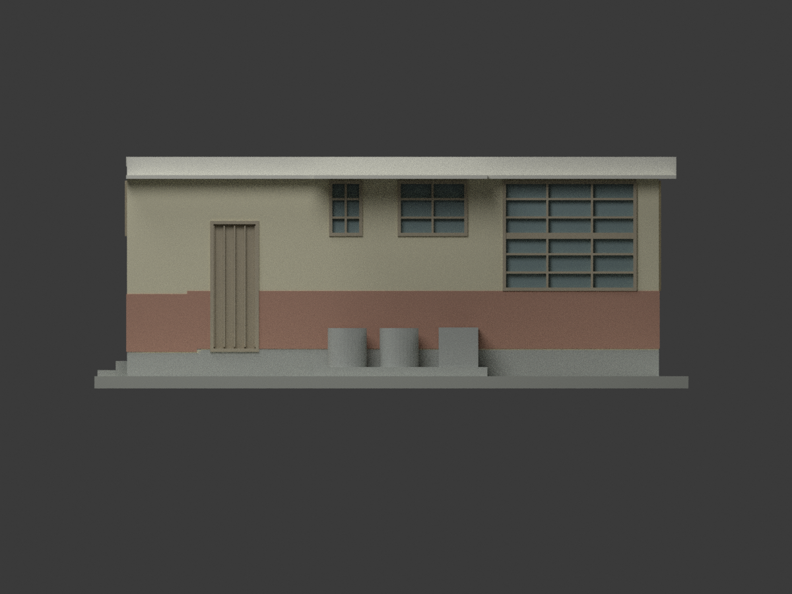
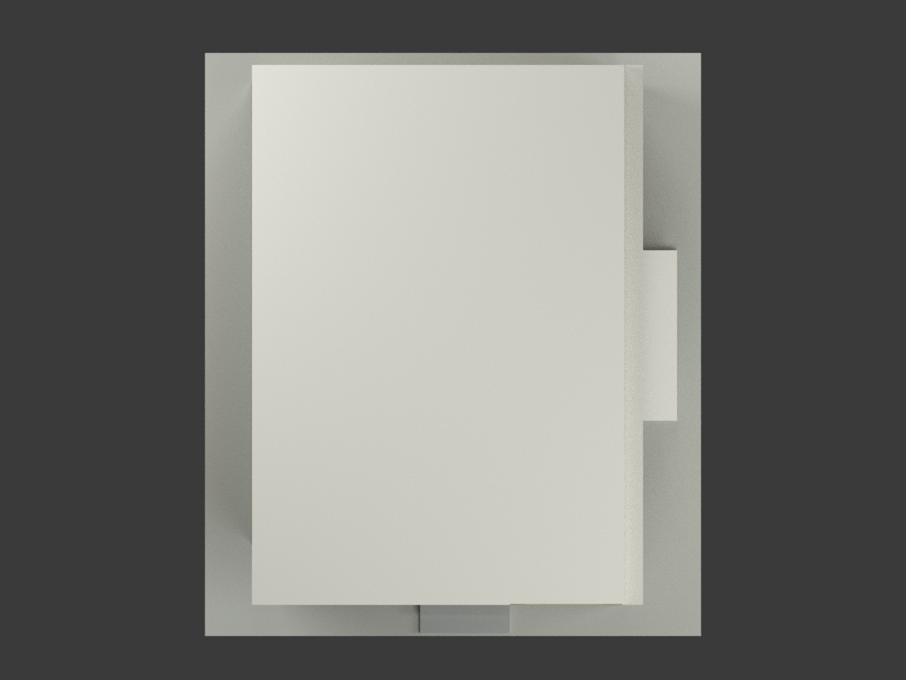
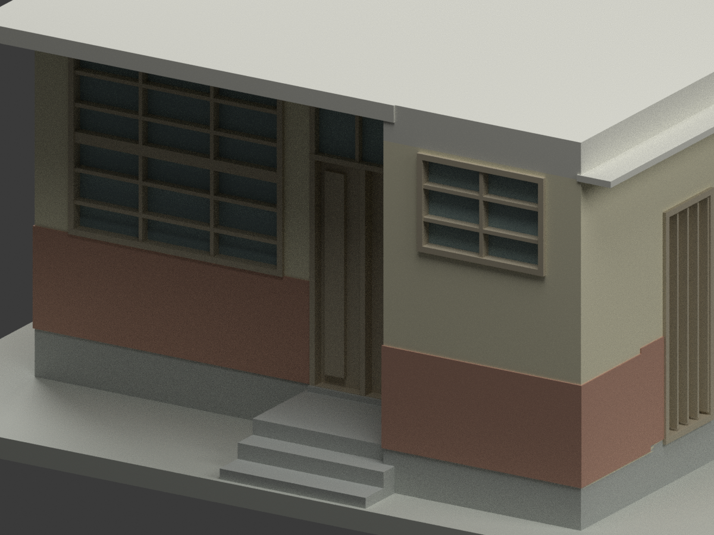
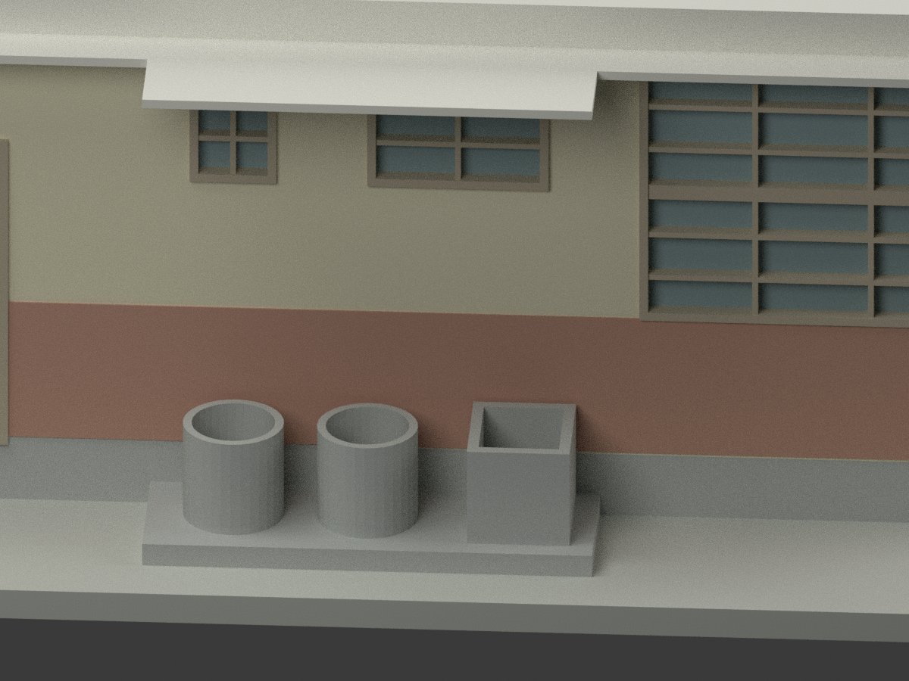
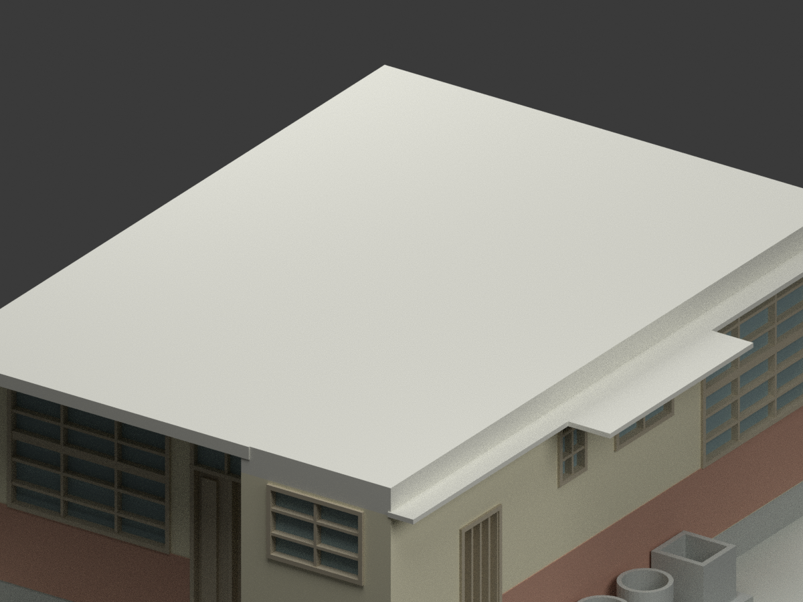

# 高雄高商本校單戶宿舍｜未定年歷史設計模型

## 模型預覽

| 整體 | 另一側 | 入口面 |
|---|---|---|
|  |  |  |
|  |  |  |
|  |  |  |
|  | | |

## 身分與來源

原圖題名「臺灣省立高雄商業職業學校 本校宿舍新建工程設計圖」，陳仁和建築師事務所。**未建立設計日期，不借用同冊教室的 1957 年日期。** 本件是歷史本校單戶宿舍，不是鳳山分部宿舍，也不混同未題名的雙戶 12 m 平面。

[國立臺灣博物館／臺灣現代建築資料典藏 CCRH11423034](https://collections.culture.tw/docomomo_collectionsweb/Collection?GID=MWM6MNM4)。原圖具平面、基礎、屋頂模板、正背側立面及 A-A／B-B 剖面。另一長側雖無獨立立面，但平面明示連續無窗牆，模型不自行加窗。

原圖授權標示 **CC BY-NC**，後設資料另為 CC BY，不能混用放寬圖檔權利。原圖、裁圖與私人逐像素審核不在公開包。保留設計者與館藏歸屬；不宣告第三方建築設計或來源衍生物可無限制商用，也不另作商業權利保證。

## 控制與重建範圍

- 主軸 **6.00 × 7.50 m**，不是任意最外包框；前廚房及入口區另伸 **1.00 m**。主空間地坪 GL+0.45 m，服務地坪 +0.40 m。
- 主屋面 **GL+3.60 m = 0.45 + 2.79 + 0.36**。36 cm 是空心／肋構造整體外輪廓，不主張歷史屋面是均質實板。本模型只呈現外觀閉實體，省略內部分間與隱藏鋼筋、空心塊。
- 前方 B-B 遮棚採 12 cm 板及上下約 2 cm 面層，外包約 **16 cm**，頂 +3.60、底約 +3.44；廚房梁區仍有較厚構造。側方 A-A 外挑另為 **6 cm** 薄板，頂低 30 cm，在 +3.30 m，不能把兩種檐混成同高厚板。屋頂模板外框圖量採左約 x−0.115 m、後約 y7.90 m、前約 y−1.13 m；側基本外挑約 43 cm，洗滌段再延至 1 m。這些外框約有 ±0.10 m 圖量不確定；後挑板厚無獨立剖面，模型延續主屋面外包作顯示簡化，不宣稱其 36 cm 厚有直接尺寸；未明示的後側低薄檐不另補造。
- 右側室帶從後往前的 270+180+105+195+100 cm 鏈與 850 cm 總長分開核對，浴廁窗位於各自牆段，不與房窗重疊。右側 **1 m** 是露天洗滌／水槽及檐部範圍，主外牆仍在 6 m 軸附近；不封成房間。兩圓形器具和水槽尺寸依平面圖量簡化，非設備實測。
- 正面非對稱大窗／入口／廚房小窗，後面兩扇大窗；服務側有單門、窄小窗、中窗及房窗。大窗名義寬 2.20 m、窗台在完成面上 0.95 m；高約 1.81 m（85.5 cm 上下兩扇加 10 cm 中梃），三列六行。小窗採兩列三行，其下緣圖量約 GL+2.30 m、上緣約 +3.21 m，非精確窗表尺寸；不套用全部相同窗格。
- 入口內框採 50+84 cm 旁扇／主門鏈，含兩側框外包約 144 cm；三格上亮與門板細節簡化，側門獨立單扇。入口外階控制 GL→10→25→40 cm，再 5 cm 門檻到室內 45 cm。框料、洞口偏移、檐線、室外器具及腳步尺寸有圖量解讀，不是施工級精度。
- 圖上黃色水泥漆、清水紅磚下段與抹水泥漿底腳提供材料類別；紅磚以色帶簡化，不聲稱復原逐磚砌法；渲染色值是示意，非現場測色。GL 不等於真實地形，底座是另外製作的展示支座。

**這是原圖歷史外觀重建，不代表已建成、目前仍存在或今日外觀。** north/south/east/west 檔名表示模型座標視向，不宣稱地理方位。

## 比例與列印限制

**1:50；STL／3MF 單位 mm；含底座 166 × 195 × 76 mm，3,208 三角面；未實際列印。** 窗玻璃採不透明背板保持閉實體；細框、門板與水槽壁依小比例簡化。最低細框約 0.7 mm；水密不保證所有設備均可直接列印。薄外檐與突出遮棚需按材料、方向及支撐設定檢查。隱藏交接少量重疊用於穩定網格，不作原構造精確尺寸承諾。

## 檔案與重現

包含 `model.stl`、材質 3MF、`scene.blend`、參數化程式、十張模型實際渲染與檢查紀錄。公開清單不含原始圖檔、私人分析或 `.blend1` 自動備份。

```bash
python -m venv .venv
. .venv/bin/activate
pip install -r requirements.txt
python build_model.py
python export_3mf.py
python validate_model.py
blender -b -t 4 --python render_model.py
blender -b -t 2 --python verify_scene.py
```

QA 分別記錄來源控制、網格、格式、可重建、場景重開、圖像構圖及獨立視覺審核；不取代施工安全或實體列印測試。
