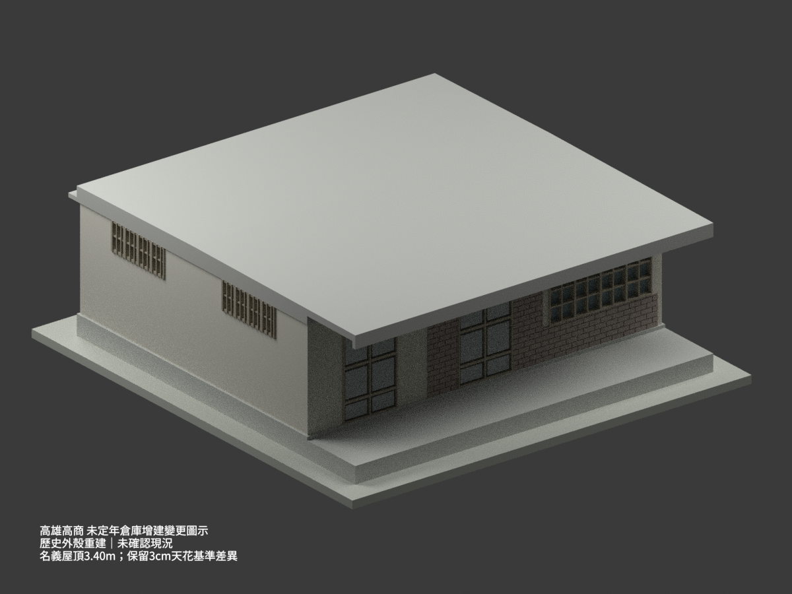
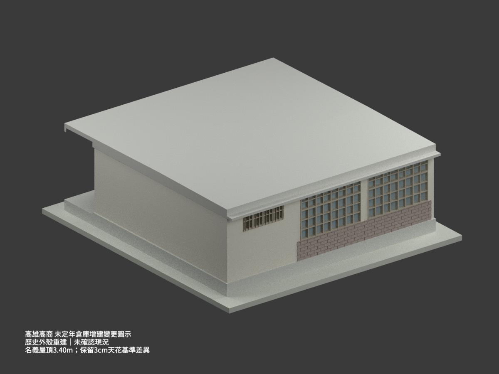
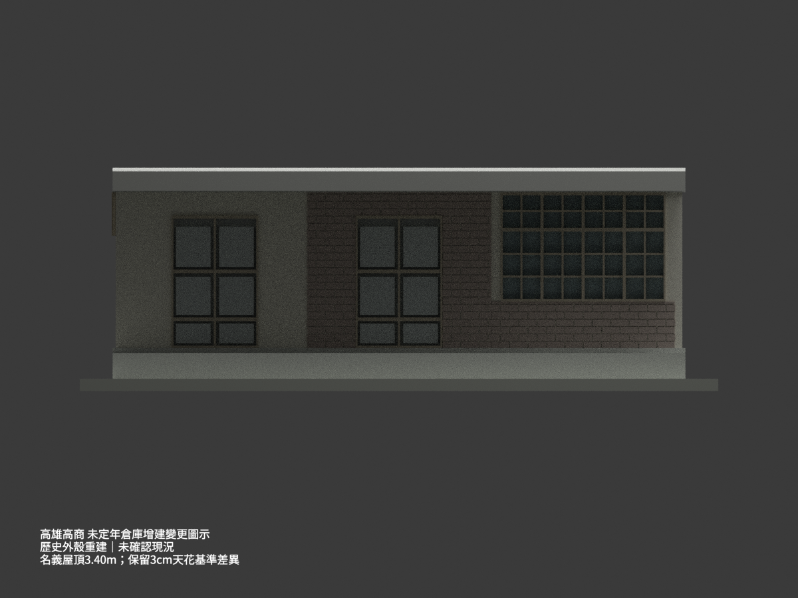
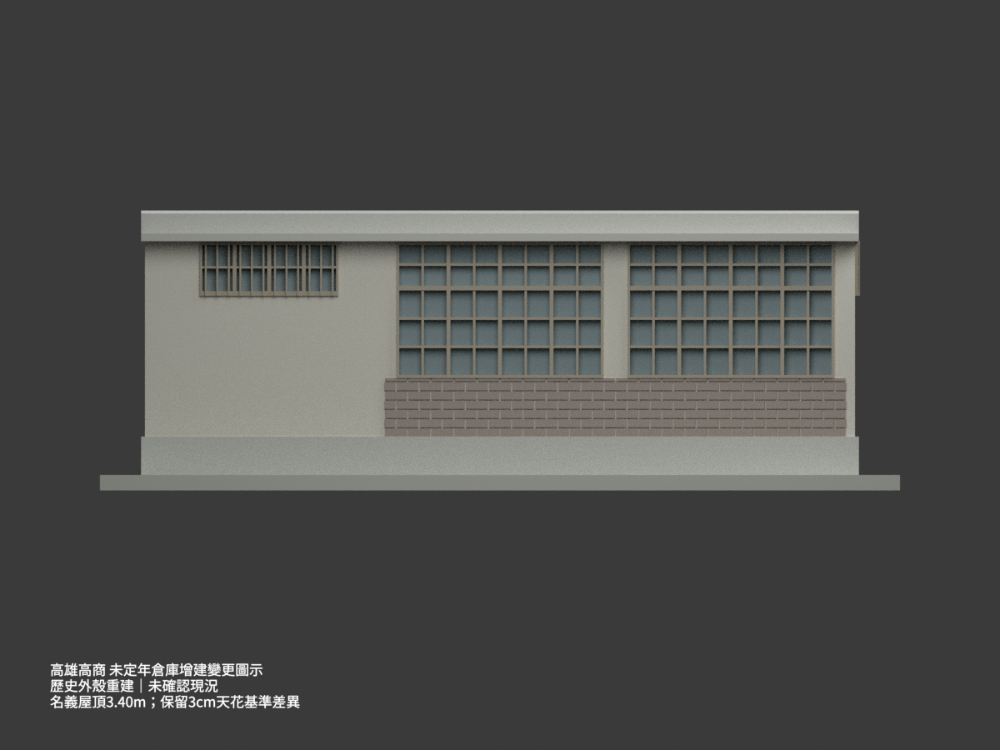
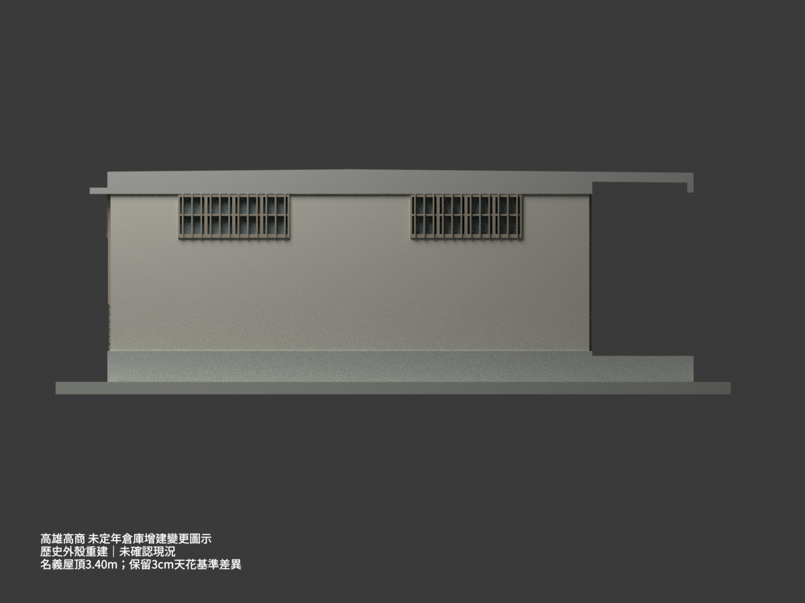
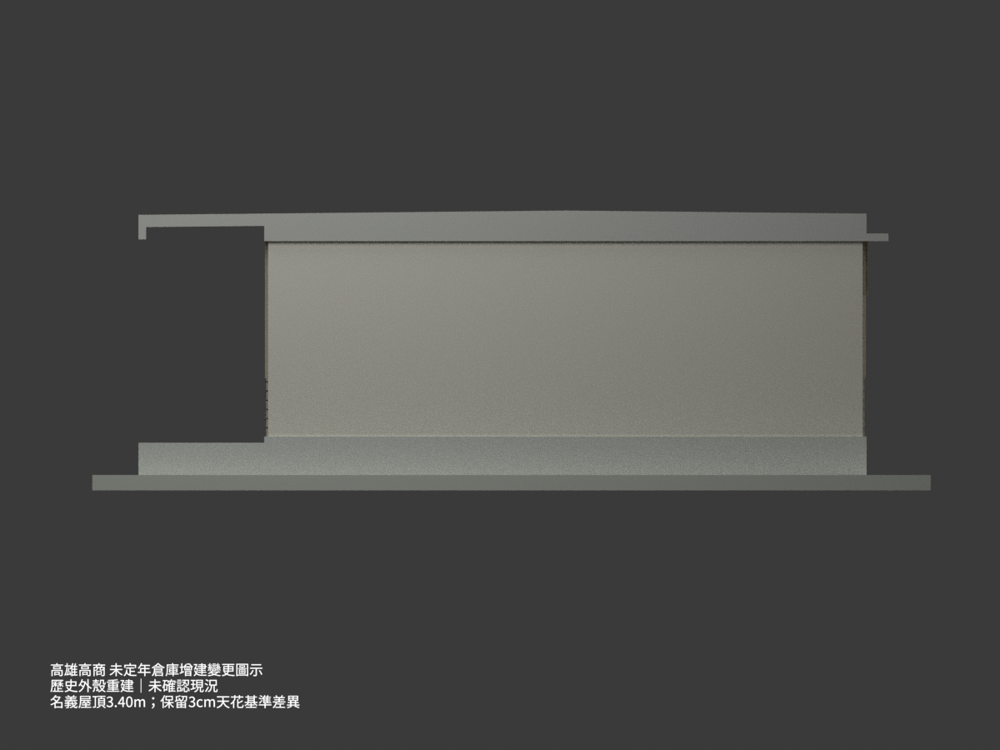
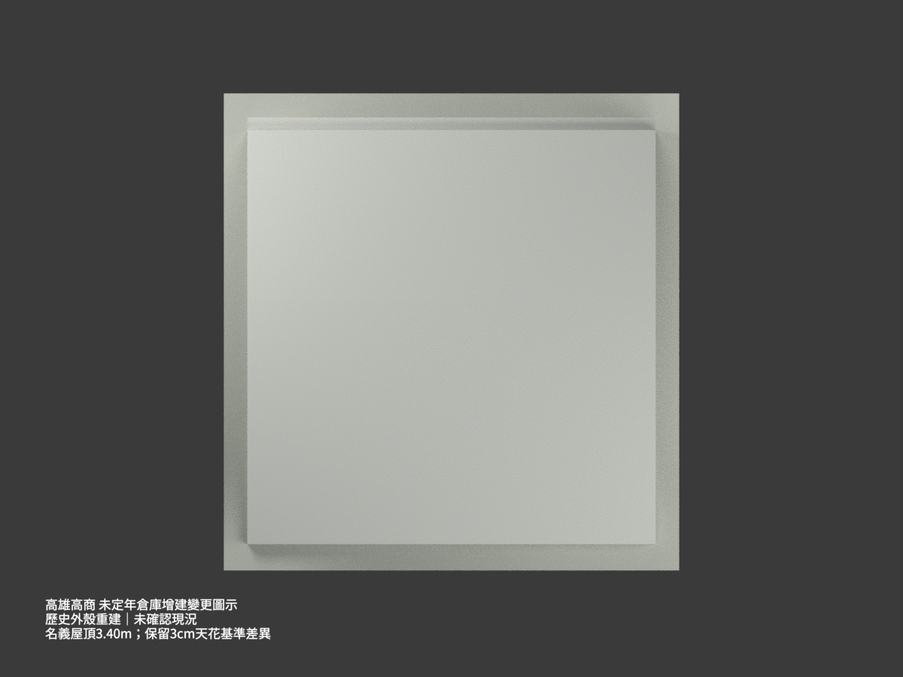
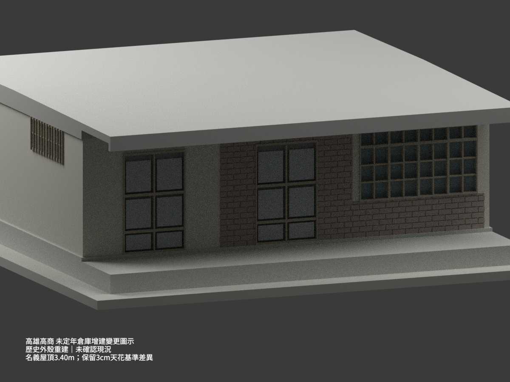
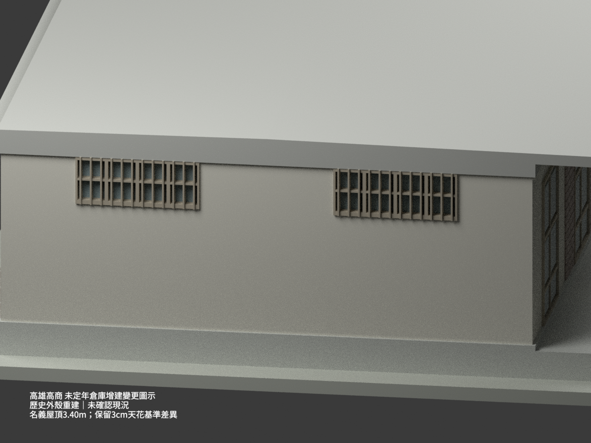
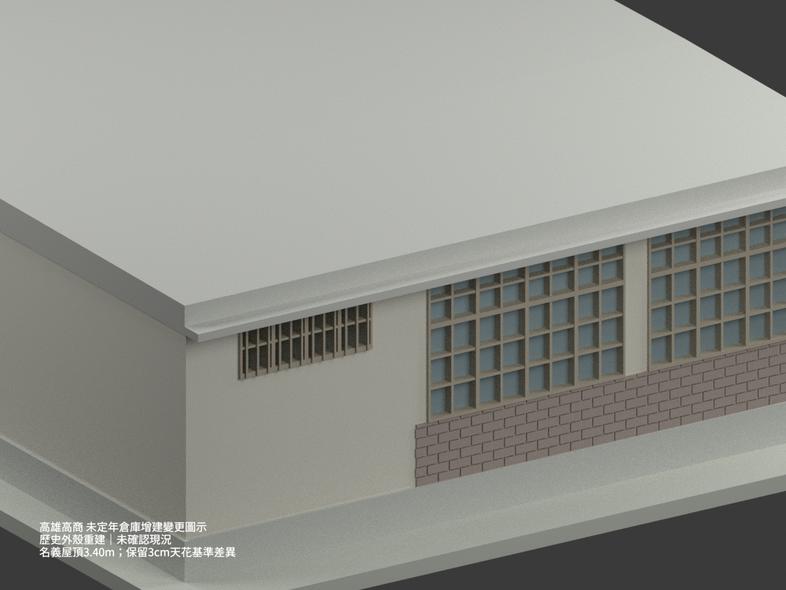

# 高雄高商倉庫增建變更工程：未定年歷史設計外殼

## 模型實際渲染

**依未定年原設計圖重建，非現況測繪；精確校址與是否按此圖實建未確認。** 名義屋頂3.40 m，原圖天花257 cm與基準推算254 cm的差異保留，不強行湊齊。

| 主視角 | 後側 | 正面 |
|---|---|---|
|  |  |  |
|  |  |  |
|  |  |  |
|  |  |  |

## 來源、身分與權利

唯一建築圖來源為陳仁和「臺灣省立高雄商業職業學校 倉庫增建變更工程設計圖」，國立臺灣博物館典藏 **CCRH11423055**，[館藏原頁](https://collections.culture.tw/docomomo_collectionsweb/Collection?GID=M4MSMCM4)。同張含平面、屋面、基礎／床版、正背側立面、完整剖面及門窗細部，已逐一實看。

原圖未確定日期，也未標「鳳山分部」；本件**不是**鳳山分部CCRH11423036小庫房，不借用其屋頂或年代。題名有「增建」，不代表可以補造一座未畫出的相鄰建物。模型只含圖示本體及前廊，不重建內部儲藏、設備、地形或現行用途。

原圖影像標示CC BY-NC；詮釋資料CC BY另列。原圖及裁圖只存私人備份，公開包沒有掃描圖或圖紙貼圖。保留原作署名及適用限制，不把影像授權直接當成整包模型授權，也不保證商業使用權。

## 名義控制與未解差異

- 主軸 **9.00×7.50 m**，寬三跨各3 m，深兩跨各3.75 m；前廊另1.80 m，合軸深9.30 m。軸網不是外包尺寸；牆、框、梁及簷邊另有外伸。
- 側立面明標 **304＋36＝340 cm**，採名義屋面GL+3.40 m、主構造下緣+3.04 m。36 cm是肋／空心構造的整體深度，不是整片實心36 cm板。
- 主樓地坪採48＋2＝**GL+0.50 m**；前廊40＋2＝**+0.42 m**，再上8 cm到室內。部分數字有改寫，這是名義基準解讀，不是精測值。
- 原文天花高讀作 **2.57 m**；3.40−0.36−0.50＝**2.54 m**，差 **3 cm**。保留此源圖／基準不一致，不移動屋頂或地坪硬湊。內部天花未另建成可使用空間。

## 排水屋面、薄簷及前廊

屋頂圖有兩向1:100排水箭頭，不做完全水平的外皮。對照主750 cm軸線，四組像素校準將分水定位於主體中間約y=3.7 m，採名義 **y=3.75 m**、水平讀圖容許±0.10 m；不是含前廊930 cm的一半。

採用的屋皮協調式為 **z(y)=3.4375−0.01×|y−3.75| m**，使主牆兩軸y=0及7.50處回到名義3.40 m，前廊端y=−1.80約3.382 m。推導峰值3.4375 m**不是原圖直標最高點**；屋皮完成面和340基準的確切關係仍有數cm不確定。此式保留明寫坡比與外觀分水形狀，而非宣稱毫米級還原。

- 前廊為**無外柱懸挑棚**，沒有自行加柱。薄棚2＋12＋2＝**16 cm**；前緣另下折16 cm，局部總深 **32 cm**，不把整片棚加厚32 cm。
- 後簷45 cm由後主軸量到簷線。薄板2＋6＋2＝**10 cm完成面**，6 cm只是結構板厚；名義下緣+3.04、頂+3.14 m，完成面較主3.40低26 cm。這是共底的外觀協調解讀，仍保留數cm基準差，**不是**把別棟宿舍的6 cm／30 cm控制移植過來。
- 主構造採封閉外殼以供模型聯集，隱藏肋梁、空心塊及配筋省略。展示底座不是現況地坪，外部排水溝及其深度未重建；圖中的橫向45 cm水溝不可誤當地坪高程。

## 外觀與細部

正面兩組門加一組寬窗；背面兩組寬窗加一組W1高窗；平面左側兩個W1、右側素牆，沒有四面鏡射。保留中間門的磚面圍框，以及正、背寬窗下的局部過火清水磚帶，不把整棟都套磚紋。中性米灰、木色、玻璃色及褐色磚為辨識近似，不代表實建色票。

- 大窗名義外寬2.68 m為開間與框柱圖量協調；四主直列，上部小窗、下部大窗分格依詳圖。名義外框GL+1.26～3.04 m；局部框料／葉片圖量與加粗不冒稱完整窗表精度。
- W1外寬1.80 m，內／外半示合讀為四列、兩行。外框約71 cm是框料鏈與圖量協調值，**不是**原圖直接標外高71 cm；60 cm標線也不能簡稱玻璃淨高。由FF+.50＋1.91−下框約.06≈2.35、外高約.71到3.06的讀法，模型整組協調為2.33～3.04 m，約下移2 cm，落在保留的3 cm基準差內。
- W1外細條名義約15 cm間距；原約9 mm細桿在1:50過薄，模型加粗為2.5 cm等效外觀浮條，約0.5 mm列印厚度。只表現歷史外觀，不推定使用性能。
- 門寬1.41 m與內鏈1.35 m分開，外高2.16 m按210 cm門葉加框協調；兩扇木面和橫檔簡化，不重建五金、鎖具或內部用途。
- 磚縫、薄框、粉刷與未全尺寸化的牆面，採局部圖量及列印外觀簡化；不宣稱現場測量準確度。

## 檔案與檢查

`model.stl`及`model.3mf`為**1:50、毫米**同一網格，3MF保留分色；`scene.blend`含相同幾何、材質、相機與燈光。網格、格式、重建、重開、文件與逐圖檢查分別列於QA檔；外包含展示底座約208×218×72.75 mm，11,782三角面、單一連通與水密，詳見最終記錄。

**未實際列印。** 屋簷懸挑、細格條仍須切片檢查與支撐；水密不等於保證可列印、結構或工程適用。場景中的歷史警語文字僅用於渲染，不包含在STL／3MF建築網格。

## 重建

```sh
python -m pip install -r requirements.txt
python build_model.py
python export_3mf.py
python validate_model.py
blender -b -t 4 --python render_model.py
blender -b -t 2 --python verify_scene.py
```

Blender4.3.2／Cycles64 samples，停用本環境不支援的去噪器。Noto CJK可用時顯示繁中警語，否則採英文等義文字。全部圖為模型實際渲染，非生成式想像圖。
